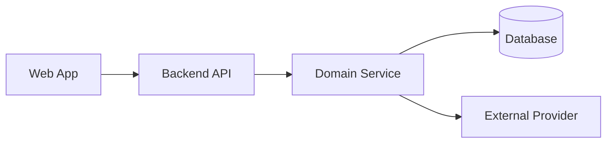
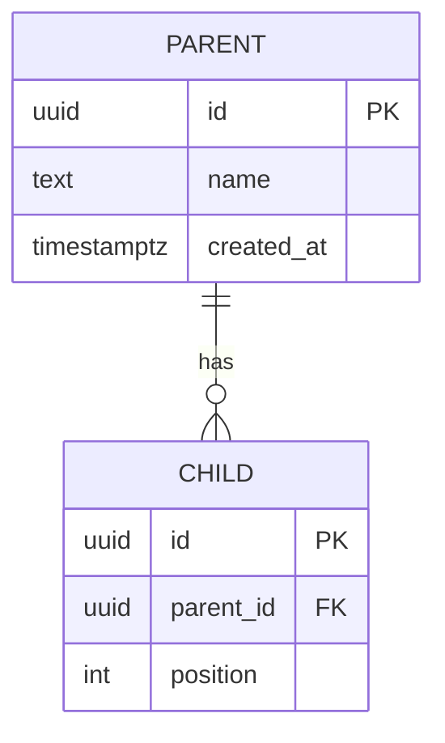
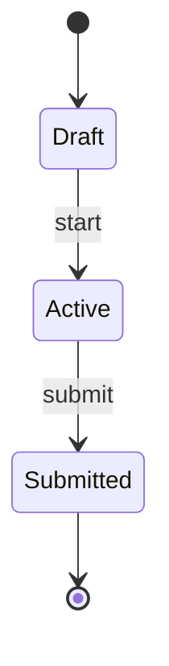

# OnRole Assessment — Submission Format Guide

**v1.2 — 2026-11-06** · Applies to Assignment 01 and Assignment 02
**Changelog:** v1.2 — added Section 11 (diagram standards: Mermaid, Excalidraw, text sitemap, charts). v1.1 — added Section 10 (how to submit) with the Google Form link. v1.0 — first version: HLD, Database, SQL, API, Design System, Tests, README, Demo formats.

> This guide defines **how** to present deliverables. It contains **no solutions**. Use synthetic data only.

---

## 0. Deliverables map

| Deliverable | File location | Format | Required |
|---|---|---|---|
| HLD | `docs/hld.md` | Section 1 | ✅ |
| Database / ER | `docs/database.md` + `db/schema.sql` + `db/seed.sql` | Section 2 | ✅ |
| SQL queries (A01) | `db/queries/*.sql` + `docs/sql.md` | Section 3 | ✅ A01 |
| API docs | `docs/api.md` (or OpenAPI `docs/openapi.yaml`) | Section 4 | ✅ |
| Design system / UI | `docs/design-system.md` | Section 5 | ✅ |
| Tests | `tests/` + `docs/testing.md` | Section 6 | ✅ |
| README | `README.md` | Section 7 | ✅ |
| Demo | `docs/demo/` (video link or screenshots) | Section 8 | ✅ |
| Diagrams | Inside each doc, plus exports in `docs/diagrams/` | Section 11 | ✅ |

---

## 1. HLD format (`docs/hld.md`)

| Part | What to include |
|---|---|
| Context | One paragraph: problem, users, scope, out of scope |
| Diagram | System Interaction Flow (Mermaid `flowchart`) of all components |
| Component table | Name · Responsibility · Inputs · Outputs · Talks to |
| Key flows | 2–3 Mermaid `sequenceDiagram`s (critical user flows) |
| Boundaries | UI vs business logic vs data access vs external integrations |
| Tech choices | Choice · Why · Alternative rejected |
| Failure handling | Scenario · Behaviour · Recovery |
| Production gaps | What must change before production |

**Diagram template**



**Rules**
- Every box in the diagram must appear in the component table, and the reverse.
- Label each arrow (protocol or data passed).
- Credentials and secrets only on the server side.

---

## 2. Database format (`docs/database.md`)

| Part | What to include |
|---|---|
| ER diagram | Mermaid `erDiagram`, with cardinality |
| Table catalogue | Table · Purpose · PK · Key FKs |
| Column detail | Column · Type · Null · Default · Constraint · Notes |
| Constraints | PK, FK (with ON DELETE rule), UNIQUE, CHECK, NOT NULL, each with a reason |
| Indexes | Index · Columns · Query it serves · Why |
| Cardinality | Relationship · 1:1 / 1:N / N:M · Junction table |
| Normalization | Short note: 1NF/2NF/3NF, and any deliberate denormalization with reason |
| Lifecycle | Soft vs hard delete, archiving, status transitions |
| Seed data | Small synthetic set, runnable and idempotent |

**ER template**



**Rules**
- `schema.sql` runs on a clean database with one command.
- Use consistent naming: `snake_case`, plural tables, `<table>_id` FKs.
- Every FK column is indexed or has a written reason why not.
- State what is immutable after creation (e.g. snapshots).

---

## 3. SQL format (`db/queries/` + `docs/sql.md`)

Each query gets one file `NN_name.sql` and one entry in `docs/sql.md`:

| Field | Content |
|---|---|
| Goal | One line |
| Inputs | Named parameters |
| Query | The SQL (CTE or window function where it helps) |
| Expected output | Columns and a sample row |
| Indexes used | Index names |
| Trade-offs | Cost, locking, scale limits, alternatives |
| Test | Link to the test that runs it |

**Rules**
- Parameterized only. No string concatenation.
- Comment non-obvious joins and window frames.
- Include one `EXPLAIN` note for the heaviest query.

---

## 4. API format (`docs/api.md` or OpenAPI)

**Endpoint table**

| Method | Path | Purpose | Auth | Idempotent |
|---|---|---|---|---|

**Per-endpoint block**

| Field | Content |
|---|---|
| Request | Headers, params, body schema |
| Response | Status codes + body schema |
| Errors | Code · When · Body |
| Idempotency | Key or natural key, replay behaviour |
| Notes | Visibility rules (what is hidden from clients) |

**Standard error body**

```json
{ "error": { "code": "VALIDATION_FAILED", "message": "Human readable", "details": [] } }
```

**Rules**
- Validate every input with a schema; return `400/422` consistently.
- Use `409` for conflicts, `404` for missing, `401/403` for auth.
- Document pagination, ordering, and cursor or version fields where used.
- Never return secrets, answer keys, or internal scoring fields to untrusted clients.
- Provide runnable examples (curl or `.http` file).

---

## 5. Design system format (`docs/design-system.md`)

| Part | What to include |
|---|---|
| Principles | 3–5 short rules (e.g. clarity, low friction, accessible) |
| Tokens | Colour (light + dark) · Type scale · Spacing · Radius · Shadow · Motion |
| Components | Name · Purpose · Variants · States · Props |
| States | Default · Hover · Focus · Disabled · Loading · Empty · Error · Offline |
| Layout | Grid, breakpoints, page templates |
| Content | Tone, labels, error and empty-state wording |
| Accessibility | Contrast ≥ 4.5:1, keyboard paths, focus order, ARIA, reduced motion |
| Screens | Screenshot per key screen, mobile + desktop |

**Token table template**

| Token | Light | Dark | Use |
|---|---|---|---|
| `--color-bg` | | | Page background |
| `--color-text` | | | Body text |
| `--color-primary` | | | Primary actions |
| `--color-danger` | | | Destructive and errors |
| `--space-2` | 8px | 8px | Base spacing |

**Rules**
- Define tokens once (CSS variables or Tailwind config), not as hard-coded values in components.
- Every interactive component documents its keyboard behaviour.
- Destructive actions need a deliberate confirmation step.

---

## 6. Testing format (`docs/testing.md`)

| Test ID | Scenario | Type (unit / integration / e2e) | Steps | Expected | File |
|---|---|---|---|---|---|

**Rules**
- Cover the critical flows and every "engineering scenario" listed in your assignment.
- One command runs all tests, for example `npm test`.
- Include failure-path tests, not only the happy path.
- State what is **not** tested, and why.

---

## 7. README format (`README.md`)

| Section | Content |
|---|---|
| Overview | What it is, in 3 lines |
| Quick start | Prerequisites, install, env setup, seed, run, test, with exact commands |
| Architecture | Link to `docs/hld.md` |
| Data model | Link to `docs/database.md` |
| API | Link to `docs/api.md` |
| Assumptions | Bullets |
| Trade-offs | Decision · Gain · Cost |
| Limitations | Bullets |
| Future work | Bullets |
| AI usage disclosure | Tools used, for which parts, and what you verified yourself |

---

## 8. Demo format (`docs/demo/`)

| Item | Requirement |
|---|---|
| Length | 3–5 minutes, or 6–10 screenshots with captions |
| Order | Setup → main flow → failure case → one design decision |
| Evidence | Show data persisting after refresh and after restart |
| Narration | Explain *why*, not only *what* |

---

## 9. Quality checklist

| ✅ Goes right | ❌ Goes wrong | ⚠️ Warning | 💡 Suggestion | ⭐ Best to do |
|---|---|---|---|---|
| Diagram matches the code | Diagram drawn after the fact and out of date | Secrets committed to the repo | Commit docs with the code that changes them | Make the docs reproducible from a clean clone |
| Schema runs from scratch | Seed data fails on re-run | Copy-pasted AI output nobody checked | Keep PRs and commits small | Be ready to explain every file in the discussion |

---

## 10. How to submit

**Submission form:** https://forms.gle/U7Hzh3P6ZMDEqxcw7

| Step | Action |
|---|---|
| 1 | Finish the checklist in Section 0 and Section 9 |
| 2 | Push your work to a GitHub repository (public, or private with access shared as instructed) |
| 3 | Confirm a clean clone runs: install, seed, run, test |
| 4 | Open the form and submit the repo link, the demo link or screenshots, and any details the form asks for |
| 5 | Submit **within the 3-calendar-day window**, one submission only |

**Warnings**
- ⚠️ Do not include secrets, API keys or real personal data in the repo or the form.
- ⚠️ Submit the assignment selected for you. Do not build both.

---

## 11. Diagram standards

**Which tool for which diagram**

| Need | Use | Where it lives |
|---|---|---|
| Flowcharts, decision logic, process steps | Mermaid `flowchart` | Inline in the doc |
| Sequence of calls between components | Mermaid `sequenceDiagram` | Inline in the doc |
| ER diagram | Mermaid `erDiagram` | `docs/database.md` |
| State and lifecycle (attempt, sync, job status) | Mermaid `stateDiagram-v2` | Inline in the doc |
| Architecture and service-to-service data flow | System Interaction Flow (Mermaid `flowchart` with labelled arrows) | `docs/hld.md` |
| High-level concept sketch, rough whiteboard overview | Excalidraw | `docs/diagrams/*.excalidraw` + exported `.png` or `.svg` |
| App screens, navigation and page structure | Text sitemap | `docs/sitemap.md` |
| Numeric comparisons, metrics, trends | Bar or line chart | PNG or SVG in `docs/diagrams/` |

**Rules**
- Mermaid first for anything precise. Excalidraw only for rough concept sketches.
- Keep the source file next to every exported image, so it can be edited later.
- Every diagram has a title, a one-line caption, and a legend if it uses colour.
- One idea per diagram. Split anything with more than about 12 nodes.
- Label every arrow (what data or call it carries).
- Each diagram must match the code. Update it in the same commit as the change.

**Text sitemap template**

```text
App
├── / (Home)
│   └── Primary action
├── /section-a
│   ├── /section-a/list
│   ├── /section-a/:id          (detail)
│   └── /section-a/:id/edit
├── /section-b
│   └── ...
└── /settings
    └── /settings/profile
```

| Sitemap column (optional table) | Content |
|---|---|
| Route | Path |
| Screen | Name |
| Role / auth | Who can see it |
| Data | API calls it makes |
| States | Loading, empty, error, offline |

**State diagram template**



**Chart rules** (bar or line)
- Label axes and units. Start bars at zero.
- Use at most 5 series, with accessible colours and not colour alone.
- Add a one-line takeaway under the chart.
