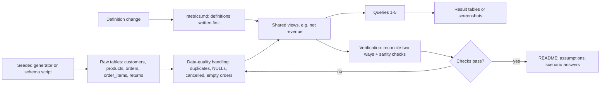
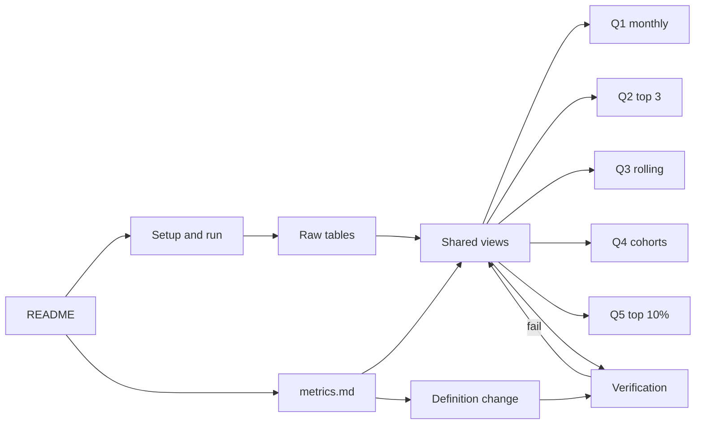

# Assignment 01 — Product Brief: What You Are Building

**v0.2 DRAFT — 2026-11-23** · Added features, screens and outputs, configuration. Read this first. Then [requirements-and-directives.md](requirements-and-directives.md) for the rules, and [developer-guide.md](developer-guide.md) for the build path.

## 1. Product in one view

| WH | Answer |
|---|---|
| What | **Retail metrics pack**: a reproducible SQL project that turns a synthetic retail sales dataset into defined, verified numbers. It holds a metric dictionary (`metrics.md`), shared views, five analysis queries with results, and a verification script |
| Why | Business questions get different answers when definitions, denominators and messy rows are handled differently. Stakeholders need one number they can trust and explain |
| Who | Producer: the analyst (you). Consumers: PM or business owner (asks the questions), finance or reviewer (checks the totals), other analysts (reuse the views) |
| Where | Runs locally on PostgreSQL, DuckDB or SQLite. No BI tool, no paid infrastructure |
| When | Built in 4–6 hours. Rerun whenever raw data changes or a definition changes |
| How | Seeded data generator or schema script, then definitions written before SQL, then shared views, then one SQL file per question, then reconciliation and sanity checks |
| Success | Every metric has a written definition, denominator, grain and limits. One total reconciles two ways. A definition change is made in one place and only the expected numbers move |

## 2. Personas

| Persona | Goal | Pain today | Needs from the pack |
|---|---|---|---|
| **PM / business owner** | Answer revenue, retention and concentration questions | Numbers differ by who ran the query | Clear answers with stated definitions |
| **Finance reviewer** | Trust that totals are right | Totals that look plausible but do not tie out | Reconciliation shown two ways, sanity checks |
| **Analyst (producer, you)** | Turn a question into a defined, verifiable number | Messy data: duplicates, NULLs, cancelled and empty orders | Shared logic in one place, documented handling rules |
| **Peer analyst (consumer)** | Reuse metrics without re-deriving them | Same filter copied into every query | Shared views or CTEs, readable SQL |
| **Interviewer** | See a definition change handled live | Logic scattered, change breaks unrelated numbers | One place to change, visible list of what moved |

## 3. Main data flow

## 4. Capabilities

| ID | Capability | What it means | Brief section |
|---|---|---|---|
| C1 | Synthetic dataset | 10k+ orders over 18–24 months, fixed seed, opaque ids, deliberate mess | A |
| C2 | Metric dictionary | Net revenue, AOV, repeat purchase rate, return rate, gross margin %: definition, denominator, grain, limits | B |
| C3 | Shared logic | Net revenue and common filters in one view or CTE, reused by all queries | Part 2 |
| C4 | Analysis queries | Five required queries: MoM revenue, top 3 per category, rolling 3-month, cohort retention, top 10% share | C |
| C5 | Data-quality handling | Stated, consistent treatment of duplicates, NULLs, cancelled orders, orders with no items | A, D |
| C6 | Verification | One total reconciled two ways, at least three sanity checks | E |
| C7 | Scenario answers | Late data, duplicates, NULLs, definition change answered in README | D |
| C8 | Changeable definitions | One definition changed in one place, with a list of numbers that moved | F |
| C9 | Reproducibility | Runs from a clean checkout, results rebuilt from raw inputs | Deliverables |

## 5. Product features

Priority: **Must** = required for submission. **Should** = expected for a strong score. **Could** = optional extra.

| ID | Feature | Capability | Priority |
|---|---|---|---|
| F-01 | Seeded data generator or schema script for customers, products, orders, order_items, returns | C1 | Must |
| F-02 | 10k+ orders over 18–24 months, fixed seed, opaque ids, no names, emails or phones | C1 | Must |
| F-03 | Deliberate mess: duplicate rows, NULL discounts, cancelled orders, orders with no items | C1, C5 | Must |
| F-04 | `metrics.md`: net revenue, AOV, repeat purchase rate, return rate, gross margin % with definition, denominator, grain, limits | C2 | Must |
| F-05 | Shared net revenue view and common filters, reused by every query | C3 | Must |
| F-06 | Query 1: monthly net revenue with MoM change (CTE + LAG) | C4 | Must |
| F-07 | Query 2: top 3 products per category with stated ranking and tie rule | C4 | Must |
| F-08 | Query 3: 3-month rolling average with explicit window frame | C4 | Must |
| F-09 | Query 4: signup-month cohorts with retention at month 0 to 6 | C4 | Must |
| F-10 | Query 5: revenue share of the top 10% of customers (NTILE or running total) | C4 | Must |
| F-11 | Result table or screenshot per query, rebuilt from raw inputs | C4, C9 | Must |
| F-12 | Written handling rules for duplicates, NULLs, cancelled and empty orders, no silent drops | C5 | Must |
| F-13 | Mess counts before and after handling | C5 | Should |
| F-14 | Reconciliation of one total two ways, with both figures and the difference | C6 | Must |
| F-15 | Three or more automated sanity checks with pass or fail output | C6 | Must |
| F-16 | README answers to late data, duplicates, NULLs and return-date netting | C7 | Must |
| F-17 | Definition change made in one place, with before and after numbers and list of what moved | C8 | Must |
| F-18 | Setup steps that run from a clean checkout | C9 | Must |
| F-19 | Comments where SQL logic is non-obvious | C3 | Should |
| F-20 | AI-assisted SQL disclosed in README | — | Must |
| F-21 | One command rebuilds data, views, results and checks (assumption) | C9 | Could |

## 6. Screens and outputs

No UI is required. These are the outputs a reader opens or runs.

| ID | Screen or output | Purpose | Key elements | States | Audience | Stories | Sample |
|---|---|---|---|---|---|---|---|
| S-01 | Setup and run commands (CLI) | Rebuild everything from a clean checkout | Generate or load data, create views, run queries, run checks, in documented order | not run, running, done, error | reviewer, analyst | US-01 | [view](samples/screens/S-01-setup-run-commands.svg) |
| S-02 | Raw tables | Inspect the dataset | Five tables, row counts, mess counts (duplicates, NULL discounts, cancelled, empty orders) | empty, ready | analyst, reviewer | US-01, 02 | [view](samples/screens/S-02-raw-tables.svg) |
| S-03 | Metric dictionary (`metrics.md`) | One meaning per metric | Metric, definition, denominator, grain, known limits, statuses counted, cost source | draft, ready | PM, peer analyst, interviewer | US-03, 04 | [view](samples/screens/S-03-metric-dictionary.svg) |
| S-04 | Shared views (e.g. net revenue) | Logic in one place | View name, filters applied, handling rules, comments | ready, error | peer analyst, interviewer | US-05–09, 12, 14 | [view](samples/screens/S-04-shared-views.svg) |
| S-05 | Query 1 result: monthly net revenue | Trend | Month, net revenue, MoM change, first month NULL or labelled | ready, empty, stale | PM | US-05 | [view](samples/screens/S-05-q1-monthly-net-revenue.svg) |
| S-06 | Query 2 result: top 3 per category | What sells | Category, product, revenue, rank, tie rule note | ready, empty, stale | category owner | US-06 | [view](samples/screens/S-06-q2-top3-per-category.svg) |
| S-07 | Query 3 result: rolling average | Smoothed trend | Month, revenue, 3-month average, first two months labelled | ready, empty, stale | PM | US-07 | [view](samples/screens/S-07-q3-rolling-average.svg) |
| S-08 | Query 4 result: cohort retention | Do customers return | Cohort month, cohort size, retention month 0 to 6, retention definition | ready, empty, stale | PM | US-08 | [view](samples/screens/S-08-q4-cohort-retention.svg) |
| S-09 | Query 5 result: top 10% share | Concentration | Method, customer base, top 10% revenue, total revenue, share | ready, empty, stale | PM | US-09 | [view](samples/screens/S-09-q5-top10-share.svg) |
| S-10 | Verification output | Trust the totals | Reconciliation (figure A, figure B, difference), sanity checks with pass or fail | pass, fail, error | finance reviewer, reviewer | US-10, 11 | [view](samples/screens/S-10-verification-output.svg) |
| S-11 | README | Explain choices | Setup, assumptions, handling rules, scenario answers, AI disclosure | draft, ready | PM, peer analyst, reviewer | US-12, 13, 15 | [view](samples/screens/S-11-readme.svg) |
| S-12 | Definition-change note | Show what moved | Old and new definition, before and after numbers, unchanged numbers, reconciliation rerun | ready | interviewer | US-14 | [view](samples/screens/S-12-definition-change-note.svg) |

States: **stale** = raw data or a definition changed since the result was last rebuilt.

## 7. Configuration

| Setting | Scope | Default | Who can change | Where | Effect |
|---|---|---|---|---|---|
| Database engine | Project | PostgreSQL, DuckDB or SQLite: candidate decides and documents | Analyst | README | SQL dialect, setup steps |
| Database connection or file path | Environment | `.env.example` | Developer | Env vars, never committed | Runtime |
| Random seed | Generator | Fixed value: candidate decides and documents | Analyst | Generator argument or constant | Same seed, same data and results |
| Data volume and date span | Generator | 10k+ orders over 18–24 months | Analyst | Generator | Rows and months covered |
| Mess rates (duplicates, NULL discounts, cancelled, empty orders) | Generator | Candidate decides and documents | Analyst | Generator | How many dirty rows each rule handles |
| Regenerate vs use committed data | Environment | Candidate decides and documents | Developer | Script flag or env var | Whether setup rebuilds raw tables |
| Timezone and month boundary | Dataset | Calendar month: timezone candidate decides and documents (assumption) | Analyst | README, shared view | Which month an order belongs to |
| Statuses counted in net revenue | Metric | Candidate decides and documents | Analyst, PM approves | `metrics.md`, shared view | Net revenue, AOV, every query |
| Return netting date | Metric | Order date (implied by scenario D) | Analyst, PM approves | `metrics.md`, shared view | Which month returns reduce |
| NULL discount and NULL cost treatment | Metric | Zero, exclude or flag: candidate decides and documents | Analyst | `metrics.md`, shared view | Net revenue, gross margin % |
| Duplicate detection key | Dataset | Candidate decides and documents | Analyst | Shared view | Rows removed, without losing real repeats |
| Retention definition | Metric | "Any order" | Analyst, interviewer may change | `metrics.md`, shared view | Query 4 |
| Channel exclusion | Shared view | None, all channels (assumption) | Analyst, interviewer may change | Shared view | Every query reading the view |
| Cohort window | Query 4 | Months 0 to 6 | Code constant | Query 4 SQL | Retention columns |
| Top N per category and tie rule | Query 2 | Top 3: RANK vs ROW_NUMBER candidate decides | Code | Query 2 SQL | Rows per category |
| Rolling window | Query 3 | 3 months | Code constant | Query 3 SQL | Average and first-two-month behaviour |
| Top customer percentile | Query 5 | 10% | Code constant | Query 5 SQL | Concentration share |
| Reconciliation tolerance | Verification | Candidate decides and documents | Analyst | Verification script, README | When reconciliation passes |
| Result output location and format | Project | Candidate decides and documents | Analyst | README | Where result tables or screenshots live |

## 8. User stories and acceptance criteria

Format: **As a** persona, **I want** action, **so that** benefit. Each has checkable acceptance criteria (AC).

### Data and definitions

| ID | Story | Acceptance criteria |
|---|---|---|
| US-01 | As a reviewer, I want the dataset rebuilt from a seeded script or schema so that I get the same numbers | Clean checkout plus setup steps recreates all five tables. Same seed gives identical row counts and results. Ids are opaque, no names, emails or phones |
| US-02 | As an analyst, I want the data to contain realistic mess so that my handling rules are tested | Duplicate rows, NULL discounts, cancelled orders and orders with no items exist and are counted |
| US-03 | As a PM, I want every metric defined before I see a number so that I know what it means | `metrics.md` has one table. Each of the five metrics states definition, denominator, grain and known limits. Statuses counted, discount and return treatment, cost source stated |
| US-04 | As a PM, I want AOV and repeat purchase rate to state their base so that I do not misread them | AOV states numerator, denominator and whether cancelled orders are in. Repeat rate names the customer base it divides by |

### Queries

| ID | Story | Acceptance criteria |
|---|---|---|
| US-05 | As a PM, I want monthly net revenue with month-over-month change so that I see the trend | One row per month. Uses the shared net revenue view. MoM change via LAG. First month change is NULL or labelled |
| US-06 | As a category owner, I want the top 3 products per category by revenue so that I know what sells | Exactly the ranking rule stated (RANK vs ROW_NUMBER) and tie handling explained |
| US-07 | As a PM, I want a 3-month rolling average so that noise is smoothed | Window frame explicit. Behaviour for the first two months stated |
| US-08 | As a PM, I want cohort retention by signup month for months 0 to 6 so that I see if customers come back | One row per cohort. Retention definition stated ("any order" by default). Cohort sizes sum to customers in scope |
| US-09 | As a PM, I want the share of revenue from the top 10% of customers so that I see concentration | Method stated (NTILE or running total). Customer base and revenue definition match `metrics.md` |

### Quality and verification

| ID | Story | Acceptance criteria |
|---|---|---|
| US-10 | As a finance reviewer, I want one total reconciled two ways so that I trust it | For example, sum of monthly net revenue equals total from order_items. Query or script output shows both figures and the difference |
| US-11 | As a reviewer, I want sanity checks so that obvious errors are caught | At least three automated checks, e.g. row counts, no negative revenue, cohort sizes sum to customers. Output shows pass or fail |
| US-12 | As a peer analyst, I want NULL, duplicate and cancelled-row rules written down so that I can reuse them safely | README states each rule and why. No row is dropped silently. Duplicate detection does not remove real repeat rows |
| US-13 | As a PM, I want the README to answer the four scenarios so that I know what can shift | Late data, duplicates, NULLs and return-date netting each answered in short bullets, naming which numbers change |

### Change

| ID | Story | Acceptance criteria |
|---|---|---|
| US-14 | As an interviewer, I want to change the retention definition to "paid order only" or exclude a channel so that I see the logic is maintainable | Change made in one place. Affected numbers listed. Unrelated numbers unchanged. Reconciliation still passes |
| US-15 | As a reviewer, I want AI-generated SQL disclosed so that I know what to probe | README lists AI-assisted queries. Candidate can explain each line |

## 9. Traceability

| Capability | Stories | Tests or checks you should show |
|---|---|---|
| C1, C9 | US-01, 02 | Clean-checkout rebuild. Same seed, same counts. Mess counts |
| C2 | US-03, 04 | `metrics.md` completeness: definition, denominator, grain, limits per metric |
| C3 | US-05–09, 14 | All queries read the shared view. No copied filters |
| C4 | US-05–09 | Result table per query, reproducible |
| C5 | US-02, 12 | Duplicate and NULL counts before and after. No silent drops |
| C6 | US-10, 11 | Reconciliation output. Three or more sanity checks |
| C7 | US-13 | README scenario section |
| C8 | US-14 | Before and after numbers for a definition change |
| All | US-15 | AI disclosure in README |

## 10. Out of scope

- BI tool, dashboard or charts (that is assignment 03)
- Pipelines, incremental loads, orchestration (that is assignment 02)
- Real or personal data of any kind
- Paid infrastructure or cloud warehouses
- Forecasting or statistical modelling beyond the five required queries
