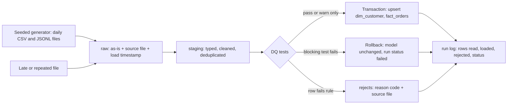
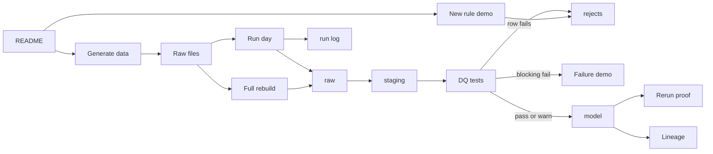

# Assignment 02 — Product Brief: What You Are Building

**v0.2 DRAFT — 2026-11-23** · Added features, screens and outputs, configuration. Read this first. Then [requirements-and-directives.md](requirements-and-directives.md) for the rules, and [developer-guide.md](developer-guide.md) for the build path.

## 1. Product in one view

| WH | Answer |
|---|---|
| What | **Daily orders pipeline**: a small, local pipeline that ingests daily raw files (customers, orders, events), cleans and models them into raw, staging, model and rejects layers, with data-quality tests, a run log and lineage notes |
| Why | Downstream analysts and reports rely on these tables. Blind appends, silent drops and half-loaded tables give wrong numbers nobody can trace |
| Who | Producer: the data engineer (you). Consumers: analysts and dashboards reading model tables, data ops / on-call owner reading the run log and rejects |
| Where | Runs locally from a clean checkout on PostgreSQL, DuckDB or SQLite. Plain script, Makefile or optional orchestrator |
| When | Built in 6–8 hours. Runs once per daily file. Reruns, late files and full rebuilds must also work |
| How | Load raw as-is, then type, clean and dedupe in staging, then upsert into dimension and fact tables inside a transaction. Bad rows go to rejects with a reason. Every run is logged |
| Success | Running the same day twice gives identical tables. A failed run leaves model tables unchanged. Every rejected row has a reason and source file. A new rule changes only the rows it should |

## 2. Personas

| Persona | Goal | Pain today | Needs from the pipeline |
|---|---|---|---|
| **Data engineer (producer, you)** | Own a pipeline others rely on | Reruns double data, late files break history | Keys, upserts, transactions, one place for rules |
| **Analyst (data consumer)** | Query clean, deduplicated fact and dimension tables | Duplicates and NULLs leak into reports | Uniqueness and not-null guarantees on model tables |
| **Data ops / on-call owner** | Know if today's run worked and why rows were dropped | "Success" with no counts, silent drops | Run log with counts and status, rejects with reason codes |
| **Upstream source owner** (assumption) | Learn which of their rows were bad | No feedback on bad data | Rejects table traceable to source file |
| **Interviewer** | See a new rule added safely | Rule changes ripple into unrelated tables | Rule plus test, proof unrelated rows unchanged |

## 3. Main data flow

## 4. Capabilities

| ID | Capability | What it means | Brief section |
|---|---|---|---|
| C1 | Synthetic raw inputs | 10–14 days of daily files, seeded, opaque ids, deliberate bad data | A |
| C2 | Layered model | raw, staging, model (dim and fact), rejects | B |
| C3 | Idempotent loads | Same file or day twice gives same final tables | C |
| C4 | Incremental and full rebuild | New day processes only new or changed data. Full rebuild also works | C |
| C5 | Atomic runs | Failed run leaves model tables unchanged | C |
| C6 | Run log | Run id, start, end, rows read, loaded, rejected, status | C |
| C7 | DQ tests | Uniqueness, not null, referential, range/domain, volume/freshness. Blocking vs warning stated | D |
| C8 | Rejects handling | Bad rows kept with reason code and source file, never silently dropped | B, Part 2 |
| C9 | Lineage | Source file to raw, staging, model, with column-level transforms | F |
| C10 | Scenario handling | Late data, conflicting duplicates, NULLs, definition change, schema drift | E |
| C11 | Extensible rules | New rule or column added with a test, unrelated data unchanged | G |

## 5. Product features

Priority: **Must** = required for submission. **Should** = expected for a strong score. **Could** = optional extra.

| ID | Feature | Capability | Priority |
|---|---|---|---|
| F-01 | Seeded generator for daily customers CSV, orders CSV and events JSONL, 10–14 days, opaque ids | C1 | Must |
| F-02 | Seeded bad data: duplicate keys, NULL required fields, malformed dates, negative amounts, unknown currency, orphan customer ids | C1, C8 | Must |
| F-03 | Generate and run from a clean checkout in one or two commands | C1 | Must |
| F-04 | raw layer: files loaded as-is with source file name and load timestamp | C2 | Must |
| F-05 | staging layer: typed, cleaned, deduplicated | C2 | Must |
| F-06 | model layer: dimension and fact tables (e.g. dim_customer, fact_orders) with keys | C2 | Must |
| F-07 | DDL for every layer, including rejects and run log, with keys and constraints | C2 | Must |
| F-08 | Keyed upsert or merge so reruns give identical tables | C3 | Must |
| F-09 | Rerun proof output | C3 | Must |
| F-10 | Incremental run per day for new or changed data only | C4 | Must |
| F-11 | Full rebuild from raw giving the same final tables | C4 | Must |
| F-12 | Model update inside one transaction, forced-failure demo | C5 | Must |
| F-13 | Run log: run id, start, end, rows read, loaded, rejected, status, counts reconcile | C6 | Must |
| F-14 | DQ tests: uniqueness, not null, referential, range/domain, volume/freshness | C7 | Must |
| F-15 | Each test marked blocking or warning with a reason | C7 | Must |
| F-16 | Passing and failing DQ demonstration | C7 | Must |
| F-17 | rejects table with reason code and source file, nothing dropped silently | C8 | Must |
| F-18 | Duplicate winner rule with a test | C8, C10 | Must |
| F-19 | Late file (day 3 after day 5) loads and equals a full rebuild | C4, C10 | Must |
| F-20 | README answers on NULL policy, renamed statuses, mandatory currency, extra column | C10 | Must |
| F-21 | Lineage table or Mermaid diagram, source file to model with column transforms | C9 | Must |
| F-22 | Rules and transforms kept in one place and reused across sources | C11 | Must |
| F-23 | New rule or column added with a test, unrelated rows unchanged | C11 | Must |
| F-24 | AI-generated code disclosed in README | — | Must |
| F-25 | Rejects summary by reason code and source file (assumption) | C8 | Should |
| F-26 | Note on what you would monitor in production | C6, C7 | Could |
| F-27 | Orchestrator (e.g. Airflow, Dagster) instead of script or Makefile | — | Could |

## 6. Screens and outputs

No UI is required. These are the commands and tables a reader runs or opens.

| ID | Screen or output | Purpose | Key elements | States | Audience | Stories | Sample |
|---|---|---|---|---|---|---|---|
| S-01 | Generate data command (CLI) | Create daily raw files | Seed, number of days, output folder, bad-data summary | running, done, error | reviewer, data engineer | US-01, 10 | [view](samples/screens/S-01-generate-data-command.svg) |
| S-02 | Run day command (CLI, incremental) | Load one day or file | Target day or file, run id, counts, exit status | running, success, failed | data ops, data engineer | US-04, 05, 11 | [view](samples/screens/S-02-run-day-command.svg) |
| S-03 | Full rebuild command (CLI) | Rebuild all layers from raw | Run id, counts, exit status | running, success, failed | data engineer, reviewer | US-05, 11 | [view](samples/screens/S-03-full-rebuild-command.svg) |
| S-04 | DQ test command and report | See what passed, warned or blocked | Test name, type, blocking or warning, result, failing row count | pass, warn, fail, error | analyst, data ops | US-08, 09 | [view](samples/screens/S-04-dq-test-report.svg) |
| S-05 | Raw input files | Replayable source | `customers_`, `orders_`, `events_` files per day | missing, ready | reviewer, source owner | US-01, 02 | [view](samples/screens/S-05-raw-input-files.svg) |
| S-06 | raw tables | Files as loaded | Rows as in file, source file name, load timestamp | empty, ready | data engineer | US-02 | [view](samples/screens/S-06-raw-tables.svg) |
| S-07 | staging tables | Clean, typed data | Typed columns, dedupe outcome | empty, ready | data engineer | US-03, 12 | [view](samples/screens/S-07-staging-tables.svg) |
| S-08 | model tables (dim_customer, fact_orders) | What analysts query | Keys, constraints, unique order_id | empty, ready, stale | analyst | US-03, 04, 06 | [view](samples/screens/S-08-model-tables.svg) |
| S-09 | rejects table | Every bad row with a reason | Row data, reason code, source file, run id | empty, ready | data ops, source owner | US-10, 12, 15 | [view](samples/screens/S-09-rejects-table.svg) |
| S-10 | run log table | What each run did | Run id, start, end, rows read, loaded, rejected, status | running, success, failed | data ops | US-06, 07 | [view](samples/screens/S-10-run-log-table.svg) |
| S-11 | Rerun proof output | Show idempotency | Table counts or checksums after run 1 and run 2 | match, mismatch | reviewer, interviewer | US-04 | [view](samples/screens/S-11-rerun-proof-output.svg) |
| S-12 | Forced-failure demo output | Show atomicity | Model row counts before and after, run status failed | ready | reviewer, analyst | US-06 | [view](samples/screens/S-12-forced-failure-demo.svg) |
| S-13 | Lineage note | Trace a column | Source file, raw, staging, model, transform per column | draft, ready | analyst | US-14 | [view](samples/screens/S-13-lineage-note.svg) |
| S-14 | README | Explain choices | Setup, blocking vs warning list, scenario answers, trade-offs, AI disclosure | draft, ready | all | US-09, 12, 13 | [view](samples/screens/S-14-readme.svg) |
| S-15 | New-rule demo output | Show safe change | Rule, test result, rows sent to rejects, unrelated tables unchanged | pass, fail | interviewer | US-15 | [view](samples/screens/S-15-new-rule-demo.svg) |

States: **stale** = the latest expected daily file has not been loaded (freshness test).

## 7. Configuration

| Setting | Scope | Default | Who can change | Where | Effect |
|---|---|---|---|---|---|
| Database engine | Project | PostgreSQL, DuckDB or SQLite: candidate decides and documents | Data engineer | README | SQL dialect, setup |
| Database connection or file path | Environment | `.env.example` | Developer | Env vars, never committed | Runtime |
| Raw input folder | Environment | Candidate decides and documents | Developer | Env var or config file | Where files are read from |
| Random seed | Generator | Fixed value: candidate decides and documents | Data engineer | Generator argument or constant | Same seed, same files |
| Number of days | Generator | 10–14 days | Data engineer | Generator argument | How many daily files exist |
| Bad-data rates per type | Generator | Candidate decides and documents | Data engineer | Generator | How many rows reach rejects |
| Regenerate vs use committed sample files | Environment | Candidate decides and documents | Developer | Script flag | Whether setup rewrites raw files |
| Target run day or file | Run | Next unprocessed day (assumption) | Data ops | CLI argument | Which file a run loads |
| Incremental watermark | Pipeline | Candidate decides and documents (e.g. file date or updated_at) | Code | Run log or state table | What counts as new or changed |
| Full rebuild flag | Run | Off | Data ops | CLI flag or Makefile target | Rebuilds all layers from raw |
| Timezone and day boundary | Pipeline | Candidate decides and documents (assumption) | Code constant | README | Which day an order_ts and file belong to |
| Duplicate winner rule | Pipeline | Candidate decides and documents (e.g. latest file or timestamp) | Code | One rules module | Which version reaches the model |
| NULL policy for required fields | Pipeline | Reject, default or quarantine: candidate decides | Code | Rules module, README | Rows rejected or kept |
| Allowed status values | DQ test | Candidate decides and documents | Code | Rules module | Domain test, rename handling |
| Allowed currencies | DQ test | Candidate decides and documents | Code | Rules module | Unknown-currency rejects |
| Amount range | DQ test | amount >= 0 | Code constant | Rules module | Negative-amount rejects |
| Expected volume band | DQ test | Candidate decides and documents | Code | Test config | Volume test result |
| Freshness limit | DQ test | Candidate decides and documents | Code | Test config | Stale warning or block |
| Blocking vs warning per test | DQ test | Candidate decides and documents with reason | Data engineer | Test config, README | Whether a failure stops the model update |
| Reason codes list | Rejects | Candidate decides and documents | Code | Rules module | Reject labels |
| Max order age rule | Pipeline | Off: 90 days when added in live follow-up | Interviewer request, code | Rules module | Old orders go to rejects |
| Extra-column policy (schema drift) | Pipeline | Candidate decides and documents | Code | Loader, README | Ignore, store or fail on new columns |
| Forced-failure switch | Run | Off (assumption) | Developer | CLI flag or env var | Triggers the atomicity demo |

## 8. User stories and acceptance criteria

Format: **As a** persona, **I want** action, **so that** benefit. Each has checkable acceptance criteria (AC).

### Ingest and model

| ID | Story | Acceptance criteria |
|---|---|---|
| US-01 | As a reviewer, I want to run the pipeline from a clean checkout so that I can verify it | One or two commands generate data and run all layers. Seeded, so the same seed gives the same files |
| US-02 | As a data engineer, I want raw files loaded as-is so that any day can be replayed | raw rows match the file exactly, plus source file name and load timestamp. Raw files are never edited by hand |
| US-03 | As an analyst, I want typed, deduplicated staging and dim/fact model tables so that I query clean data | Schema or DDL for every layer with keys and constraints. order_id unique in fact_orders. Types enforced |

### Rerun, incremental and failure

| ID | Story | Acceptance criteria |
|---|---|---|
| US-04 | As a data ops owner, I want reruns to be safe so that a retry never doubles data | Running the same day twice gives identical model tables. Rerun proof output committed |
| US-05 | As a data engineer, I want a new day to process only new or changed data so that runs stay fast | Incremental run touches only new or changed keys. Full rebuild from raw gives the same final tables |
| US-06 | As an analyst, I want a failed run to leave model tables unchanged so that I never read half-loaded data | Model updates wrapped in a transaction. Forced failure demo shows model row counts unchanged and run status failed |
| US-07 | As a data ops owner, I want a run log so that I know what each run did | One row per run: run id, start, end, rows read, loaded, rejected, status. Counts reconcile: read = loaded + rejected (+ deduplicated, if stated) |

### Data quality and rejects

| ID | Story | Acceptance criteria |
|---|---|---|
| US-08 | As an analyst, I want automated DQ tests so that bad data is caught before I use it | Tests cover uniqueness, not null, referential, range/domain, volume/freshness. Demo shows each passing and at least one failing |
| US-09 | As a data ops owner, I want to know which tests block and which warn so that I know when a run stops | README lists each test as blocking or warning with a reason. A blocking failure stops the model update |
| US-10 | As a source owner (assumption), I want every bad row in rejects with a reason so that I can fix it upstream | Rejects row has reason code and source file. Seeded bad data (duplicate keys, NULL required fields, malformed dates, negative amounts, unknown currency, orphan customer ids) all appear. Nothing dropped silently |

### Scenarios, lineage and change

| ID | Story | Acceptance criteria |
|---|---|---|
| US-11 | As a data ops owner, I want a late file (day 3 after day 5) handled correctly so that history is right | Late file loads without corrupting later days. Final tables equal a full rebuild |
| US-12 | As an analyst, I want a clear winner rule for conflicting duplicate orders so that values are consistent | README states which version wins and why (e.g. latest file or timestamp). Test proves it |
| US-13 | As a data engineer, I want schema drift and upstream renames handled on purpose so that runs do not break silently | README answers extra column, renamed status values, currency becoming mandatory, and NULL policy (reject, default or quarantine) |
| US-14 | As an analyst, I want lineage notes so that I can trace a column to its source | One table or Mermaid diagram: source file to raw, staging, model, and which transform touches which column |
| US-15 | As an interviewer, I want a new rule (e.g. reject orders older than 90 days) added with a test so that I see safe change | Rule added in one place with a test. Matching rows go to rejects. Unrelated tables and rows unchanged |

## 9. Traceability

| Capability | Stories | Tests or checks you should show |
|---|---|---|
| C1 | US-01, 10 | Seeded generation. Bad-data types present |
| C2 | US-02, 03 | DDL for all layers. Raw equals file |
| C3 | US-04 | Rerun proof: identical tables |
| C4 | US-05, 11 | Incremental vs full rebuild equality. Late file |
| C5 | US-06 | Forced failure leaves model unchanged |
| C6 | US-07 | Run log counts reconcile |
| C7 | US-08, 09 | Passing and failing DQ demo. Blocking vs warn list |
| C8 | US-10, 12 | Every reject has reason and source file. Duplicate winner test |
| C9 | US-14 | Lineage table or diagram |
| C10 | US-11, 12, 13 | README scenario section |
| C11 | US-15 | New rule test. Unrelated rows unchanged |

## 10. Out of scope

- Streaming, Kubernetes, cloud services or paid tools
- Mandatory orchestrator (Airflow, Dagster etc. are optional)
- Dashboards or insight reports (that is assignment 03)
- Real or personal data of any kind
- Production monitoring stack (describe what you would monitor, if asked)
