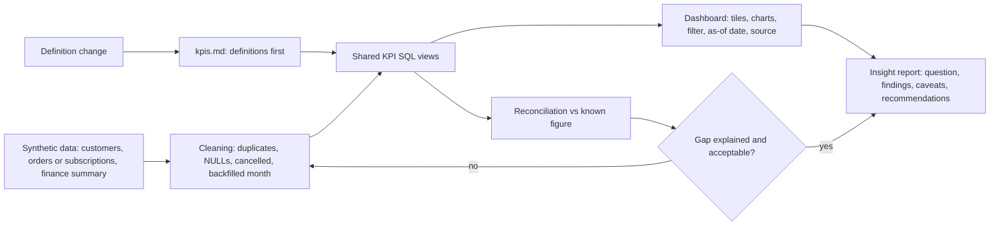
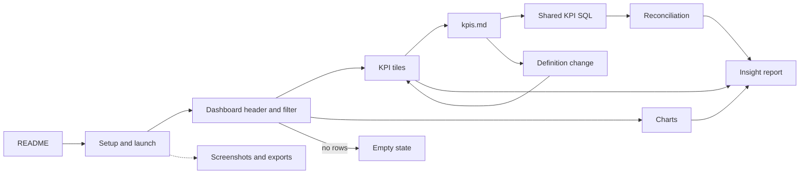

# Assignment 03 — Product Brief: What You Are Building

**v0.2 DRAFT — 2026-11-23** · Added features, screens and outputs, configuration. Read this first. Then [requirements-and-directives.md](requirements-and-directives.md) for the rules, and [developer-guide.md](developer-guide.md) for the build path.

## 1. Product in one view

| WH | Answer |
|---|---|
| What | **KPI dashboard plus insight report**: a small dashboard (4+ KPI tiles, 3 charts, one filter) and a 1–2 page report on a synthetic subscription or retail dataset, backed by `kpis.md`, shared KPI SQL and a reconciliation note |
| Why | Stakeholders act on numbers they cannot check. They need clear definitions, honest charts and stated limits, not just a polished screen |
| Who | Producer: the analyst (you). Consumers: non-technical stakeholders (business lead, PM), finance (owns the known figure), KPI owners |
| Where | Runs locally (Streamlit, Metabase, Superset, notebook or static HTML) or as exported files. SQL on PostgreSQL, DuckDB or SQLite |
| When | Built in 6–8 hours. Read at a reporting point, e.g. month or quarter end (assumption) |
| How | Define KPIs first, then shared SQL views, then tiles and charts, then reconcile to the finance figure, then write findings with caveats and recommendations |
| Success | Every tile has a stated definition and denominator. The dashboard total reconciles to the known figure, with any gap explained not forced. Each recommendation ties to a finding and a caveat |

## 2. Personas

| Persona | Goal | Pain today | Needs from the product |
|---|---|---|---|
| **Business lead / PM** | Make a decision from the data | Charts that exaggerate, partial months shown as drops | Clear tiles, honest charts, 3 findings, actions |
| **Finance owner** | Know the dashboard matches the books | Totals that silently disagree | Reconciliation to the known figure with the gap explained |
| **KPI owner** | Keep one agreed definition per KPI | Same KPI computed differently per chart | `kpis.md` with owner, one shared SQL per KPI |
| **Analyst (producer, you)** | Turn data into a trustworthy message | Messy data: duplicates, NULLs, cancelled rows, backfilled month | Documented handling and caveats next to claims |
| **Interviewer** | See a definition change handled live | Change ripples unpredictably | One place to change, list of tiles that moved |

## 3. Main data flow

## 4. Capabilities

| ID | Capability | What it means | Brief section |
|---|---|---|---|
| C1 | Synthetic dataset | Customers, orders or subscriptions, monthly finance summary with one known figure. Opaque ids. Seeded mess | A |
| C2 | KPI dictionary | 4–6 KPIs, each with definition, numerator, denominator, grain, time window, owner, limits | B |
| C3 | Shared KPI SQL | One view or model per KPI, reused by every tile and chart | Part 2 |
| C4 | KPI tiles | 4+ tiles with period-over-period change | C |
| C5 | Honest charts | 3 charts. Zero baseline for bars, labelled axes and units, no dual axes, no unflagged truncation | C |
| C6 | Filter and context | One filter (date range or segment). As-of date and data source shown | C |
| C7 | Edge states | Empty, small-sample and incomplete periods shown without misleading values | C, F |
| C8 | Reconciliation | Dashboard total vs known figure, difference, cause, acceptable or not | D |
| C9 | Insight report | Question, 3 findings, caveats, recommendations in 1–2 pages | E |
| C10 | Scenario answers | Late data, duplicates, NULLs, churn redefinition | F |
| C11 | Changeable definitions | One KPI changed in one place, tiles that moved listed | G |

## 5. Product features

Priority: **Must** = required for submission. **Should** = expected for a strong score. **Could** = optional extra.

| ID | Feature | Capability | Priority |
|---|---|---|---|
| F-01 | Synthetic dataset: customers, orders or subscriptions, monthly finance summary with one known figure | C1 | Must |
| F-02 | Opaque ids and seeded mess: duplicates, NULLs, cancelled rows, a backfilled month | C1 | Must |
| F-03 | Setup steps that rebuild data, KPIs and dashboard from raw inputs | C1 | Must |
| F-04 | `kpis.md`: 4–6 KPIs with definition, numerator, denominator, grain, time window, owner, limits | C2 | Must |
| F-05 | One shared SQL view or model per KPI, read by every tile and chart | C3 | Must |
| F-06 | 4+ KPI tiles with value, comparison period and change | C4 | Must |
| F-07 | Ratio tiles state their base | C4 | Must |
| F-08 | 3 charts: zero baseline for bars, labelled axes and units, no dual axes or 3D | C5 | Must |
| F-09 | Note on any truncated scale | C5 | Must |
| F-10 | One filter (date range or segment), tiles and charts update together | C6 | Must |
| F-11 | As-of date and data source on the page | C6 | Must |
| F-12 | Empty state shown as empty, not zero | C7 | Must |
| F-13 | Small-sample flag | C7 | Must |
| F-14 | Incomplete last period marked, not shown as a drop | C7 | Must |
| F-15 | Reconciliation note: both figures, difference, cause, acceptable or not | C8 | Must |
| F-16 | Insight report: question and 3 findings with number, comparison, chart reference | C9 | Must |
| F-17 | Caveats beside the claim they affect, observation separate from interpretation | C9 | Must |
| F-18 | Recommendations tied to a finding, with what to verify next | C9 | Must |
| F-19 | README answers on incomplete month, duplicates removed per KPI, missing segments, churn redefinition | C10 | Must |
| F-20 | KPI changed once in `kpis.md` and shared SQL, tiles that moved listed | C11 | Must |
| F-21 | AI-assisted SQL or text disclosed in README | — | Must |
| F-22 | Missing segments shown one consistent way (Unknown, excluded or flagged) | C10 | Should |
| F-23 | Screenshots plus exported files when the dashboard is not run live | C4, C5 | Should |
| F-24 | KPI definition reachable from each tile (assumption) | C2, C4 | Could |
| F-25 | Second filter (segment) added in live follow-up | C6, C11 | Could |

## 6. Screens and outputs

| ID | Screen or output | Purpose | Key elements | States | Audience | Stories | Sample |
|---|---|---|---|---|---|---|---|
| S-01 | Setup and launch commands (CLI) | Rebuild and open the dashboard | Generate or load data, build KPI views, start dashboard or export | running, done, error | reviewer, analyst | US-01 | [view](samples/screens/S-01-setup-launch-commands.svg) |
| S-02 | Dashboard page: header and filter | Context and focus | Title, as-of date, data source, date-range or segment filter | loading, ready, error, stale | business lead, any reader | US-06, 07 | [view](samples/screens/S-02-dashboard-header-filter.svg) |
| S-03 | KPI tiles (4+) | Direction at a glance | Value, comparison period, change, base for ratios, flags | loading, ready, empty, small sample, incomplete | business lead | US-04, 08 | [view](samples/screens/S-03-kpi-tiles.svg) |
| S-04 | Charts (3) | Trends and breakdowns | Zero-baseline bars, axis labels and units, truncation note, incomplete-period marker | loading, ready, empty, small sample, incomplete | business lead | US-05, 08 | [view](samples/screens/S-04-charts.svg) |
| S-05 | Empty-state panel | No data for the filter | Message, active filter, way to reset | empty | business lead | US-08 | [view](samples/screens/S-05-empty-state-panel.svg) |
| S-06 | KPI dictionary (`kpis.md`) | One agreed definition | KPI, definition, numerator, denominator, grain, time window, owner, limits | draft, ready | KPI owner, any reader | US-02 | [view](samples/screens/S-06-kpi-dictionary.svg) |
| S-07 | Shared KPI SQL views | One source per KPI | View per KPI, query output matching tile value | ready, error | KPI owner, reviewer | US-03 | [view](samples/screens/S-07-shared-kpi-views.svg) |
| S-08 | Reconciliation note | Match to the books | Dashboard total, known figure, difference, cause, acceptable or not | matched, gap explained, gap unexplained | finance owner | US-09 | [view](samples/screens/S-08-reconciliation-note.svg) |
| S-09 | Insight report (PDF or Markdown) | Support a decision | Question, 3 findings, caveats beside claims, recommendations | draft, ready | business lead | US-10, 11, 12 | [view](samples/screens/S-09-insight-report.svg) |
| S-10 | README | Explain choices | Setup, assumptions, scenario answers, trade-offs, AI disclosure | draft, ready | any reader, reviewer | US-13, 15 | [view](samples/screens/S-10-readme.svg) |
| S-11 | Definition-change note | Show what moved | Old and new definition, tiles before and after, trend still holds or not, how readers are told | ready | interviewer, KPI owner | US-14 | [view](samples/screens/S-11-definition-change-note.svg) |
| S-12 | Screenshots and exported files | Review without running | One per page and state (incl. empty and incomplete) | ready | reviewer | US-01, 08 | [view](samples/screens/S-12-screenshots-exports.svg) |

States: **stale** = data was rebuilt after the as-of date shown. **incomplete** = the period is not finished at report time.

## 7. Configuration

| Setting | Scope | Default | Who can change | Where | Effect |
|---|---|---|---|---|---|
| Dashboard tool | Project | Streamlit, Metabase, Superset, notebook or static HTML: candidate decides | Analyst | README | How the dashboard runs or exports |
| Database engine | Project | PostgreSQL, DuckDB or SQLite: candidate decides and documents | Analyst | README | SQL dialect, setup |
| Database connection or file path | Environment | `.env.example` | Developer | Env vars, never committed | Runtime |
| Dataset type | Generator | Subscription or retail: candidate decides | Analyst | Generator, README | Which KPIs make sense |
| Random seed | Generator | Fixed value: candidate decides and documents | Analyst | Generator argument or constant | Same seed, same numbers |
| Regenerate vs use committed data | Environment | Candidate decides and documents | Developer | Script flag | Whether setup rebuilds data |
| Known figure and its period | Finance summary | Set in the finance summary (e.g. net revenue for a quarter) | Finance owner | Finance summary table | Reconciliation target |
| Reconciliation acceptable gap | Reconciliation | Candidate decides and documents | Analyst, finance owner agrees | Reconciliation note | Acceptable or not verdict |
| Timezone and month boundary | Dataset | Candidate decides and documents (assumption) | Code constant | README, shared SQL | Which period a row belongs to |
| Reporting grain | KPI | Monthly (assumption, from monthly finance summary) | KPI owner | `kpis.md` | Tile and chart periods |
| Default filter value | Dashboard | Candidate decides and documents | Analyst | Dashboard config | What a reader sees first |
| Comparison period | Tiles | Candidate decides and documents (e.g. previous period) | KPI owner | `kpis.md`, shared SQL | Period-over-period change |
| Incomplete-period rule | Dashboard | Candidate decides and documents | Analyst | Shared SQL, README | Which period is marked incomplete |
| Small-sample threshold | Dashboard | Candidate decides and documents | Analyst | Shared SQL or dashboard config | When a tile or chart is flagged |
| Churn inactivity window | KPI | 30 days, 60 days in live follow-up | KPI owner, interviewer may change | `kpis.md`, shared SQL | Churn tile and charts |
| Missing-segment handling | KPI | Unknown, excluded or flagged: candidate decides | Analyst | Shared SQL, README | Segment filter and breakdowns |
| Duplicate handling rule | Dataset | Candidate decides and documents | Analyst | Shared SQL, README | Duplicates removed per KPI |
| As-of date source | Dashboard | Candidate decides and documents (e.g. latest data date) | Code | Dashboard | Freshness shown to readers |
| Data source label | Dashboard | Candidate decides | Analyst | Dashboard config | Source shown on page |
| Bar chart baseline | Charts | Zero | Code constant | Chart code | Honest bar lengths |
| KPI owner | KPI | Named per KPI | KPI owner | `kpis.md` | Who approves a definition change |

## 8. User stories and acceptance criteria

Format: **As a** persona, **I want** action, **so that** benefit. Each has checkable acceptance criteria (AC).

### Data and definitions

| ID | Story | Acceptance criteria |
|---|---|---|
| US-01 | As a reviewer, I want the results reproducible from raw inputs so that I can verify them | Setup instructions rebuild data, KPIs and dashboard. Ids opaque, no personal data. Mess (duplicates, NULLs, cancelled rows, backfilled month) present |
| US-02 | As a KPI owner, I want each KPI defined before it is charted so that everyone reads it the same way | `kpis.md` covers 4–6 KPIs. Each states definition, numerator, denominator, grain, time window, owner, known limits |
| US-03 | As a KPI owner, I want one SQL definition per KPI so that every chart agrees | Each KPI computed in one shared view or model. Tiles and charts read from it. No duplicated KPI logic |

### Dashboard

| ID | Story | Acceptance criteria |
|---|---|---|
| US-04 | As a business lead, I want KPI tiles with period-over-period change so that I see direction at a glance | At least 4 tiles. Each shows value, comparison period and change. Ratio tiles state their base |
| US-05 | As a business lead, I want honest charts so that I am not misled | 3 charts. Bars start at zero. Axes and units labelled. No dual axes or 3D. Any truncated scale has a note |
| US-06 | As a business lead, I want a filter so that I can focus on a period or segment | One date-range or segment filter. Tiles and charts update consistently |
| US-07 | As any reader, I want the as-of date and data source on the page so that I know how fresh it is | Both visible on the dashboard |
| US-08 | As a business lead, I want empty, small-sample and incomplete periods marked so that I do not misread them | Empty filter shows a clear empty state, not zero. Small samples flagged. Incomplete last month marked, not shown as a drop |

### Reconciliation and report

| ID | Story | Acceptance criteria |
|---|---|---|
| US-09 | As a finance owner, I want the dashboard total reconciled to the known figure so that I trust it | Note shows both figures, difference, cause and whether acceptable. Data is not adjusted to force a match |
| US-10 | As a business lead, I want a short insight report so that I can decide | 1–2 pages. States the question. 3 findings, each with a number, comparison and chart reference |
| US-11 | As a business lead, I want caveats next to the claims they affect so that I know how far to trust them | Data limits, sample size and correlation vs causation stated beside the finding. Observation kept separate from interpretation |
| US-12 | As a business lead, I want recommendations tied to findings so that I know what to do next | Each recommendation cites a finding and says what to verify next |

### Scenarios and change

| ID | Story | Acceptance criteria |
|---|---|---|
| US-13 | As a reader, I want the README to explain late data, duplicates and NULLs so that I understand the numbers | States how the incomplete month is shown, how many duplicates were removed and their effect per KPI, and how missing segments appear (Unknown, excluded or flagged) |
| US-14 | As an interviewer, I want churn redefined (30 to 60 days) or a segment filter added so that I see maintainable logic | Definition changed once in `kpis.md` and the shared SQL. Tiles that moved listed. Candidate says whether the trend story still holds and how readers are told |
| US-15 | As a reviewer, I want AI-generated content disclosed so that I know what to probe | README lists AI-assisted SQL or text. Conclusions checked by the candidate |

## 9. Traceability

| Capability | Stories | Tests or checks you should show |
|---|---|---|
| C1 | US-01 | Clean rebuild from raw. Mess counts |
| C2 | US-02 | `kpis.md` completeness per KPI |
| C3 | US-03, 14 | Every tile and chart reads the shared view |
| C4 | US-04 | Tile values match KPI SQL output |
| C5 | US-05 | Chart checklist: zero baseline, labels, units, no dual axes |
| C6 | US-06, 07 | Filter changes tiles and charts together. As-of date shown |
| C7 | US-08, 13 | Empty and incomplete-period screenshots |
| C8 | US-09 | Reconciliation note with figures and gap |
| C9 | US-10, 11, 12 | Report: question, 3 findings, caveats, recommendations |
| C10 | US-13 | README scenario section |
| C11 | US-14 | Before and after tiles for a definition change |
| All | US-15 | AI disclosure in README |

## 10. Out of scope

- Visual polish beyond clarity (secondary to correct numbers)
- Paid BI tools or cloud services
- Production pipeline, scheduling or incremental loads (that is assignment 02)
- Real or personal data of any kind
- Causal claims the data cannot support (state them as hypotheses to verify)
