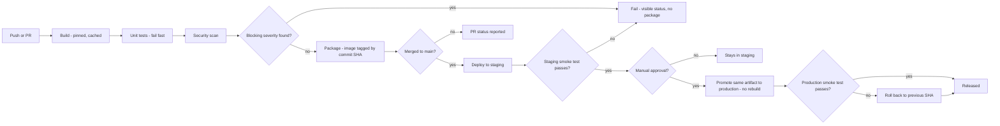
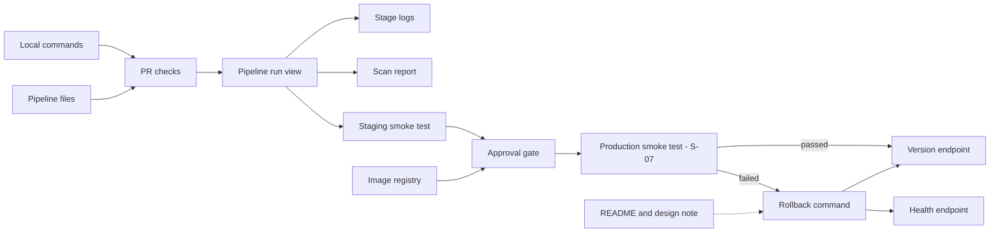

# Assignment 01 — Product Brief: What You Are Building

**v0.2 DRAFT — 2026-11-23** · Added features, interfaces, configuration. Read this first. Then [requirements-and-directives.md](requirements-and-directives.md) for the rules, and [developer-guide.md](developer-guide.md) for the build path.

## 1. Product in one view

| WH | Answer |
|---|---|
| What | **A delivery pipeline** for a small sample HTTP service: build, test, security scan, package, deploy to staging, promote to production, roll back. The pipeline is the product. The service is only its payload |
| Why | Manual or ad-hoc releases ship untested or unscanned code, rebuild different artifacts per environment, and have no rehearsed way back. The team wants safe, repeatable delivery |
| Who | Developers (push and open PRs), release approver (approves production), DevOps engineer (owns the pipeline), on-call or operator (rolls back) |
| Where | Pipeline as code in the repo, on a free CI tier (GitHub Actions preferred) and locally. Staging and production simulated with Docker Compose or a local cluster |
| When | Runs on every push and pull request. Staging deploy on merge to main. Production on manual approval. Rollback on a failed smoke test or bad release |
| How | Build once, tag by commit SHA, gate each stage, promote the same artifact, keep a tested rollback path |
| Success | Every change is tested and scanned before it reaches staging. The artifact in production is byte-for-byte the one tested. A broken release is detected and rolled back with a stated time |

## 2. Personas

| Persona | Goal | Pain today | Needs from the pipeline |
|---|---|---|---|
| **Developer** | Get a change merged and released quickly | Slow or unclear feedback, "works on my machine" | Fast, fail-fast tests on every push and PR. Clear failure output |
| **Release approver** (assumption: role name) | Decide when a tested build goes to production | No evidence of what was tested, risky releases | Manual approval gate, staging smoke result, SHA of the artifact |
| **DevOps engineer (pipeline owner)** | Keep delivery safe, repeatable and cheap to change | Pipelines nobody can explain, broad tokens, `latest` tags | Pipeline as code, modular stages, least-privilege jobs, secret store |
| **Security reviewer** (assumption: role) | Stop known-vulnerable code shipping | Scans that run but block nothing | Dependency and image or config scan with stated blocking severities |
| **On-call / operator** | Restore service fast after a bad release | Rollback untested, unknown duration | Documented, rehearsed rollback to the previous version |

## 3. Main pipeline flow

## 4. Capabilities

| ID | Capability | What it means | Brief section |
|---|---|---|---|
| C1 | Sample service | HTTP service with health and version endpoints, 3+ unit tests, small non-root image | A |
| C2 | Reproducible build | Pinned base image and dependencies, cached where safe | B |
| C3 | Test gate | Unit tests on every push and PR. Fail fast | B |
| C4 | Security scan gate | Dependency scan plus image or config scan. Defined blocking severities | B |
| C5 | Immutable packaging | Image tagged by commit SHA, not only `latest` | B |
| C6 | Staging deploy and smoke test | Automatic on merge to main, then a smoke test | B |
| C7 | Promotion | Same artifact to production behind manual approval. No rebuild | B |
| C8 | Rollback | Documented and tested path to the previous version, with time and limits stated | B, E |
| C9 | Pipeline hygiene | Pipeline as code, least-privilege job permissions, secrets from the CI store, clear per-stage status | C |
| C10 | Modular gates | Adding a gate or changing a blocking severity is a small change | F |

## 5. Product features

Priority: **Must** = required for submission. **Should** = expected for a strong score. **Could** = optional extra.

| ID | Feature | Capability | Priority |
|---|---|---|---|
| F-01 | Sample service with health and version endpoints | C1 | Must |
| F-02 | At least three unit tests on synthetic logic | C1 | Must |
| F-03 | Small Dockerfile image that runs as non-root | C1 | Must |
| F-04 | Pinned base image and dependencies. No `latest` base image | C2 | Must |
| F-05 | Build cache used only where safe | C2 | Should |
| F-06 | Unit tests on every push and pull request, fail fast, failing test named | C3 | Must |
| F-07 | Dependency scan | C4 | Must |
| F-08 | Image or config scan | C4 | Must |
| F-09 | Written blocking severities. A blocking finding fails the run | C4 | Must |
| F-10 | Image tagged by commit SHA. `latest` alone never used to deploy | C5 | Must |
| F-11 | Version endpoint reports the SHA or version (assumption, per US-05) | C1, C5 | Should |
| F-12 | Automatic staging deploy on merge to main | C6 | Must |
| F-13 | Smoke test after staging deploy. Failure marks the stage red | C6 | Must |
| F-14 | Manual approval gate before production. No auto-deploy | C7 | Must |
| F-15 | Promote the same image by SHA or digest. No rebuild in the production path | C7 | Must |
| F-16 | Smoke test after production promotion | C7, C8 | Must |
| F-17 | Concurrency or ordering control so an older build never overwrites a newer one | C7 | Should |
| F-18 | Documented, tested rollback to the previous SHA, with time and limits stated | C8 | Must |
| F-19 | Rollback triggered automatically by a failed production smoke test | C8 | Could |
| F-20 | Pipeline defined as code in the repo | C9 | Must |
| F-21 | Least-privilege permissions declared per job | C9 | Must |
| F-22 | Secrets from the CI secret store or placeholders only. None in the repo | C9 | Must |
| F-23 | Visible pass or fail per stage, with failure output that names the cause | C9 | Must |
| F-24 | Modular stages: add a gate (lint, coverage) or change a blocking severity in one stage | C10 | Should |

## 6. Interfaces

| ID | Interface | Purpose | Key elements | States | Users | Stories | Sample |
|---|---|---|---|---|---|---|---|
| S-01 | PR checks | See if a change is safe to merge | One check per stage (build, test, scan), commit SHA, link to run logs | queued, running, passed, failed | developer, security reviewer | US-03, 04, 12 | [view](samples/screens/S-01-pr-checks.svg) |
| S-02 | Pipeline run view | Follow one run end to end | Stage list with status, trigger (push, PR, merge), commit SHA, image tag, links to stage logs | queued, running, passed, failed, blocked, awaiting approval | all | US-07, 12 | [view](samples/screens/S-02-pipeline-run-view.svg) |
| S-03 | Stage log and failure output | Find where and why a run failed | Step output, failing test name, error cause | running, passed, failed | developer, DevOps engineer | US-03, 12 | [view](samples/screens/S-03-stage-log-failure.svg) |
| S-04 | Scan report | Decide if a finding blocks release | Findings by severity, package or file, blocking threshold applied | clean, findings below threshold, blocked | security reviewer, DevOps engineer | US-04, 13 | [view](samples/screens/S-04-scan-report.svg) |
| S-05 | Production approval gate | Approve or reject a release | Image SHA or digest, staging smoke result, approve and reject actions, approver name | awaiting approval, approved, rejected | release approver | US-08, 09 | [view](samples/screens/S-05-production-approval-gate.svg) |
| S-06 | Image registry entry | Confirm what was built and promoted | Image name, SHA tag, digest, push time | present, missing | release approver, DevOps engineer | US-05, 09 | [view](samples/screens/S-06-image-registry-entry.svg) |
| S-07 | Smoke test output | Prove a deploy works | Target environment, checks run, result, duration | running, passed, failed | developer, operator | US-07, 11 | [view](samples/screens/S-07-smoke-test-output.svg) |
| S-08 | Deploy and rollback commands (CLI or manual workflow run) | Deploy a SHA or roll back to the previous one | Target environment, SHA, output, elapsed time. Command names: Candidate decides and documents | running, succeeded, failed | on-call operator, DevOps engineer | US-11 | [view](samples/screens/S-08-deploy-rollback-commands.svg) |
| S-09 | Service health endpoint | Show the service is up | Status response. Path: Candidate decides and documents | healthy, unhealthy, unreachable | operator, smoke test | US-01, 07 | [view](samples/screens/S-09-health-endpoint.svg) |
| S-10 | Service version endpoint | Show which build is running | SHA or version string (assumption, per US-05) | matches expected SHA, mismatch | release approver, operator | US-01, 05, 09 | [view](samples/screens/S-10-version-endpoint.svg) |
| S-11 | Local commands (build, test, run) | Reproduce the pipeline locally | Documented setup commands, Docker Compose up and down | succeeded, failed | developer | US-01, 02 | [view](samples/screens/S-11-local-commands.svg) |
| S-12 | Pipeline definition files | Change stages, triggers, gates, permissions | Stages, triggers, permissions block, secret references, concurrency settings | changed in PR, reviewed, merged | DevOps engineer | US-06, 10, 13 | [view](samples/screens/S-12-pipeline-definition-review.svg) |
| S-13 | README and design note | Explain gates, rollback and scenarios | Stage diagram, gate rules, rollback steps and time, scenario answers (section D), assumptions | draft, submitted | all, reviewers | US-04, 10, 11 | [view](samples/screens/S-13-readme-design-note.svg) |

## 7. Configuration

| Setting | Scope | Default | Who can change | Where | Effect |
|---|---|---|---|---|---|
| Pipeline triggers | Repo | Push and pull request run build, test, scan. Merge to main deploys to staging | DevOps engineer, via reviewed PR | Pipeline file | Which events run which stages |
| Branch rules on main | Repo | Required checks before merge (assumption) | Repo admin | CI or repo settings | Untested or unscanned code cannot reach staging |
| Blocking scan severity | Scan stage | Candidate decides and documents | DevOps engineer with security reviewer, via PR | Scan stage config | Which findings fail the run |
| Scan types | Scan stage | Dependency scan plus image or config scan | DevOps engineer | Scan stage config | What is checked before packaging |
| Fail fast | Test stage | On | DevOps engineer | Pipeline file | First failure stops the run |
| Base image and dependency versions | Build | Pinned. No `latest` | Developer, via PR | Dockerfile, lock file | Reproducible build |
| Build cache scope | Build | Candidate decides and documents ("where safe") | DevOps engineer | Pipeline file | Speed versus stale-dependency risk |
| Image tag scheme | Package stage | Commit SHA | Code | Pipeline file | Traceable, immutable artifact |
| Production approval requirement | Production environment | Required, manual | Repo admin | CI environment protection | Production waits for an approver |
| Approvers | Production environment | Release approver role (assumption) | Repo admin | CI environment settings | Who can release |
| Deploy concurrency or ordering | Deploy stages | Candidate decides and documents | DevOps engineer | Pipeline file | Older build never overwrites a newer one |
| Smoke test checks | Per environment | Health and version endpoints (assumption) | DevOps engineer | Smoke test script | What "deploy works" means |
| Rollback target | Production | Previous successful SHA | On-call operator | Rollback command argument | Which version is restored |
| Job permissions | Per job | Minimal, declared per job | DevOps engineer, via reviewed PR | Permissions block in pipeline file | Blast radius of a leaked token |
| Environment variables | Per environment (staging, production) | `.env.example` with placeholders | Developer | Env files or CI environment variables, never committed | Runtime settings per environment |
| Secrets (registry and deploy credentials) | Per environment | None in repo | Repo admin | CI secret store | Jobs authenticate without leaking credentials |
| Service port | Environment | Candidate decides and documents | Developer | `.env.example`, Compose file | Where health and version endpoints listen |
| Run log and artifact retention | CI | CI provider default (assumption) | Repo admin | CI settings | Green and blocked run evidence stays available |

## 8. User stories and acceptance criteria

Format: **As a** persona, **I want** action, **so that** benefit. Each has checkable acceptance criteria (AC).

### Service and build

| ID | Story | Acceptance criteria |
|---|---|---|
| US-01 | As a DevOps engineer, I want a small sample service so that the pipeline has something real to deliver | Health and version endpoints respond. At least three unit tests. Synthetic logic only. Dockerfile builds a small image that runs as non-root |
| US-02 | As a developer, I want a reproducible build so that the same commit always produces the same result | Base image and dependencies pinned. Cache used only where safe. No `latest` base image |
| US-03 | As a developer, I want tests on every push and PR so that I learn about breakage early | Unit tests run on every push and pull request. First failure stops the run. Failing test name visible in the output |

### Security and packaging

| ID | Story | Acceptance criteria |
|---|---|---|
| US-04 | As a security reviewer, I want a scan stage so that known-vulnerable code does not ship | Dependency scan and image or config scan both run. Blocking severities written down. A blocking finding fails the run (evidence of a blocked run) |
| US-05 | As a release approver, I want each image tagged by commit SHA so that I know exactly what I approve | Image carries the commit SHA tag. `latest` alone is never used for deploys. Version endpoint reports the SHA or version (assumption: version endpoint shows it) |
| US-06 | As a DevOps engineer, I want secrets only from the CI secret store so that nothing leaks through the repo | No secrets in the repo. Placeholders or CI store only. Each job has minimal permissions declared |

### Deploy and promote

| ID | Story | Acceptance criteria |
|---|---|---|
| US-07 | As a developer, I want merge to main to deploy to staging automatically so that my change is verified in an environment | Merge to main triggers the staging deploy. Smoke test runs after deploy. Failure marks the stage red |
| US-08 | As a release approver, I want a manual approval before production so that no release goes out unchecked | Production stage waits for explicit approval. No auto-deploy to production |
| US-09 | As a release approver, I want the tested artifact promoted unchanged so that production runs what staging tested | Promotion reuses the image by SHA or digest. No rebuild step in the production path. Digest matches staging |
| US-10 | As a DevOps engineer, I want merges that land close together to deploy in order so that an older build never overwrites a newer one | Concurrency or ordering control described and configured. Approach explained in scenario answers (section D) |

### Rollback and operations

| ID | Story | Acceptance criteria |
|---|---|---|
| US-11 | As an on-call operator, I want to roll back to the previous version so that users recover fast from a bad release | Deliberately broken version deployed, detected by smoke test, rolled back. Output captured. Rollback time stated. What rollback cannot undo stated (for example data changes) |
| US-12 | As any pipeline user, I want a clear status per stage so that I see where and why a run failed | Each stage shows pass or fail separately. Failure output names the cause. Green run and blocked run evidence submitted |
| US-13 | As a DevOps engineer, I want gates to be modular so that adding a lint step or coverage threshold is a small change | A new gate or a changed blocking severity touches one stage. Demonstrable live in the discussion |

## 9. Traceability

| Capability | Stories | Tests or checks you should provide |
|---|---|---|
| C1 | US-01 | Unit tests pass. Container runs as non-root |
| C2–C3 | US-02, 03 | Pinned versions visible. Failing test fails the run |
| C4 | US-04 | Blocked run evidence on a blocking severity |
| C5 | US-05 | Image tag equals commit SHA |
| C6 | US-07 | Staging smoke test log |
| C7 | US-08, 09, 10 | Approval step. Same digest in staging and production. Ordering control |
| C8 | US-11 | Broken-deploy and rollback output with timing |
| C9 | US-06, 12 | Job permissions block. No secrets in repo. Per-stage status |
| C10 | US-13 | Live gate change in the discussion |

## 10. Out of scope

- Kubernetes, service mesh or multi-region setups
- Real cloud accounts, real keys or tokens, paid infrastructure
- Rebuilding per environment
- Production-grade application features (the service is a payload only)
- Database migrations as a built feature (answer the scenario in section D only)
