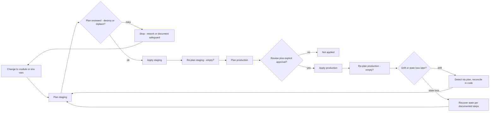
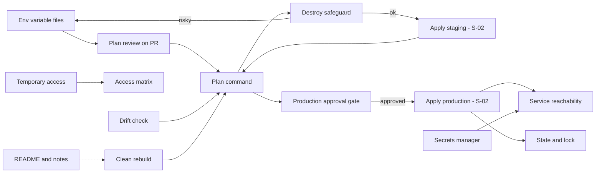

# Assignment 02 — Product Brief: What You Are Building

**v0.2 DRAFT — 2026-11-23** · Added features, interfaces, configuration. Read this first. Then [requirements-and-directives.md](requirements-and-directives.md) for the rules, and [developer-guide.md](developer-guide.md) for the build path.

## 1. Product in one view

| WH | Answer |
|---|---|
| What | **An environment platform as code**: one reusable module that provisions staging and production for a small sample service, with secrets injection and least-privilege identities |
| Why | Hand-built or copy-pasted environments drift, leak secrets, grant admin access by default and cannot be rebuilt after a loss. The team wants repeatable, reviewable infrastructure |
| Who | Platform or DevOps engineer (writes and applies), change approver (reviews plans, approves production), CI pipeline (applies as an identity), workload (runs with its own identity), human operator (limited access) |
| Where | The repo, with Terraform or OpenTofu (preferred). Local, container or mocked providers (for example LocalStack). No real cloud account |
| When | On every infrastructure change: plan, review, apply to staging, then production after explicit approval. On rebuild from a clean checkout. On drift or state loss |
| How | One shared module plus per-environment variable files. Plan before apply. Secrets from a manager at runtime. Explicit, scoped policies per identity |
| Success | One documented command sequence rebuilds each environment from clean. A second apply shows an empty plan. No secret appears in code, state examples or logs. No identity has wildcard access without a written reason |

## 2. Personas

| Persona | Goal | Pain today | Needs from the platform |
|---|---|---|---|
| **Platform / DevOps engineer** | Provision and change environments safely | Copy-pasted env code, manual console steps, drift | One module, per-env variables, idempotent apply, clean rebuild |
| **Change approver** (assumption: role name) | Know exactly what will change before it changes | Applies without a reviewed plan, surprise destroys | Readable plan output, explicit approval for production, destroy warnings |
| **CI pipeline identity** | Apply reviewed changes automatically | Broad admin tokens | Its own identity, scoped to the actions it needs |
| **Workload (sample service)** | Run and reach its data store | Shared credentials, secrets baked in | Its own identity, secrets injected at runtime |
| **Human operator / teammate** | Investigate or fix, sometimes in production | Permanent broad production access | Narrower rights in production, temporary access with revocation |

## 3. Main change flow

## 4. Capabilities

| ID | Capability | What it means | Brief section |
|---|---|---|---|
| C1 | Environment separation | Staging and production with different size, change flow and data treatment | A |
| C2 | Shared module | One module, per-environment variable files. No copy-pasted env code | A |
| C3 | Minimum resources | Network or isolation boundary, compute target, data store, identity per workload | A |
| C4 | State management | Documented backend choice and locking behaviour | B |
| C5 | Reproducible rebuild | One documented command sequence rebuilds each env from a clean checkout | B |
| C6 | Idempotent apply | Re-running apply makes no changes. Empty plan shown | B |
| C7 | Secrets handling | Secrets manager (real or simulated), runtime injection, rotation, leak response | C |
| C8 | Least-privilege identities | Pipeline, workload and human operator identities. Explicit actions and resources | D |
| C9 | Change safety | Plan review, drift handling, destroy safeguards, rollback | E, Part 2 |
| C10 | Cost awareness | Tagged resources, documented cost assumptions, no unbounded or paid resources | E, Part 2 |
| C11 | Extensibility | Adding a third environment or a new scoped identity is a small change | F |

## 5. Product features

Priority: **Must** = required for submission. **Should** = expected for a strong score. **Could** = optional extra.

| ID | Feature | Capability | Priority |
|---|---|---|---|
| F-01 | One shared module used by staging and production | C2 | Must |
| F-02 | Per-environment variable files. No duplicated resource code | C1, C2 | Must |
| F-03 | Production larger or replicated through variables only. Staging minimal | C1 | Must |
| F-04 | Network or isolation boundary per environment | C3 | Must |
| F-05 | Compute target for the sample service | C3 | Must |
| F-06 | Data store per environment | C3 | Must |
| F-07 | Workload identity per environment | C3, C8 | Must |
| F-08 | Documented state backend and locking. State files not committed | C4 | Must |
| F-09 | One documented command sequence rebuilds each environment from a clean checkout | C5 | Must |
| F-10 | Idempotent apply with an empty re-run plan for both environments | C6 | Must |
| F-11 | Secrets read from a manager (real or simulated) and injected at runtime | C7 | Must |
| F-12 | No secrets in code, state examples, logs or variable defaults | C7 | Must |
| F-13 | Secrets note: source, injection, rotation, leak response | C7 | Must |
| F-14 | Separate pipeline, workload and human operator identities | C8 | Must |
| F-15 | Policies with explicit actions and resources. No wildcards without a written reason | C8 | Must |
| F-16 | Human operator rights narrower in production than in staging | C8 | Must |
| F-17 | Access matrix: identity, purpose, permissions, environment | C8 | Must |
| F-18 | Temporary production access with documented grant and revoke (may be simulated) | C8 | Should |
| F-19 | Plan before every apply. Production apply needs explicit approval | C9 | Must |
| F-20 | Warning and safeguard on destroy or replace changes | C9 | Must |
| F-21 | Drift detected through plan and reconciled in code | C9 | Should |
| F-22 | Documented recovery from lost or corrupted state | C4, C9 | Should |
| F-23 | Resources tagged. Cost assumptions and cap approach documented | C10 | Must |
| F-24 | Add a third environment or a new scoped identity with a small change, plan shown first | C11 | Should |
| F-25 | Plan run by the CI pipeline identity on each change (assumption) | C8, C9 | Could |

## 6. Interfaces

| ID | Interface | Purpose | Key elements | States | Users | Stories | Sample |
|---|---|---|---|---|---|---|---|
| S-01 | Plan command (per environment) | See exactly what will change | Resources to add, change, destroy, replace. Summary counts. Target environment | running, no changes, changes pending, destroy or replace flagged, error | platform engineer, change approver | US-06, 12, 13 | [view](samples/screens/S-01-plan-command.svg) |
| S-02 | Apply command (per environment) | Make the reviewed change | Reviewed plan, confirmation prompt, output per resource | awaiting confirmation, applying, applied, failed, blocked by lock | platform engineer, CI pipeline identity | US-05, 06, 12 | [view](samples/screens/S-02-apply-command.svg) |
| S-03 | Clean rebuild sequence | Rebuild an environment from a clean checkout | Documented ordered commands (init, plan, apply). Wrapper script or Makefile: Candidate decides and documents | running, succeeded, failed | platform engineer | US-05 | [view](samples/screens/S-03-clean-rebuild.svg) |
| S-04 | Plan review on PR (assumption) | Review plan output before merge | Plan output per environment attached to the change, reviewer comments | running, passed, failed, awaiting review | change approver, platform engineer | US-12 | [view](samples/screens/S-04-plan-review-pr.svg) |
| S-05 | Production approval gate | Explicitly approve a production apply | Production plan, destroy warnings, approve and reject actions, approver | awaiting approval, approved, rejected | change approver | US-03, 12 | [view](samples/screens/S-05-production-approval-gate.svg) |
| S-06 | Destroy safeguard | Stop surprise destroys | Warning in plan, protection on critical resources (for example the data store) (assumption) | allowed, blocked, overridden with documented reason | change approver, platform engineer | US-12 | [view](samples/screens/S-06-destroy-safeguard.svg) |
| S-07 | State backend and lock | Keep state safe from concurrent writes | Backend location, lock holder, unlock procedure | unlocked, locked, stale lock, lost or corrupted | platform engineer | US-04 | [view](samples/screens/S-07-state-backend-lock.svg) |
| S-08 | Secrets manager (real or simulated) | Store, read and rotate secrets | Secret names, versions, read by workload, rotate and revoke steps | present, rotated, revoked | workload, platform engineer | US-07, 08 | [view](samples/screens/S-08-secrets-manager.svg) |
| S-09 | Temporary access grant and revoke | Give an operator time-bound production access | Request, grant step, expiry, revoke step (may be simulated) | requested, granted, expired, revoked | human operator, change approver | US-11 | [view](samples/screens/S-09-temporary-access.svg) |
| S-10 | Per-environment variable files | Set size and settings per environment | Instance size or count, replicas, tags. No secret values | changed in PR, reviewed, applied | platform engineer, change approver | US-01, 03, 15 | [view](samples/screens/S-10-env-variable-files.svg) |
| S-11 | Drift check | Surface console changes | Plan against live resources, diff list | no drift, drift detected | platform engineer | US-13 | [view](samples/screens/S-11-drift-check.svg) |
| S-12 | Sample service reachability check (assumption) | Confirm the workload runs after apply | Call to the service on its compute target | reachable, unreachable | platform engineer | US-02 | [view](samples/screens/S-12-service-reachability.svg) |
| S-13 | Access matrix | Audit who can do what | Identity, purpose, permissions, environment, wildcard reasons | draft, reviewed | change approver, reviewers | US-09, 10 | [view](samples/screens/S-13-access-matrix.svg) |
| S-14 | README, design note and cost note | Explain state, rebuild, cost and scenarios | Diagram, state strategy, rebuild steps, cost assumptions, scenario answers (section E) | draft, submitted | all, reviewers | US-04, 05, 14 | [view](samples/screens/S-14-readme-design-cost-note.svg) |

## 7. Configuration

| Setting | Scope | Default | Who can change | Where | Effect |
|---|---|---|---|---|---|
| Environment list | Repo | Staging, production | Platform engineer, via reviewed PR | Environment folders or variable files | Which environments exist. A third is a small change |
| Environment size | Per environment | Staging minimal. Production larger or replicated | Platform engineer, reviewed by change approver | Per-environment variable files | Resource count and size |
| State backend and locking | Per environment | Candidate decides and documents | Platform engineer | Backend config | Where state lives and how concurrent writes are blocked |
| State file location | Repo | Outside the repo, ignored by git | Platform engineer | Backend config, `.gitignore` | No state committed |
| Production approval requirement | Production | Required, explicit | Change approver | CI environment protection or documented manual step | Production apply waits for approval |
| Destroy safeguard | Critical resources | On for the data store (assumption) | Platform engineer, reviewed by change approver | Module lifecycle rules | Destroy or replace is blocked or warned |
| Provider endpoints | Per environment | Local or mocked (for example LocalStack) | Platform engineer | Provider config, environment variables | No real cloud account used |
| Tool and provider versions | Repo | Pinned (assumption) | Platform engineer | Version constraints, lock file | Same plan on every machine |
| Secret source | Per environment | Secrets manager (real or simulated) | Platform engineer | Module config | Where the workload reads secrets at runtime |
| Secret rotation interval | Per secret | Candidate decides and documents | Platform engineer | Secrets note | How often secrets change |
| Identity policies | Per identity | Explicit actions and resources. No wildcards without a written reason | Platform engineer, reviewed by change approver | Policy files in the module | What each identity can do |
| Human operator production rights | Production | Narrower than staging | Change approver | Policy files | Limits standing production access |
| Temporary access duration | Production | Candidate decides and documents | Change approver | Access procedure (may be simulated) | When a grant expires |
| Resource tags | All resources | Candidate decides and documents the keys | Platform engineer | Module default tags | Ownership and cost tracking |
| Cost cap approach | Per environment | Candidate decides and documents | Platform engineer | Cost note | Spend stays bounded. No paid resources |
| Drift check frequency | Per environment | Candidate decides and documents | Platform engineer | Pipeline schedule or manual plan | How fast console changes are found |
| Local credentials and env vars | Environment | `.env.example` with placeholders | Developer | Env vars, never committed | Provider and tool auth without leaking secrets |

## 8. User stories and acceptance criteria

Format: **As a** persona, **I want** action, **so that** benefit. Each has checkable acceptance criteria (AC).

### Environments and structure

| ID | Story | Acceptance criteria |
|---|---|---|
| US-01 | As a platform engineer, I want staging and production from one module so that they cannot silently diverge | One shared module. Per-env variable files only. No duplicated resource code between envs |
| US-02 | As a platform engineer, I want each environment to have the minimum resource set so that the sample service can run | Isolation boundary, compute target, data store and a workload identity exist in both envs |
| US-03 | As a change approver, I want production sized differently only through variables so that the difference is visible and reviewable | Production is larger or replicated via variables. Staging minimal. Same module code |

### State and reproducibility

| ID | Story | Acceptance criteria |
|---|---|---|
| US-04 | As a platform engineer, I want a documented state backend so that two people cannot corrupt state | Backend choice and locking behaviour documented. State files not committed |
| US-05 | As a platform engineer, I want to rebuild an environment from a clean checkout so that loss is recoverable | One documented command sequence per env. Works live in the discussion |
| US-06 | As a change approver, I want a re-run to show no changes so that I trust apply is idempotent | Second plan after apply is empty. Output submitted for both envs |

### Secrets

| ID | Story | Acceptance criteria |
|---|---|---|
| US-07 | As a workload, I want secrets injected at runtime so that nothing sensitive lives in code | Secret read from a manager (real or simulated). None in code, state examples, logs or variable defaults |
| US-08 | As a platform engineer, I want a rotation and leak procedure so that a leaked secret is contained | Secrets note covers source, injection, rotation and leak response steps |

### Access

| ID | Story | Acceptance criteria |
|---|---|---|
| US-09 | As a platform engineer, I want a separate identity for pipeline, workload and human operator so that each has only what it needs | Three identities defined. Access matrix lists identity, purpose, permissions, environment |
| US-10 | As a change approver, I want policies to list explicit actions and resources so that access is auditable | No wildcards without a written reason. Human rights in production narrower than in staging |
| US-11 | As a human operator, I want temporary production access so that I can fix an issue without permanent risk | Grant and revoke steps documented (scenario answer). Revocation path stated (assumption: may be simulated) |

### Change safety and cost

| ID | Story | Acceptance criteria |
|---|---|---|
| US-12 | As a change approver, I want to review a plan before every apply so that destroys are never a surprise | Plan shown before apply. Production needs explicit approval. Destroy or replace changes carry a warning and a safeguard |
| US-13 | As a platform engineer, I want drift detected so that console changes do not persist unnoticed | Drift detection and handling described. Plan used to surface the difference |
| US-14 | As a platform engineer, I want resources tagged and cost assumptions written so that spend is bounded | Tags applied. Cost assumptions and cap approach documented. No paid or unbounded resources |
| US-15 | As a platform engineer, I want to add an environment or identity cheaply so that the platform scales | Third env or new scoped identity added with small change. Plan shown before apply |

## 9. Traceability

| Capability | Stories | Tests or checks you should provide |
|---|---|---|
| C1–C3 | US-01, 02, 03 | Staging and production plans. Module reused |
| C4 | US-04 | Backend and locking note. No state in repo |
| C5–C6 | US-05, 06 | Clean rebuild. Empty re-run plan |
| C7 | US-07, 08 | Secret scan of repo and state examples. Secrets note |
| C8 | US-09, 10, 11 | Access matrix. Policy review for wildcards |
| C9 | US-12, 13 | Risky plan walkthrough. Drift answer |
| C10 | US-14 | Tags in plan. Cost note |
| C11 | US-15 | Live third env or new identity plan |

## 10. Out of scope

- Real cloud accounts, keys or paid resources
- Application features of the sample service
- Manual console provisioning
- Production-grade multi-region or high-availability design (describe only if asked) (assumption)
