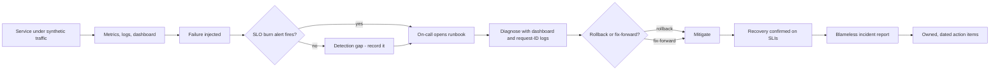
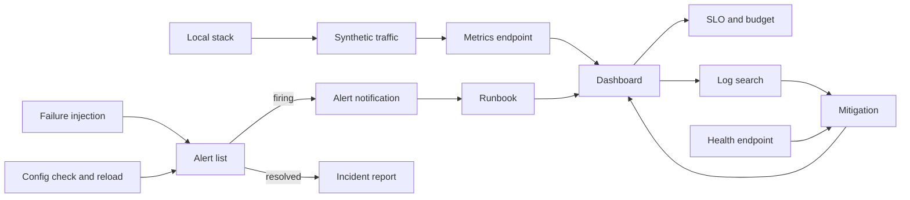

# Assignment 03 — Product Brief: What You Are Building

**v0.2 DRAFT — 2026-11-23** · Added features, interfaces, configuration. Read this first. Then [requirements-and-directives.md](requirements-and-directives.md) for the rules, and [developer-guide.md](developer-guide.md) for the build path.

## 1. Product in one view

| WH | Answer |
|---|---|
| What | **An observability and incident kit** for a small sample service: metrics, structured logs, one dashboard, SLOs, symptom alerts, a runbook and a blameless report of a simulated failure |
| Why | Without telemetry and SLOs the team learns about outages from users, alerts are noisy, and the same failure repeats. The team wants to detect, diagnose and learn |
| Who | On-call engineer (responds), SRE or service owner (sets SLOs and alerts), developer or release owner (decides rollback or fix-forward), incident reviewers (read the report) |
| Where | Runs locally. Prometheus, Grafana and a log aggregator via Docker Compose suggested. Config, dashboards and rules in the repo |
| When | Continuously during operation. Alerts fire when users feel pain. Runbook used at incident time. Report written after recovery |
| How | Instrument the four signals, define SLIs with error budgets, alert on burn rate, link every alert to a runbook, inject a failure and run the response end to end |
| Success | The injected failure fires an alert, telemetry shows the cause, the runbook leads to mitigation, and the report has owned, dated actions. The dashboard reads in 30 seconds |

## 2. Personas

| Persona | Goal | Pain today | Needs from the kit |
|---|---|---|---|
| **On-call engineer** | Know fast if users are hurt and what to do | Paged for causes that do not matter, no runbook at 3 a.m. | Symptom alerts with severity, owner and runbook link. 30-second dashboard |
| **SRE / service owner** | Set reliability targets and protect them | Targets with no reasoning, alert fatigue | SLIs, targets, window, error budget, burn-rate alert, noise controls |
| **Developer / release owner** (assumption: role name) | Decide rollback or fix-forward | No data to decide on | Request-ID logs, latency and error breakdown, deploy context |
| **Incident reviewer** (assumption: role) | Learn without blame and track follow-ups | Vague actions, blame language | Blameless report with timeline, root cause, detection gap, owned and dated actions |

## 3. Main incident flow

## 4. Capabilities

| ID | Capability | What it means | Brief section |
|---|---|---|---|
| C1 | Metrics | Request rate, error rate, latency percentiles, saturation of one resource | A |
| C2 | Structured logs | Request ID and severity on every line. No personal or secret data | A |
| C3 | On-call dashboard | One view readable in 30 seconds. Exported as code | A, Part 2 |
| C4 | SLOs and error budget | 2+ SLIs with targets and window. Budget calculation. Policy when nearly spent | B |
| C5 | Symptom alerting | Severity, owner, runbook link, reason. Burn-rate or multi-window on at least one. Noise controls | C |
| C6 | Runbook | Impact, first checks, likely causes, mitigation, rollback, escalation | D |
| C7 | Failure injection | One realistic, reproducible failure, clearly described | E |
| C8 | Incident report | Blameless timeline, impact, root cause, detection gap, went well or badly, owned actions | E |
| C9 | Extensibility | New alert and SLO for a new endpoint is a small change | G |

## 5. Product features

Priority: **Must** = required for submission. **Should** = expected for a strong score. **Could** = optional extra.

| ID | Feature | Capability | Priority |
|---|---|---|---|
| F-01 | Request rate metric | C1 | Must |
| F-02 | Error rate metric | C1 | Must |
| F-03 | Latency percentiles (for example p50, p95, p99) (assumption: which percentiles) | C1 | Must |
| F-04 | Saturation of one resource | C1 | Must |
| F-05 | Structured logs with request ID and severity on every line | C2 | Must |
| F-06 | No personal or secret data in logs | C2 | Must |
| F-07 | Logs searchable in the aggregator | C2 | Must |
| F-08 | One on-call dashboard readable in 30 seconds, only used panels | C3 | Must |
| F-09 | Dashboard exported as code in the repo | C3 | Must |
| F-10 | Deploy context shown alongside telemetry (assumption: for example dashboard annotations) | C3 | Could |
| F-11 | At least two SLIs with targets, window and reasoning | C4 | Must |
| F-12 | Error budget formula and remaining budget visible | C4 | Must |
| F-13 | Stated policy when the budget is nearly spent | C4 | Must |
| F-14 | Symptom alerts with severity, owner, runbook link and reason | C5 | Must |
| F-15 | At least one burn-rate or multi-window alert, or a justified simpler rule | C5 | Must |
| F-16 | Documented noise and flapping controls | C5 | Must |
| F-17 | Alert rules exported as code | C5 | Must |
| F-18 | Alert notification delivered to a local receiver (assumption) | C5 | Should |
| F-19 | Runbook for the main alert: impact, first checks, likely causes, mitigation, rollback, escalation | C6 | Must |
| F-20 | Synthetic traffic against the sample service | C7 | Must |
| F-21 | One realistic, reproducible failure injection with a stated trigger | C7 | Must |
| F-22 | Rollback or fix-forward criteria, applied in the incident | C6, C7 | Must |
| F-23 | Blameless incident report: timeline, impact, root cause, detection gap, went well and badly | C8 | Must |
| F-24 | Every action item has an owner and a due date | C8 | Must |
| F-25 | New endpoint SLO and alert added through config, reviewed before apply | C9 | Should |

## 6. Interfaces

| ID | Interface | Purpose | Key elements | States | Users | Stories | Sample |
|---|---|---|---|---|---|---|---|
| S-01 | On-call dashboard | Judge service health in 30 seconds | Rate, errors, latency percentiles, saturation, SLO and budget panels | loading, healthy, degraded, no data | on-call engineer, SRE | US-01, 03, 11 | [view](samples/screens/S-01-on-call-dashboard.svg) |
| S-02 | SLO and error budget view | See how much risk remains | Each SLI, target, window, budget remaining, burn rate | within budget, nearly spent, exhausted | SRE, release owner | US-04, 05 | [view](samples/screens/S-02-slo-error-budget.svg) |
| S-03 | Alert list (rule evaluator or alert manager UI) | See which alerts are active | Alert name, severity, labels, active since | inactive, pending, firing, resolved, silenced | on-call engineer, SRE | US-06, 07, 08 | [view](samples/screens/S-03-alert-list.svg) |
| S-04 | Alert notification | Tell on-call that users are hurt | Severity, owner, summary, reason, runbook link. Receiver: Candidate decides and documents | firing, resolved | on-call engineer | US-06, 10 | [view](samples/screens/S-04-alert-notification.svg) |
| S-05 | Runbook page | Act at 3 a.m. | Impact, first checks, likely causes, mitigation, rollback, escalation | draft, reviewed | on-call engineer | US-09 | [view](samples/screens/S-05-runbook-page.svg) |
| S-06 | Log search (aggregator) | Trace one failing request | Query by request ID and severity, time range, matching lines | no results, results | developer, on-call engineer | US-02, 11 | [view](samples/screens/S-06-log-search.svg) |
| S-07 | Service metrics endpoint and scrape target | Expose signals for collection | Metrics endpoint, scrape target status | up, down | SRE | US-01 | [view](samples/screens/S-07-metrics-endpoint-scrape.svg) |
| S-08 | Service health endpoint (assumption) | Quick liveness check during diagnosis | Status response | healthy, unhealthy, unreachable | on-call engineer | US-11 | [view](samples/screens/S-08-health-endpoint.svg) |
| S-09 | Synthetic traffic command | Generate load for signals | Start and stop, request rate. Tool: Candidate decides and documents | running, stopped | SRE | US-10 | [view](samples/screens/S-09-synthetic-traffic.svg) |
| S-10 | Failure injection command or toggle | Trigger the simulated failure reproducibly | Failure type, on and off, stated trigger method | off, injected, cleared | SRE, interviewer | US-10, 15 | [view](samples/screens/S-10-failure-injection.svg) |
| S-11 | Mitigation commands (rollback or fix-forward) | Recover the SLIs | Chosen action, output, time to recover | running, succeeded, failed | on-call engineer, release owner | US-11, 12 | [view](samples/screens/S-11-mitigation-commands.svg) |
| S-12 | Config check and reload | Review and apply rule or dashboard changes safely | Rule validation output, diff, reload result | valid, invalid, reloaded | SRE | US-07, 15 | [view](samples/screens/S-12-config-check-reload.svg) |
| S-13 | Incident report | Learn and track follow-ups | Timeline, impact, root cause, detection gap, went well and badly, owned and dated actions | draft, final | incident reviewer | US-13, 14 | [view](samples/screens/S-13-incident-report.svg) |
| S-14 | Local stack commands | Start and stop the kit from the repo | Docker Compose up and down, documented setup steps | running, stopped, failed | all | US-03, 07 | [view](samples/screens/S-14-local-stack-commands.svg) |

## 7. Configuration

| Setting | Scope | Default | Who can change | Where | Effect |
|---|---|---|---|---|---|
| SLI definitions | Service | At least two (for example availability and latency) | SRE or service owner | SLO document, recording rules | What reliability means |
| SLO targets | Per SLI | Candidate decides and documents, with reasoning | SRE or service owner | SLO document, rules as code | Error budget size |
| SLO window | Per SLI | Candidate decides and documents | SRE or service owner | SLO document, rules as code | Period the budget is measured over |
| Budget policy | Service | Candidate decides and documents | SRE or service owner | SLO document | What happens when the budget is nearly spent |
| Burn-rate thresholds and windows | Per burn-rate alert | Candidate decides and documents | SRE | Alert rules as code | How fast and slow budget loss is caught |
| Alert threshold and for-duration | Per alert | Candidate decides and documents | SRE, via reviewed change | Alert rules as code | When an alert moves from pending to firing |
| Grouping and repeat interval | Receiver | Candidate decides and documents | SRE | Alert manager config | Noise and flapping control |
| Severity levels | All alerts | Candidate decides and documents | SRE | Alert labels | How urgent a page is |
| Owner and runbook link | Per alert | Required. No default | SRE | Alert labels and annotations | Every page has an owner and next step |
| Notification receiver | Environment | Local receiver (assumption) | SRE | Alert manager config | Where alerts are delivered |
| Latency percentiles | Service | p50, p95, p99 (assumption, per US-01) | SRE | Metrics and dashboard config | Which latency views exist |
| Saturation resource | Service | Candidate decides and documents (one resource) | SRE | Instrumentation code | Capacity signal |
| Scrape interval | Metrics collector | Candidate decides and documents | SRE | Collector config | Signal freshness versus cost |
| Metrics and log retention | Local stack | Tool defaults (assumption) | SRE | Collector and aggregator config | Storage cost. Capping is a scenario answer only |
| Log level | Service | Candidate decides and documents | Developer | Environment variable | Log volume and detail |
| Log redaction | Service | No personal or secret fields. Method: Candidate decides and documents | Developer | Logging code | Logs stay safe to search |
| Failure injection toggle | Service | Off (assumption) | SRE | Environment variable, flag or script | Turns the simulated failure on and off |
| Synthetic traffic rate | Traffic generator | Candidate decides and documents | SRE | Script or config | Enough traffic for alerts to evaluate |
| Dashboard definition | Repo | Exported as code. Hand edits re-exported | SRE | Dashboard files in repo | Dashboard is reproducible |
| Stack credentials and env vars | Environment | `.env.example` with placeholders | Developer | Env vars, never committed | Local tool logins without leaking secrets |

## 8. User stories and acceptance criteria

Format: **As a** persona, **I want** action, **so that** benefit. Each has checkable acceptance criteria (AC).

### Signals

| ID | Story | Acceptance criteria |
|---|---|---|
| US-01 | As an on-call engineer, I want rate, errors, latency and saturation metrics so that I see user impact and capacity | All four exposed and scraped. Latency shown as percentiles (for example p50, p95, p99) (assumption: which percentiles) |
| US-02 | As a developer, I want structured logs with request IDs so that I can trace one failing request | Every log line has request ID and severity. Logs searchable in the aggregator. No personal or secret data |
| US-03 | As an on-call engineer, I want one focused dashboard so that I judge health in 30 seconds | Single view. Only panels that are used. Exported as code in the repo |

### SLOs and alerts

| ID | Story | Acceptance criteria |
|---|---|---|
| US-04 | As an SRE, I want at least two SLIs with targets and a window so that reliability has a shared definition | For example availability and latency. Target and window stated with reasoning |
| US-05 | As an SRE, I want the error budget shown so that the team knows how much risk remains | Budget formula documented. Remaining budget visible. Action when nearly spent stated |
| US-06 | As an on-call engineer, I want alerts only on symptoms users feel so that every page matters | No cause-only alerts without reason. Each alert has severity, owner, runbook link and stated reason |
| US-07 | As an SRE, I want a burn-rate or multi-window alert so that fast and slow budget loss are both caught | At least one burn-rate or multi-window rule, or a justified simpler rule. Rules exported as code |
| US-08 | As an on-call engineer, I want noisy and flapping alerts prevented so that I trust the pager | Noise controls documented (for example for-duration, grouping, hysteresis) (assumption: technique examples) |

### Response

| ID | Story | Acceptance criteria |
|---|---|---|
| US-09 | As an on-call engineer, I want a runbook for the main alert so that I can act at 3 a.m. | Impact, first checks, likely causes, mitigation, rollback, escalation. Followable by someone new |
| US-10 | As an SRE, I want to inject a realistic failure so that detection is proven, not assumed | One failure (slow dependency, bad deploy, memory leak or exhausted pool). Trigger method stated. Alert fires (evidence) |
| US-11 | As an on-call engineer, I want to diagnose with my telemetry so that mitigation targets the real cause | Evidence shows the path from alert to dashboard to logs to cause. Mitigation recovers the SLIs |
| US-12 | As a release owner, I want a rule for rollback vs fix-forward so that the decision is quick | Criteria written in scenario answers (section F) and applied in the incident |

### Learning

| ID | Story | Acceptance criteria |
|---|---|---|
| US-13 | As an incident reviewer, I want a blameless report so that the team learns without fear | Timeline, impact, root cause, detection gap, what went well and badly. No individuals named or blamed |
| US-14 | As an incident reviewer, I want each action owned and dated so that follow-ups happen | Every action item has an owner and due date. No vague items |
| US-15 | As an SRE, I want a new endpoint's alert and SLO to be a small change so that coverage grows safely | New SLO and alert added via config. Signal, firing alert and runbook step shown. Change reviewed before apply |

## 9. Traceability

| Capability | Stories | Tests or checks you should provide |
|---|---|---|
| C1 | US-01 | Metrics endpoint and query output |
| C2 | US-02 | Sample log lines with request ID. No PII or secret check |
| C3 | US-03 | Exported dashboard JSON or equivalent |
| C4 | US-04, 05 | SLO document with budget calculation |
| C5 | US-06, 07, 08 | Alert rules as code. Firing evidence |
| C6 | US-09 | Runbook linked from the alert |
| C7 | US-10, 11, 12 | Injection script or steps. Detection, diagnosis, recovery evidence |
| C8 | US-13, 14 | Incident report review |
| C9 | US-15 | Live new alert or injected failure |

## 10. Out of scope

- Real accounts, paid monitoring services or real user data
- Alerting on every metric or cause
- Production-scale storage, retention or multi-cluster telemetry (answer cost capping as a scenario only)
- Building application features beyond what the sample service needs to emit signals
