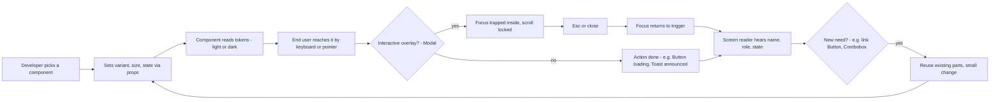
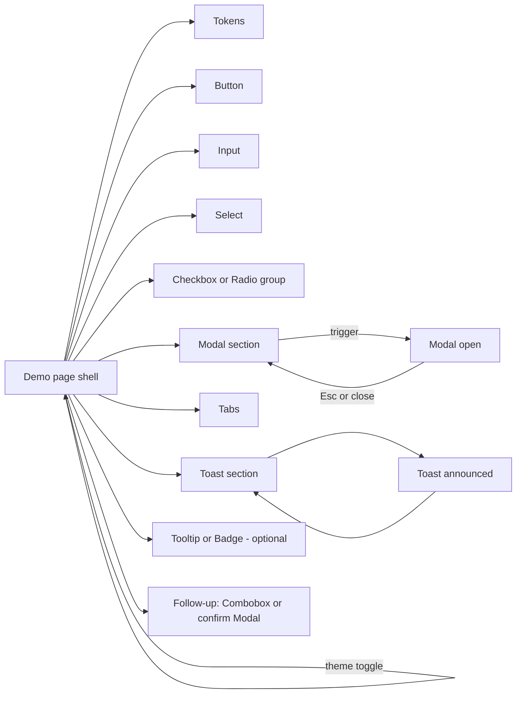

# Assignment 01 — Product Brief: What You Are Building

**v0.2 DRAFT — 2026-11-23** · Added features, screens, configuration. Read this first. Then [requirements-and-directives.md](requirements-and-directives.md) for the rules, and [developer-guide.md](developer-guide.md) for the build path.

## 1. Product in one view

| WH | Answer |
|---|---|
| What | **A small accessible component library**: 6–8 reusable UI components (Button, Input, Select, Modal, Tabs, Toast, Checkbox or Radio group, optional Tooltip or Badge), driven by design tokens, with a demo page |
| Why | Product teams rebuild the same controls again and again, often with broken keyboard support, missing labels and hard-coded colours. One shared, tested library fixes this once |
| Who | Consuming developers (build screens with it), keyboard users and screen reader users (depend on it), the reviewer (checks every state on the demo page) |
| Where | Runs locally in the browser. No backend. Works at 320 px width and at 200% zoom |
| When | Used whenever a product developer builds a screen. The demo page is used during review |
| How | Semantic HTML first, ARIA only to fill gaps. Colours, spacing, radius, type and focus ring come from tokens. Light and dark themes swap tokens only |
| Success | Every component works by keyboard alone with a visible focus ring. Screen readers announce the right name, role and state. A theme switch needs no component change. A new variant touches few files |

## 2. Personas

| Persona | Goal | Pain today | Needs from the library |
|---|---|---|---|
| **Consuming developer** | Build product screens fast and correctly | Each team writes its own button and modal. Bugs repeat. One-off props everywhere | Small, consistent props API (variant, size, disabled). Ref and native attribute forwarding. Docs and a demo of every state |
| **Keyboard user** | Use every control without a mouse | Focus gets lost in modals. No visible focus. Tabs only work by click | Full keyboard model, visible focus ring, focus returned to the trigger |
| **Screen reader user** | Understand what each control is and what changed | Unlabelled inputs. Errors not linked. Toasts never announced | Correct roles and names, errors linked by `aria-describedby`, live region announcements |
| **Low-vision or motion-sensitive user** | Read and use the UI comfortably | Low contrast, colour-only meaning, animations that cannot be turned off | Contrast at least 4.5:1, text or icon besides colour, respects `prefers-reduced-motion`, works at 200% zoom |
| **Reviewer (interviewer)** | Check behaviour quickly | Has to hunt for states | Demo page or Storybook showing every component in every state, with a theme toggle |

## 3. Main journey

## 4. Capabilities

| ID | Capability | What it means | Brief section |
|---|---|---|---|
| C1 | Design tokens and theming | Colour, spacing, radius, type, focus ring defined once. Light and dark by swapping tokens only. No hard-coded values in components | B |
| C2 | Button | primary, secondary, danger, ghost. default, hover, focus, disabled, loading. No double submit while loading. Can render as a link | A, D |
| C3 | Form fields | Input with label, hint, error linked by `aria-describedby`. Select (native, or custom with full listbox keyboard pattern). Checkbox or Radio group with group label | A |
| C4 | Modal dialog | Focus trap, Esc closes, focus returns to trigger, scroll lock | A, D |
| C5 | Tabs | Arrow keys, Home / End, roving tabindex, correct roles. No layout jump between panels of different heights | A, D |
| C6 | Toast | Announced via live region, dismissible, auto-dismiss that can be paused | A, D |
| C7 | Accessibility baseline | Keyboard for everything, visible focus, contrast 4.5:1, no colour-only meaning, reduced motion, 320 px and 200% zoom | C |
| C8 | Consumer API | Small consistent props. Forward refs and native attributes. Extensible without a prop per one-off need | Part 2 |
| C9 | Demo and tests | Demo page or Storybook with every state and theme toggle. Behaviour tests and an automated a11y check | E |
| C10 | Extensibility | Combobox with async suggestions or destructive confirm modal built by reusing parts | F |

## 5. Product features

Priority: **Must** = required for submission. **Should** = expected for a strong score. **Could** = optional extra.

| ID | Feature | Capability | Priority |
|---|---|---|---|
| F-01 | Tokens for colour, spacing, radius, type and focus ring, defined once | C1 | Must |
| F-02 | Light and dark themes by swapping tokens only, with a theme toggle | C1 | Must |
| F-03 | Button: primary, secondary, danger, ghost. default, hover, focus, disabled, loading | C2 | Must |
| F-04 | Loading Button ignores repeat clicks and Enter / Space | C2 | Must |
| F-05 | Button that renders as a link with link semantics | C2, C8 | Must |
| F-06 | Input with label, hint and error linked by `aria-describedby`. Error and disabled states | C3 | Must |
| F-07 | Select, native or custom with full listbox keyboard pattern | C3 | Must |
| F-08 | Checkbox or Radio group with group label, checked and disabled states | C3 | Must |
| F-09 | Modal: focus trap, Esc closes, focus returns to trigger, scroll lock | C4 | Must |
| F-10 | Tabs: arrow keys, Home / End, roving tabindex, correct roles | C5 | Must |
| F-11 | Tabs with no layout jump between short and tall panels | C5 | Must |
| F-12 | Toast: live region, dismissible, auto-dismiss that can be paused | C6 | Must |
| F-13 | Visible focus ring, contrast at least 4.5:1, no colour-only meaning | C7 | Must |
| F-14 | Respects `prefers-reduced-motion` | C7 | Must |
| F-15 | Usable at 320 px width and 200% zoom | C7 | Must |
| F-16 | Small consistent props (variant, size, disabled). Ref and native attribute forwarding | C8 | Must |
| F-17 | Tooltip or Badge, not colour-only, reachable by keyboard | C7 | Could |
| F-18 | Demo page or Storybook with every component in every state, plus theme toggle | C9 | Must |
| F-19 | At least eight behaviour tests (keyboard, ARIA, focus) and one automated a11y check | C9 | Must |
| F-20 | Design system notes in `docs/design-system.md` | C1, C9 | Must |
| F-21 | Combobox with async suggestions or destructive confirm modal, reusing existing parts | C10 | Could (live follow-up) |

## 6. Screens

The product is a library, so its "screens" are the demo page and its sections. Each section shows one component in every variant and state.

| ID | Screen / view | Purpose | Key elements | States | Users | Stories | Sample |
|---|---|---|---|---|---|---|---|
| S-01 | Demo page shell | Entry point for review | Page heading, list of component sections with in-page links (assumption), theme toggle | light, dark | reviewer, all | US-02, 14 | [view](samples/screens/S-01-demo-page-shell.svg) |
| S-02 | Tokens section | Show the token set | Colour, spacing, radius, type and focus ring samples (assumption: form of display is yours) | light, dark | consuming developer, reviewer | US-01, 02 | [view](samples/screens/S-02-tokens.svg) |
| S-03 | Button section | Show every Button variant and state | primary, secondary, danger, ghost. Link-rendered Button. Loading demo with click handler | default, hover, focus, disabled, loading | consuming developer, keyboard user, screen reader user | US-03, 04, 05 | [view](samples/screens/S-03-button.svg) |
| S-04 | Input section | Show field labelling | Label, hint, error text, disabled example | default, focus, error, disabled | screen reader user, keyboard user | US-06 | [view](samples/screens/S-04-input.svg) |
| S-05 | Select section | Show choosing from a list | Native or custom Select with label | closed, open (custom only), selected, disabled | keyboard user, screen reader user | US-07 | [view](samples/screens/S-05-select.svg) |
| S-06 | Checkbox or Radio group section | Show group choices | Group label, options | unchecked, checked, disabled | keyboard user, screen reader user | US-07 | [view](samples/screens/S-06-checkbox-radio-group.svg) |
| S-07 | Modal section | Show focus management | Trigger Button, dialog with title, content, close control | closed, open (focus inside, scroll locked), closed (focus back on trigger) | keyboard user, screen reader user | US-08 | [view](samples/screens/S-07-modal.svg) |
| S-08 | Tabs section | Show tab keyboard model and stable layout | Tablist, one short and one tall panel | active, focused, switching panel | keyboard user, screen reader user | US-09, 10 | [view](samples/screens/S-08-tabs.svg) |
| S-09 | Toast section | Show announcements while typing | Input to type in, trigger, toast with close control | hidden, shown, paused, dismissed | screen reader user, slow reader | US-11, 12 | [view](samples/screens/S-09-toast.svg) |
| S-10 | Tooltip or Badge section (optional) | Show non-colour status or hint | Badge text or icon, Tooltip on focus and hover | hidden, shown | keyboard user, low-vision user | US-13 | [view](samples/screens/S-10-tooltip-badge.svg) |
| S-11 | Narrow and zoomed view | Check reflow | Whole demo at 320 px and 200% zoom, reduced motion on | 320 px, 200% zoom, reduced motion | low-vision or motion-sensitive user | US-12, 13 | [view](samples/screens/S-11-narrow-zoomed-view.svg) |
| S-12 | Follow-up section | Show reuse | Combobox (Input + listbox) or destructive confirm Modal (Modal + danger Button) | Combobox: idle, loading, results, no results (assumption). Confirm: closed, open, confirmed, cancelled | consuming developer, reviewer | US-15 | [view](samples/screens/S-12-follow-up-section.svg) |

## 7. Configuration

| Setting | Scope | Default | Who can change | Where | Effect |
|---|---|---|---|---|---|
| Colour tokens | Library | Shared design system or your own | Developer | Token file (CSS variables or equivalent) | Every component colour, in both themes |
| Spacing, radius, type tokens | Library | Shared design system or your own | Developer | Token file | Sizes and type in every component |
| Focus ring token | Library | Candidate decides and documents | Developer | Token file | Visible focus on every interactive element |
| Theme | Viewer | Light (assumption) | Each user | Theme toggle on demo page | Swaps token values only. No component change |
| Reduced motion | User | Follows OS setting | End user | OS or browser setting (`prefers-reduced-motion`) | Toast and other animations reduced or off |
| Variant, size, disabled | Component instance | Candidate decides and documents | Consuming developer | Props | Look and state of one component |
| Button as link | Component instance | Renders a `<button>` | Consuming developer | Prop such as `as` or `href` (assumption: name is yours) | Renders an `<a>` with link role |
| Toast auto-dismiss time | Toast | Candidate decides and documents | Consuming developer (assumption) | Toast prop or library default | When a toast closes. Pausable |
| Toast politeness | Toast | Candidate decides and documents (polite vs assertive) | Developer | Code, README | How and when a toast is announced |
| Select type | Library | Candidate decides and documents (native vs custom) | Developer | Code, README trade-off | Keyboard pattern the Select must support |
| Contrast minimum | Library | 4.5:1 for body text | Code constant, checked by tests | Tokens, automated a11y check | Text readability in both themes |
| Combobox suggestion source | Follow-up only | Synthetic data. Candidate decides latency (assumption) | Developer | Code | Async suggestion states |
| Env vars and secrets | Environment | None needed. No backend | — | — | Nothing secret is committed |

## 8. User stories and acceptance criteria

Format: **As a** persona, **I want** action, **so that** benefit. Each has checkable acceptance criteria (AC).

### Tokens and theming

| ID | Story | Acceptance criteria |
|---|---|---|
| US-01 | As a consuming developer, I want all visual values to come from tokens so that the brand changes in one place | Colour, spacing, radius, type and focus ring defined once. A search of component code finds no hex values or raw pixel sizes |
| US-02 | As any user, I want light and dark themes so that I can read in my preferred mode | Theme toggle on the demo switches every component. Only token values change. Contrast stays at least 4.5:1 for body text in both |

### Actions and form fields

| ID | Story | Acceptance criteria |
|---|---|---|
| US-03 | As a consuming developer, I want one Button with variants and states so that I do not build my own | primary, secondary, danger, ghost. default, hover, focus, disabled, loading all shown on demo. Native attributes and ref reach the element |
| US-04 | As an end user, I want a loading Button to ignore repeat clicks so that my action is not sent twice | While loading, further clicks or Enter / Space do not fire the handler again. Loading is not shown by colour alone. Loading state exposed to assistive tech, for example `aria-busy` (assumption) |
| US-05 | As a consuming developer, I want a Button that renders as a link so that navigation keeps link semantics | API allows link rendering (for example `as` or `href`) (assumption: exact prop name is your choice). Renders an `<a>` with link role, same visual variants |
| US-06 | As a screen reader user, I want each Input to have its label, hint and error linked so that I hear them on focus | Visible label tied to the input. Hint and error ids in `aria-describedby`. Error state is exposed to assistive tech, for example `aria-invalid` (assumption). Disabled state shown and exposed |
| US-07 | As a keyboard user, I want Select and Checkbox or Radio groups to work without a mouse so that I can complete forms | Native select, or custom with full listbox keyboard pattern (arrows, Home / End, Enter, Esc). Group has a label. Checked and disabled states are exposed to assistive tech |

### Overlays and navigation

| ID | Story | Acceptance criteria |
|---|---|---|
| US-08 | As a keyboard user, I want the Modal to keep focus inside and return it on close so that I never get lost | On open, focus moves inside. Tab and Shift+Tab cycle within. Esc closes. Focus returns to the trigger. Background scroll is locked |
| US-09 | As a keyboard user, I want Tabs that follow the standard pattern so that I can switch panels quickly | Arrow keys move between tabs, Home / End jump to ends. Roving tabindex: only the active tab is in tab order. Correct tablist / tab / tabpanel roles |
| US-10 | As an end user, I want tab panels of different heights not to jump the layout so that the page stays stable | Switching between a short and a tall panel does not shift content above or the tab bar. Approach is documented in README |

### Feedback

| ID | Story | Acceptance criteria |
|---|---|---|
| US-11 | As a screen reader user, I want toasts announced without losing my place so that I hear updates while typing | Toast text goes to a live region. Focus stays in the input being typed in. README states what is announced and when (polite vs assertive) |
| US-12 | As a slow reader, I want to pause or dismiss a toast so that it does not vanish before I read it | Close control reachable by keyboard. Auto-dismiss can be paused, for example on hover and focus (assumption). Animations respect `prefers-reduced-motion` |

### Accessibility baseline and quality

| ID | Story | Acceptance criteria |
|---|---|---|
| US-13 | As a low-vision user, I want the library usable at 320 px and 200% zoom so that I can enlarge the UI | No horizontal scroll or clipped controls at 320 px or 200% zoom. Visible focus ring on every interactive element. No colour-only meaning |
| US-14 | As a reviewer, I want a demo of every component in every state so that I can verify behaviour quickly | Demo page or Storybook lists each component and state, with theme toggle. At least eight behaviour tests (keyboard, ARIA, focus) and one automated a11y check pass |
| US-15 | As a consuming developer, I want new components to reuse existing parts so that additions are small | Combobox with async suggestions or destructive confirm modal can be added by reusing Input, listbox, Modal and Button. README names the files that change for a new variant |

## 9. Traceability

| Capability | Stories | Tests you should write |
|---|---|---|
| C1 | US-01, 02 | Theme switch changes token values. Automated contrast or axe check in both themes |
| C2 | US-03, 04, 05 | Loading Button blocks second click. Link rendering has link role |
| C3 | US-06, 07 | `aria-describedby` links label, hint, error. Select keyboard navigation |
| C4 | US-08 | Focus trap, Esc closes, focus returns to trigger |
| C5 | US-09, 10 | Arrow, Home / End, roving tabindex |
| C6 | US-11, 12 | Live region content. Auto-dismiss pause |
| C7 | US-13 | axe on demo. Manual check at 320 px and 200% zoom |
| C8 | US-03, 05, 15 | Ref and native attribute forwarding |
| C9 | US-14 | Demo covers all states. At least eight behaviour tests |
| C10 | US-15 | Live follow-up change stays small |

## 10. Out of scope

- Backend, mock API or real data (synthetic sample data only, if any)
- A full design system or large UI kit (headless libraries only if you can explain them)
- Pixel-perfect visual polish (secondary to correct behaviour)
- Publishing to a package registry (assumption)
- Components beyond the 6–8 listed, unless asked in the live follow-up
