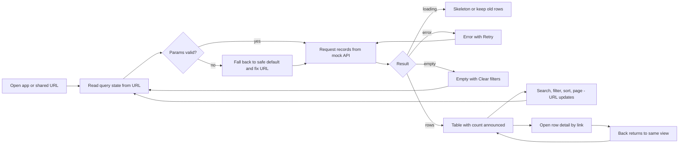
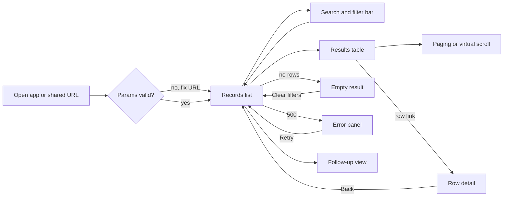

# Assignment 02 — Product Brief: What You Are Building

**v0.2 DRAFT — 2026-11-23** · Added features, screens, configuration. Read this first. Then [requirements-and-directives.md](requirements-and-directives.md) for the rules, and [developer-guide.md](developer-guide.md) for the build path.

## 1. Product in one view

| WH | Answer |
|---|---|
| What | **A records explorer**: a table and search app over a mocked API of 5,000+ synthetic records (suggested: id, name, category, status, owner, amount, updated_at), with search, filters, sort, paging or virtualization, and a row detail view |
| Why | Operators lose time scrolling long lists, cannot share "the view I am looking at", and lose their place on reload. Slow or flaky APIs leave blank screens or wrong results |
| Who | Analyst or operator (searches, narrows, opens records), colleague (opens a shared link), keyboard and screen reader users |
| Where | Browser on desktop or phone (works at 360 px). Runs locally against a mock API (MSW, json-server or similar) |
| When | Daily work sessions: find records, check details, share a view with a teammate |
| How | The URL holds all query state. The mock "server" filters, sorts and pages. The UI handles latency, 500s and empty results, and never lets a stale response win |
| Success | A copied URL reopens the exact same view. Typing fast never floods requests or shows out-of-order results. Every failure has a recovery action. One stated performance budget is met and measured |

## 2. Personas

| Persona | Goal | Pain today | Needs from the app |
|---|---|---|---|
| **Analyst / operator** | Find the right records quickly and inspect one | Long unfiltered lists, slow search, lost place after reload | Debounced search, multi-select filter, sort, paging, detail view, fast interaction |
| **Colleague receiving a link** | See exactly what the sender saw | Links open the default view | Shareable URL that restores search, filters, sort and page. Safe handling of invalid params |
| **Keyboard / screen reader user** | Use filters and read results without a mouse | Div tables, unlabelled controls, silent result changes | Semantic table, labelled controls, live result count |
| **Mobile user** | Check a record on the move | Table overflows, controls unusable | Works at 360 px width |
| **Reviewer (interviewer)** | See state design and performance evidence | Claims without numbers | README with budget, profiler finding, trade-offs |

## 3. Main journey

## 4. Capabilities

| ID | Capability | What it means | Brief section |
|---|---|---|---|
| C1 | Search | Debounced text search. Input stays responsive. No request per keystroke | A, D |
| C2 | Filters | At least two filters, one multi-select. Facet counts optional | A, B |
| C3 | Sort | Sort on at least three columns | A |
| C4 | Paging or virtualization | Server-driven pagination or virtualization, with the choice justified | A, E |
| C5 | Row detail | Drawer or page reachable by its own link | A, B |
| C6 | URL-synced state | Search, filters, sort and page live in the URL. Reload and back / forward restore the view. Invalid params handled | A, D |
| C7 | Mock API | `/records`, `/records/{id}`, optional `/facets`. Server-side filter, sort, page. Simulated latency, random 500s, empty result | B |
| C8 | Resilient UI states | Loading without layout jump, empty with clear-filters, error with retry, partial refresh. Stale responses never overwrite newer ones | C |
| C9 | Accessibility and responsive | Semantic table, labelled controls, live result count, keyboard use, 360 px | D, Part 2 |
| C10 | Performance | One stated budget, measured. Needless re-renders avoided with a before / after finding. Small initial bundle | E |
| C11 | Extensibility | Saved view, column visibility or CSV export of current view as a small change | F |

## 5. Product features

Priority: **Must** = required for submission. **Should** = expected for a strong score. **Could** = optional extra.

| ID | Feature | Capability | Priority |
|---|---|---|---|
| F-01 | Debounced text search with a responsive input | C1 | Must |
| F-02 | Stale requests cancelled or ignored. Only the latest response is shown | C1, C8 | Must |
| F-03 | At least two filters, one multi-select | C2 | Must |
| F-04 | Facet counts from `/facets` | C2, C7 | Could |
| F-05 | Sort on at least three columns, direction shown by text or icon | C3 | Must |
| F-06 | Server-driven paging with total, or virtualization, with the choice justified | C4 | Must |
| F-07 | Valid landing page when the result set shrinks | C4, C6 | Must |
| F-08 | Row detail drawer or page with its own URL | C5 | Must |
| F-09 | Search, filters, sort and page in the URL. Reload and back / forward restore the view | C6 | Must |
| F-10 | Invalid URL params fall back to a safe default and the URL is corrected | C6 | Must |
| F-11 | Mock `/records` and `/records/{id}` with server-side filter, sort and page | C7 | Must |
| F-12 | Seed script for 5,000+ synthetic records | C7 | Must |
| F-13 | Mock simulates latency, random 500s and an empty result | C7 | Must |
| F-14 | Loading without layout jump. Old rows kept during refresh | C8 | Must |
| F-15 | Empty state with Clear filters | C8 | Must |
| F-16 | Error state with Retry | C8 | Must |
| F-17 | Semantic table, labelled controls, keyboard use | C9 | Must |
| F-18 | Result count in a live region | C9 | Must |
| F-19 | Works at 360 px width | C9 | Must |
| F-20 | One stated performance budget, measured, plus one before / after or profiler finding | C10 | Must |
| F-21 | Small initial bundle, lazy-loaded parts listed | C10 | Should |
| F-22 | Caching rule (what, how long, how invalidated) documented | C8 | Should |
| F-23 | Saved view, column visibility toggle or CSV export of current view | C11 | Could (live follow-up) |

## 6. Screens

| ID | Screen / view | Purpose | Key elements | States | Users | Stories | Sample |
|---|---|---|---|---|---|---|---|
| S-01 | Records list | Find and narrow records | Search, filters, results table, result count, paging or virtual scroll | first load, refreshing (old rows kept), ready, empty, error | operator, colleague, keyboard / screen reader user, mobile user | US-01 to 06, 10 to 13 | [view](samples/screens/S-01-records-list.svg) · [narrow](samples/screens/S-01-records-list-narrow.svg) |
| S-02 | Search and filter bar | Narrow the list | Labelled search box, at least two filters (one multi-select), facet counts (optional), Clear filters | default, typing (debounced), filtered | operator, keyboard / screen reader user | US-01, 02, 13 | [view](samples/screens/S-02-search-filter-bar.svg) |
| S-03 | Results table | Read and sort records | Semantic table, suggested columns (id, name, category, status, owner, amount, updated_at), sortable headers with direction by text or icon, row link to detail | loading skeleton, ready, refreshing | operator, screen reader user | US-03, 10, 13 | [view](samples/screens/S-03-results-table.svg) |
| S-04 | Paging or virtual scroll | Move through 5,000+ rows | Page controls with total, or virtualized rows | ready, page out of range (corrected) | operator | US-04, 07, 08 | [view](samples/screens/S-04-paging.svg) |
| S-05 | Row detail | Inspect one record | Drawer or page with own URL, record fields, close or Back | loading, ready, error, not found (assumption) | operator, colleague | US-09 | [view](samples/screens/S-05-row-detail.svg) |
| S-06 | Empty result | Recover from no matches | Message, Clear filters | empty | operator | US-11 | [view](samples/screens/S-06-empty-result.svg) |
| S-07 | Error panel | Recover from a 500 | Message, Retry (same query) | error, retrying | operator | US-12 | [view](samples/screens/S-07-error-panel.svg) |
| S-08 | Follow-up view | Reuse the current view | One of: saved view, column visibility toggle, CSV export of current view | default, saved or exported | operator | US-15 | [view](samples/screens/S-08-follow-up-view.svg) |

## 7. Configuration

| Setting | Scope | Default | Who can change | Where | Effect |
|---|---|---|---|---|---|
| API base URL | Environment | Local mock (MSW, json-server or similar). Candidate decides and documents | Developer | Env var, `.env.example` (assumption) | Where the client sends requests. No real endpoints |
| Seed size | Mock data | 5,000+ synthetic records | Developer | Seed script | Data volume. 50,000 for the scale scenario |
| Mock latency | Mock | Candidate decides and documents | Developer | Mock handler config or env var (assumption) | Makes loading and stale-response paths visible |
| Mock 500 failure rate | Mock | Candidate decides and documents | Developer, reviewer | Mock handler config or env var (assumption) | Makes the error and Retry path reachable |
| Empty-result switch | Mock | Candidate decides and documents | Developer, reviewer | Mock handler config or a query that matches nothing (assumption) | Makes the empty state reachable |
| Search debounce time | App | Candidate decides and documents | Developer | Code constant | Requests sent while typing |
| Page size (`pageSize`) | Query | Candidate decides and documents | Developer. Operator only if exposed (assumption) | Code constant, URL param | Rows per request |
| Default sort and page | Query | Candidate decides and documents | Developer | Code constant | View with no params, and fallback for invalid params |
| Invalid-param fallback | App | Safe default, URL corrected | Code | Code, README | What a broken shared link shows |
| Page-shrink landing rule | App | For example the last page (assumption) | Code | Code, README | Where the user lands when results drop |
| Paging or virtualization | App | Candidate decides and justifies | Developer | Code, README | How large result sets are shown |
| Performance budget | App | Candidate states one (example: interaction under 100 ms) | Developer | README | Target that is measured and reported |
| Cache lifetime and invalidation | App | Candidate decides and documents | Developer | Data-fetching layer, README | Freshness vs request count |
| Saved view or column state | User | URL or local storage | Operator | Follow-up UI | Reuses current query state |
| Secrets | Environment | None. Mock API only | — | Never in client code or the repo | Nothing secret is committed |

## 8. User stories and acceptance criteria

Format: **As a** persona, **I want** action, **so that** benefit. Each has checkable acceptance criteria (AC).

### Find records

| ID | Story | Acceptance criteria |
|---|---|---|
| US-01 | As an operator, I want to search by text so that I find records fast | Search is debounced. Typing stays responsive. Fast typing sends far fewer requests than keystrokes. Only the latest response is shown |
| US-02 | As an operator, I want to filter by at least two fields, one multi-select, so that I narrow the list | Selecting values sends them to `/records` as query params. Results and total update. Filtering happens in the mock handler, not the client |
| US-03 | As an operator, I want to sort by a column so that I see highest, lowest or newest first | At least three sortable columns. Sort direction is shown by text or icon, not colour only (assumption: also exposed via `aria-sort`). Sort runs server-side |
| US-04 | As an operator, I want to move through a large result set so that I can reach any record | Server-driven paging with total count, or virtualization over 5,000+ rows. README justifies the choice |

### Share and navigate

| ID | Story | Acceptance criteria |
|---|---|---|
| US-05 | As an operator, I want my view kept in the URL so that reload and back / forward restore it | Search, filters, sort and page are in the URL. Reload shows the same view. Back / forward step through prior views. Filter state is not duplicated outside the URL |
| US-06 | As a colleague, I want a shared URL to open the same view so that we discuss the same records | Pasting the URL in a new tab shows identical rows, filters and sort |
| US-07 | As a colleague, I want a broken URL to still work so that I am not shown an error page | Invalid sort or page falls back to a safe default and the URL is corrected. Behaviour is documented in README |
| US-08 | As an operator, I want a sensible landing when results shrink so that I am not left on an empty page | If the result set drops while on page 9, the user lands on a valid page (for example the last page) (assumption: exact rule is yours, documented in README) |
| US-09 | As an operator, I want to open a record's detail by link so that I can share or bookmark it | Detail drawer or page has its own URL and loads from `/records/{id}`. Closing or Back returns to the same list view |

### States and resilience

| ID | Story | Acceptance criteria |
|---|---|---|
| US-10 | As an operator, I want clear loading feedback so that I know the app is working | Skeleton or spinner without layout jump. On refresh, old rows stay visible while new data loads |
| US-11 | As an operator, I want a way out of an empty result so that I do not get stuck | Empty state explains no matches and offers Clear filters, which resets the URL query |
| US-12 | As an operator, I want to retry after a server error so that a flaky API does not block me | Simulated 500 shows an error with Retry. Retry re-sends the same query. No blank screen |

### Accessibility and performance

| ID | Story | Acceptance criteria |
|---|---|---|
| US-13 | As a screen reader user, I want to hear when the result count changes so that I know my filter worked | Count is in a live region and announced after a filter change. Table uses semantic markup. All controls are labelled. Usable by keyboard and at 360 px |
| US-14 | As an operator, I want interactions to feel instant so that work is not slowed down | One budget stated (for example interaction under 100 ms) and checked. One profiler or before / after finding recorded. Lazy-loaded parts listed |
| US-15 | As an operator, I want a saved view, column toggle or CSV export so that I reuse and share my work | Live follow-up: one of these added in the URL or local storage as a small change, reusing existing query state |

## 9. Traceability

| Capability | Stories | Tests you should write |
|---|---|---|
| C1 | US-01 | Debounce. Out-of-order responses ignored |
| C2–C3 | US-02, 03 | Filter and sort params sent. Results update |
| C4 | US-04, 08 | Paging. Result set shrinks below current page |
| C5 | US-09 | Detail opens by URL. Back returns to list |
| C6 | US-05, 06, 07 | URL to state and state to URL. Reload restore. Invalid param fallback |
| C7 | US-02, 03, 12 | Handlers filter, sort, page server-side |
| C8 | US-10, 11, 12 | Error and retry. Empty with clear filters. Stale response |
| C9 | US-13 | Live count announced. Labelled controls |
| C10 | US-14 | Profiler finding in README (evidence, not a unit test) |
| C11 | US-15 | Live follow-up change stays small |

## 10. Out of scope

- Real backend, database or real endpoints (mock API and seeded synthetic data only)
- Authentication and user accounts (assumption)
- Editing, creating or deleting records (assumption: the app is read-only)
- Secrets of any kind in client code
- Saved views, column toggles and CSV export, unless asked in the live follow-up
