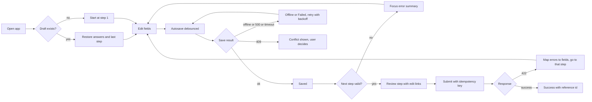
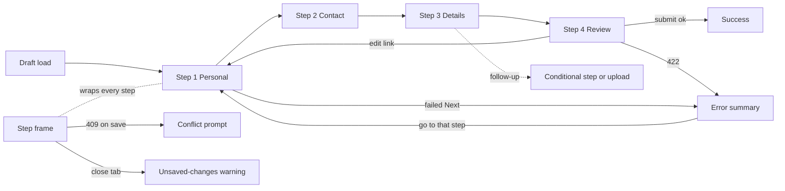

# Assignment 03 — Product Brief: What You Are Building

**v0.2 DRAFT — 2026-11-23** · Added features, screens, configuration. Read this first. Then [requirements-and-directives.md](requirements-and-directives.md) for the rules, and [developer-guide.md](developer-guide.md) for the build path.

## 1. Product in one view

| WH | Answer |
|---|---|
| What | **A multi-step application form**: 4 steps (suggested: Personal, Contact, Details with a repeating group, Review and submit), synthetic fields only, with autosave, resume and recovery from network failure |
| Why | Long forms lose people's work: a dropped connection, a closed tab or a second tab wipes answers. Vague errors leave users unsure what to fix |
| Who | Applicant who fills a long form over several sittings, possibly on a poor connection. Keyboard and screen reader users. Reviewer who triggers failures |
| Where | Browser on desktop or phone (works at 360 px). Runs locally against a mock API (MSW, json-server or similar) |
| When | Over one or several sittings. Autosave runs after edits. Submit once at the end |
| How | One schema drives field, step and submit validation. Drafts save with a version check. Submit uses an idempotency key. Status is honest: Saving, Saved, Failed, Offline |
| Success | The applicant never loses an answer. "Saved" only shows after the server confirms. A server error lands on the right field. Submit never creates a duplicate |

## 2. Personas

| Persona | Goal | Pain today | Needs from the app |
|---|---|---|---|
| **Applicant** | Finish and submit the application with confidence | Lost answers, unclear errors, starting over | Step progress, autosave, resume, review with edit links, reference id on success |
| **Applicant on a poor connection** | Keep working while offline or flaky | Silent save failures, false "Saved" | Honest status, queued retries with backoff, recovery when back online |
| **Applicant with two tabs** | Not have one tab silently overwrite the other | Last write wins, data lost | Version check, clear 409 conflict handling |
| **Keyboard / screen reader user** | Know where errors are and which step is active | Errors not announced, focus lost on step change | Labels, hints, errors linked. Focus to error summary or step heading. Status in a polite live region |
| **Reviewer (interviewer)** | See failure paths, not only the happy path | Demos that mock away failures | Mock that simulates latency, 500, timeout, 409, 422 and offline |

## 3. Main journey

## 4. Capabilities

| ID | Capability | What it means | Brief section |
|---|---|---|---|
| C1 | Data-driven steps | 4 steps including a repeating group. Progress indicator. Back never loses data. Jump to a completed step | A, Part 2 |
| C2 | Single schema validation | One schema for field, step and submit checks. Types derived from it | A, C |
| C3 | Autosave | Debounced save after edits with status Saving, Saved, Failed, Offline. Queue and retry with backoff | A, Part 2 |
| C4 | Resume | Reopening restores the draft and the last step | A |
| C5 | Conflict handling | Draft `version`. PUT returns 409 on mismatch. Never overwrite blindly | B, D |
| C6 | Submit | Review lists all answers with edit links. Submit with idempotency key. Success shows reference id | A, D |
| C7 | Server error mapping | 422 field errors mapped to the right field, even on an earlier step. Unknown-field messages in a form-level summary | C |
| C8 | Accessible errors and steps | Label, hint, error via `aria-describedby`. Focus to error summary or step heading. Step change and save status announced | D |
| C9 | Mock API with failures | `GET` / `PUT /drafts/{id}`, `POST /submissions`. Simulates latency, 500, timeout, 409, 422, offline | B |
| C10 | Data safety | No sensitive values in logs or URLs. Decide what is persisted locally | Constraints, D |
| C11 | Extensibility | Conditional step or file-upload field with retry as a small change | F |

## 5. Product features

Priority: **Must** = required for submission. **Should** = expected for a strong score. **Could** = optional extra.

| ID | Feature | Capability | Priority |
|---|---|---|---|
| F-01 | 4 data-driven steps, one with a repeating group (add and remove items) | C1 | Must |
| F-02 | Progress indicator with current and completed steps | C1 | Must |
| F-03 | Back never loses data. Jump to a completed step | C1 | Must |
| F-04 | One schema for field, step and submit checks, with types derived from it | C2 | Must |
| F-05 | Inline errors on blur, step errors on Next, all errors on submit | C2 | Must |
| F-06 | Debounced autosave with status Saving, Saved, Failed, Offline | C3 | Must |
| F-07 | "Saved" only after the server confirms | C3 | Must |
| F-08 | Save queue and retry with backoff. Latest draft saves when back online | C3 | Must |
| F-09 | Unsaved-changes protection on tab close | C3 | Should |
| F-10 | Resume: restore answers and last step on reopen | C4 | Must |
| F-11 | Older draft version still loads after a schema change | C4 | Must |
| F-12 | Draft `version` sent on save. 409 shown with a clear choice | C5 | Must |
| F-13 | Review step with every answer and edit links | C6 | Must |
| F-14 | Submit with idempotency key. Success shows reference id | C6 | Must |
| F-15 | 422 field errors mapped to the right field and step, first error focused | C7 | Must |
| F-16 | Unknown-field server messages in a form-level summary | C7 | Must |
| F-17 | Label, hint and error linked by `aria-describedby`. Error summary with links | C8 | Must |
| F-18 | Step change announced, focus to step heading. Save status in a polite live region | C8 | Must |
| F-19 | Works by keyboard and at 360 px | C8 | Must |
| F-20 | Mock `GET` / `PUT /drafts/{id}`, `POST /submissions` with latency, 500, timeout, 409, 422, offline | C9 | Must |
| F-21 | No sensitive values in logs or URLs. Persistence rule documented | C10 | Must |
| F-22 | Conditional step or file-upload field with retry | C11 | Could (live follow-up) |

## 6. Screens

| ID | Screen / view | Purpose | Key elements | States | Users | Stories | Sample |
|---|---|---|---|---|---|---|---|
| S-01 | Draft load (resume) | Restore work on open | Loading indicator, then last step with answers | loading, restored, no draft (start at step 1), load failed (assumption) | applicant | US-09 | [view](samples/screens/S-01-draft-load.svg) |
| S-02 | Step frame | Shared layout for every step | Progress indicator, step heading, autosave status, Back, Next | Saving, Saved, Failed, Offline | applicant, applicant on a poor connection, keyboard / screen reader user | US-01, 02, 07, 08, 14 | [view](samples/screens/S-02-step-frame.svg) · [narrow](samples/screens/S-02-step-frame-narrow.svg) |
| S-03 | Step 1 — Personal (suggested) | Collect personal fields | Synthetic fields with label, hint, error | default, field error, step errors | applicant, screen reader user | US-03, 04 | [view](samples/screens/S-03-step-1-personal.svg) |
| S-04 | Step 2 — Contact (suggested) | Collect contact fields | Synthetic fields with label, hint, error | default, field error, step errors | applicant, screen reader user | US-03, 04 | [view](samples/screens/S-04-step-2-contact.svg) |
| S-05 | Step 3 — Details (suggested) | Collect repeating items | Repeating group with Add and Remove, fields per item | no items (assumption), items, field error, step errors | applicant | US-01, 03 | [view](samples/screens/S-05-step-3-details.svg) |
| S-06 | Step 4 — Review and submit | Check and send | Every answer incl. group items, edit link per step, Submit | ready, submitting, 422 errors, failed (500 or timeout) | applicant | US-05, 06, 12, 13 | [view](samples/screens/S-06-step-4-review-submit.svg) |
| S-07 | Error summary | Reach every error | List of errors linked to fields, form-level messages for unknown fields | hidden, shown with focus | screen reader user, keyboard user | US-04, 05, 06 | [view](samples/screens/S-07-error-summary.svg) |
| S-08 | Conflict prompt (409) | Stop a blind overwrite | Message, choice (for example reload latest or keep mine) (assumption) | shown, resolved | applicant with two tabs | US-10 | [view](samples/screens/S-08-conflict-prompt.svg) |
| S-09 | Unsaved-changes warning | Protect last edits on close | For example a beforeunload prompt (assumption) | shown | applicant | US-11 | [view](samples/screens/S-09-unsaved-changes-warning.svg) |
| S-10 | Success | Confirm submission | Reference id | success | applicant | US-13 | [view](samples/screens/S-10-success.svg) |
| S-11 | Follow-up step or field | Show the form can grow | Conditional step, or file-upload field with Retry | shown or hidden by answer. Upload: uploading, failed, done (assumption) | applicant, product owner | US-16 | [view](samples/screens/S-11-follow-up-step-or-field.svg) |

## 7. Configuration

| Setting | Scope | Default | Who can change | Where | Effect |
|---|---|---|---|---|---|
| Step definitions | Form | 4 steps (suggested: Personal, Contact, Details, Review) | Developer | Step config and schema (data-driven) | Order, fields and conditions. A new step is a small change |
| Validation schema | Form | One schema (for example Zod) | Developer | Schema file | Field, step and submit checks, and types |
| Autosave debounce interval | App | Candidate decides and documents | Developer | Code constant | How soon a save fires after an edit |
| Retry backoff (delay, cap, attempts) | App | Candidate decides and documents | Developer | Code constant | Retry pacing after offline, 500 or timeout |
| Request timeout | App | Candidate decides and documents | Developer | Code constant | When a save is marked Failed |
| Draft id | Draft | Candidate decides and documents | Code | Code, README | Which draft is loaded on resume |
| Draft schema version and migration | Draft | Candidate decides and documents | Developer | Code, README | How an older draft loads |
| Idempotency key | Submission | One per submit attempt (Candidate decides how it is made) | Code | Submit logic | Blocks duplicate submissions |
| Unsaved-changes protection | App | For example beforeunload or local draft (assumption) | Developer | Code, README | What is protected on tab close |
| Local persistence rule | Data | Candidate decides and documents | Developer | README | What is in memory, in local storage, never persisted |
| Save status announcement | App | Polite live region | Code constant | Code | How status changes are announced |
| API base URL | Environment | Local mock (MSW, json-server or similar) | Developer | Env var, `.env.example` (assumption) | Where drafts and submissions go |
| Mock latency | Mock | Candidate decides and documents | Developer | Mock handler config or env var (assumption) | Makes Saving state visible |
| Mock failure switches (500, timeout, 409, 422, offline) | Mock | Candidate decides and documents | Developer, reviewer | Mock handler config, env var or dev toggle (assumption) | Makes each failure reachable in demo and tests |
| Secrets | Environment | None. Mock API only | — | Never in client code or the repo | Nothing secret is committed |

## 8. User stories and acceptance criteria

Format: **As a** persona, **I want** action, **so that** benefit. Each has checkable acceptance criteria (AC).

### Steps and navigation

| ID | Story | Acceptance criteria |
|---|---|---|
| US-01 | As an applicant, I want to see my progress through the steps so that I know how much is left | Progress indicator shows current and completed steps. 4 steps, including one with a repeating group (add and remove items) |
| US-02 | As an applicant, I want to go back or jump to a completed step so that I can fix answers | Back never loses entered data. Completed steps are reachable directly. Uncompleted later steps are not (assumption) |

### Validation and errors

| ID | Story | Acceptance criteria |
|---|---|---|
| US-03 | As an applicant, I want errors at the right moment so that I am not nagged while typing | Inline error on blur. Step errors on Next. All errors on submit. All three use the same schema |
| US-04 | As a screen reader user, I want errors summarised and linked so that I can reach each one | Failed Next or submit moves focus to an error summary with links to each field. Each field has label, hint and error linked by `aria-describedby` |
| US-05 | As an applicant, I want server field errors shown on the right field so that I know what to fix | 422 errors map to fields, even on an earlier step. The user is sent to that step and the first error is focused |
| US-06 | As an applicant, I want unknown server errors shown, not hidden, so that I am never confused | A 422 message for a field the form does not know appears in a form-level summary. No generic "Something went wrong" only |

### Autosave and resume

| ID | Story | Acceptance criteria |
|---|---|---|
| US-07 | As an applicant, I want my answers saved as I go so that I never retype them | Save is debounced after edits. Status shows Saving, Saved, Failed or Offline. "Saved" appears only after the server confirms. Status is in a polite live region, not colour only |
| US-08 | As an applicant on a poor connection, I want saves retried automatically so that a drop does not lose work | On offline, 500 or timeout, status shows Offline or Failed. Saves queue and retry with backoff. When the network returns, the latest draft saves and status becomes Saved |
| US-09 | As an applicant, I want to resume where I left off so that I can finish across sittings | Reopening the app restores all answers and the last step. An older draft version still loads after a schema change (approach documented in README) |
| US-10 | As an applicant with two tabs open, I want a conflict handled clearly so that one tab does not silently erase the other | Save sends `version`. A 409 is shown to the user with a clear choice (assumption: for example reload latest or keep mine). No blind overwrite |
| US-11 | As an applicant, I want warning before closing with unsaved changes so that I do not lose the last edits | Closing the tab with pending saves is protected (assumption: for example a beforeunload prompt or local draft). README states what is protected |

### Review and submit

| ID | Story | Acceptance criteria |
|---|---|---|
| US-12 | As an applicant, I want to review all answers before submitting so that I can catch mistakes | Review step lists every answer, including repeating group items, with an edit link to its step |
| US-13 | As an applicant, I want submit to happen exactly once so that I do not create duplicates | Submit sends an idempotency key. Double click or a retry after a lost response does not create a second submission. Success shows a reference id |

### Accessibility, safety and change

| ID | Story | Acceptance criteria |
|---|---|---|
| US-14 | As a keyboard user, I want step changes announced so that I know where I am | On step change, the change is announced and focus moves to the step heading. Whole flow works by keyboard and at 360 px |
| US-15 | As an applicant, I want my personal data handled with care so that it does not leak | No sensitive values in logs or URLs. README lists what is kept in memory, what is stored locally, and what is never persisted |
| US-16 | As a product owner, I want a conditional step or file-upload field added easily so that the form can grow (assumption: persona) | Live follow-up: validation, autosave, review and tests adapt with a small change because steps are data-driven |

## 9. Traceability

| Capability | Stories | Tests you should write |
|---|---|---|
| C1 | US-01, 02 | Back keeps data. Jump to completed step. Repeating group add / remove |
| C2 | US-03 | Same schema rule fires on blur, Next and submit |
| C3 | US-07, 08 | Status transitions. Offline then online retry. "Saved" only after server ok |
| C4 | US-09 | Reload restores answers and step |
| C5 | US-10 | 409 conflict |
| C6 | US-12, 13 | Review lists all answers. Idempotent submit |
| C7 | US-05, 06 | 422 mapping to earlier step. Unknown-field summary |
| C8 | US-04, 14 | Focus to error summary. Focus to step heading. Live region status |
| C9 | all | Each simulated failure is reachable in tests or demo |
| C10 | US-15 | No sensitive values in URL or logs (review check) |
| C11 | US-16 | Live follow-up change stays small |

## 10. Out of scope

- Real backend, database or real personal data (mock API and synthetic fields only)
- Authentication and user accounts (assumption)
- Real file storage (file upload only if asked in the live follow-up)
- Real-time co-editing across tabs (only detect and handle the 409)
- Secrets of any kind in client code
