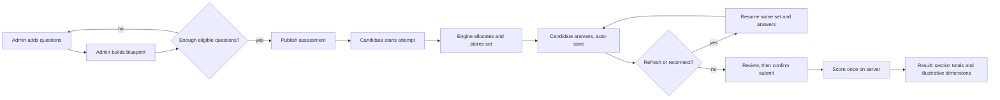
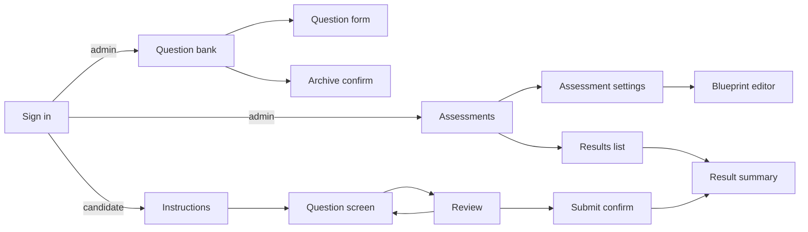

# Assignment 01 — Product Brief: What You Are Building

**v1.1 — 2026-11-23** · Added features, screens, configuration. Read this first. Then [requirements-and-directives.md](requirements-and-directives.md) for the rules, and [developer-guide.md](developer-guide.md) for the build path. Look and feel: [design-system/README.md](design-system/README.md) and [samples/](samples/).

## 1. Product in one view

| WH | Answer |
|---|---|
| What | **Assessment platform**: a question bank, assessment blueprints, an allocation engine that builds each candidate's question set, a timed attempt, and scoring |
| Why | Hiring teams need fair, repeatable tests. Hand-picked question lists are slow, leak answers, and cannot be scored consistently |
| Who | Admin (builds questions and assessments). Candidate (takes an attempt) |
| Where | A web browser. Runs locally |
| When | Admin sets up before a hiring round. Candidate sits one timed attempt |
| How | A blueprint sets quotas by category and difficulty. The engine draws eligible questions, stores the set, and scores answers on the server |
| Which | Two assessment types: **technical** (SQL, multiple choice, marks) and **psychometric** (Likert, situational judgment, dimensions) |
| Success | Every candidate gets a valid set that matches the blueprint. Refresh never changes the set. A result is scored once. Answer keys never reach the browser |

## 2. Personas

| Persona | Goal | Pain today | Needs from the app |
|---|---|---|---|
| **Admin (assessment author)** | Build a reliable test once, reuse it for many candidates | Manual question picking, uneven difficulty, no reuse | Question bank with filters, blueprint editor, publish check |
| **Candidate** | Answer calmly and get a fair result | Lost answers on refresh, unclear timer, accidental submit | One-question focus, timer, auto-save, resume, confirm before submit |
| **Hiring reviewer** (assumption: same account as admin) | Read results and compare candidates | Raw answers, no section totals | Section totals, dimension summary labelled illustrative |

## 3. Main journey

## 4. Capabilities

| ID | Capability | What it means | Brief section |
|---|---|---|---|
| C1 | Question bank | Create, edit, archive, retrieve. Type, category, topic, skill, difficulty, marks, status, options, correct answers | A |
| C2 | Psychometric mapping | Map an item to one or more dimensions, with weight and reverse scoring | A, E |
| C3 | Assessment configuration | Name, type, duration, sections, scoring rules, negative marking | B |
| C4 | Blueprint and publish check | Quotas by category and difficulty. Publish blocked when the bank is short | B, design system |
| C5 | Allocation engine | Eligible questions, random order, no duplicates, persisted set, documented method | C |
| C6 | Attempt execution | Instructions, sections, navigator, timer, save, resume | D |
| C7 | Idempotent start and submit | Repeated start or submit does not create a second attempt or second score | D, Directives |
| C8 | Scoring | Auto-score objective items, section totals, negative marking, dimension scores | E |
| C9 | Snapshot and answer-key protection | Store what the candidate saw. Never send answer keys or scoring rules to the browser | API scope, Directives |
| C10 | Results view | Section totals table. Dimension bars labelled illustrative, no right or wrong framing | E, design system |

## 5. Product features

Priority: **Must** = required for submission. **Should** = expected for a strong score. **Could** = optional extra.

| ID | Feature | Capability | Priority |
|---|---|---|---|
| F-01 | Create technical question: single, multiple answer or SQL, with options and correct answers | C1 | Must |
| F-02 | Edit question and archive with confirmation | C1 | Must |
| F-03 | Filter the bank by category, difficulty and status in a dense table | C1 | Must |
| F-04 | Psychometric item: Likert or situational judgment, no right or wrong answer stored | C2 | Must |
| F-05 | Map an item to one or more dimensions with weight, direction and reverse-scored flag | C2 | Must |
| F-06 | Configure assessment: name, type, duration, sections, scoring rules | C3 | Must |
| F-07 | Negative marking on applicable technical questions | C3, C8 | Must |
| F-08 | Blueprint quota table by category and difficulty, live available vs required per row | C4 | Must |
| F-09 | Publish check: blocked when short, short rows named | C4 | Must |
| F-10 | Allocate eligible questions, no duplicates, random question and option order where suitable | C5 | Must |
| F-11 | Persist the allocated set. Documented selection method | C5 | Must |
| F-12 | Instructions, sections, one-question focus | C6 | Must |
| F-13 | Navigator chips: unanswered, answered, flagged, current | C6 | Must |
| F-14 | Timer always visible, warning colour plus text at 5 minutes left | C6 | Must |
| F-15 | Save each answer with "Saved" and failure state. Resume after refresh | C6 | Must |
| F-16 | Review screen and confirm dialog with unanswered count | C6 | Must |
| F-17 | Idempotent start and submit | C7 | Must |
| F-18 | Auto-score objective items with section totals | C8 | Must |
| F-19 | Psychometric dimension scores with weights and reverse scoring | C8 | Must |
| F-20 | Snapshot what the candidate saw (text, options, marks) | C9 | Must |
| F-21 | No answer keys or scoring rules in any candidate-facing response | C9 | Must |
| F-22 | Result: section totals table and dimension bars labelled illustrative | C10 | Must |
| F-23 | Results list for the reviewer to compare candidates | C10 | Should |
| F-24 | Seeded deterministic allocation, reproducible for a given seed | C5 | Could |

## 6. Screens

Wireframes in [samples/](samples/): S-07 matches `admin-blueprint-editor.svg`, S-09 matches `candidate-question-screen.svg`, S-12 matches `result-summary.svg`.

| ID | Screen | Purpose | Key elements | States | Roles | Stories | Sample |
|---|---|---|---|---|---|---|---|
| S-01 | Sign in | Enter as admin or candidate | Email, password (assumption: simple local auth) | default, error | all | US-10, 18 | [view](samples/screens/S-01-sign-in.svg) |
| S-02 | Question bank | Find and manage questions | Dense table, filters (category, difficulty, status), archive action | loading, empty, ready | admin | US-03, 04 | [view](samples/screens/S-02-question-bank.svg) |
| S-03 | Question form | Add or edit a question | Type, category, topic, skill, difficulty, marks, status, options, correct answers; psychometric: dimensions, weight, direction, reverse flag | default, validation error, saved | admin | US-01, 02, 03 | [view](samples/screens/S-03-question-form.svg) |
| S-04 | Archive confirm dialog | Retire a question safely | Question text, confirm, cancel | default, done | admin | US-03 | [view](samples/screens/S-04-archive-confirm-dialog.svg) |
| S-05 | Assessments list | Track assessments | Name, type, status (draft, published), open | loading, empty, ready | admin | US-05, 07 | [view](samples/screens/S-05-assessments-list.svg) |
| S-06 | Assessment settings | Define structure | Name, type, duration, sections, scoring rules, negative marking | default, validation error, saved | admin | US-05 | [view](samples/screens/S-06-assessment-settings.svg) |
| S-07 | Blueprint editor | Set quotas and publish | Quota rows (category, difficulty, required, available), total, Publish | enough, short, error, published | admin | US-06, 07 | [view](samples/admin-blueprint-editor.svg) |
| S-08 | Instructions | Start the attempt | Rules, duration, sections, Start | default, starting, resumed | candidate | US-08, 10 | [view](samples/screens/S-08-instructions.svg) |
| S-09 | Question screen | Answer one question | Question card, radio, checkbox or 5-point Likert, navigator chips, timer, save status, flag | default, answered, flagged, saving, save failed, timer warning, expired | candidate | US-09, 11, 12 | [view](samples/candidate-question-screen.svg) |
| S-10 | Review | Check before submit | Navigator summary, unanswered count, back to question | ready | candidate | US-13 | [view](samples/screens/S-10-review.svg) |
| S-11 | Submit confirm dialog | Prevent accidental submit | Unanswered count, Submit, Cancel | default, submitting, done | candidate | US-13, 14 | [view](samples/screens/S-11-submit-confirm-dialog.svg) |
| S-12 | Result summary | Read the outcome | Section totals table, dimension bars with value and label, illustrative label | loading, ready | candidate, admin | US-15, 16, 17 | [view](samples/result-summary.svg) |
| S-13 | Results list | Compare candidates | Candidate, assessment, section totals, open result | loading, empty, ready | admin | US-15, 16 | [view](samples/screens/S-13-results-list.svg) |

## 7. Configuration

| Setting | Scope | Default | Who can change | Where | Effect |
|---|---|---|---|---|---|
| Assessment name, type | Assessment | — | Admin | Assessment settings | Technical or psychometric item pool and scoring |
| Duration | Assessment | Set by admin | Admin | Assessment settings | Timer length |
| Sections | Assessment | Set by admin | Admin | Assessment settings | Grouping of questions and section totals |
| Quotas (category × difficulty) | Blueprint | Set by admin | Admin | Blueprint editor | Allocation counts. Publish check |
| Marks per question | Question | Set by admin | Admin | Question form | Objective score |
| Negative marking | Assessment, question | Off (assumption) | Admin | Scoring rules | Deduction on wrong answer, technical only |
| Dimension weight, direction, reverse flag | Item mapping | Set by admin | Admin | Question form | Psychometric dimension score |
| Likert scale points | Business | 5 (design system) | Code constant | README | Likert options |
| Option-order randomisation | Question type | Candidate decides and documents | Code | README | Which items shuffle options |
| Selection method | Engine | Candidate decides and documents (random, weighted random or seeded) | Code | README | How eligible questions are drawn |
| Random seed | Attempt | Candidate decides and documents | Code | README | Reproducible allocation, if seeded |
| Timer warning threshold | Business | 5 minutes left | Code constant | README | Warning colour plus text |
| Behaviour at timer expiry | Assessment | Candidate decides and documents | Code | README | Auto-submit or lock |
| Illustrative label text | Business | "Illustrative summary. Not a clinical or diagnostic result." | Code constant | README | Psychometric result wording |
| Users and roles | User | Seeded admin and candidates (assumption) | Developer | Seed script | Access to admin or candidate screens |
| Database URL, port, secrets | Environment | `.env.example` | Developer | Env vars, never committed | Runtime. PostgreSQL or SQLite |
| Seed data toggle | Environment | On for local | Developer | Env var or script | Loads synthetic questions and candidates |

## 8. User stories and acceptance criteria

Format: **As a** persona, **I want** action, **so that** benefit. Each has checkable acceptance criteria (AC).

### Question bank

| ID | Story | Acceptance criteria |
|---|---|---|
| US-01 | As an admin, I want to create a technical question so that it can be drawn into tests | Type (single or multiple answer, SQL), category, topic, skill, difficulty, marks, status required. At least one correct option for objective types. Invalid input returns a consistent error, not a raw DB error |
| US-02 | As an admin, I want to create a psychometric item so that it scores a dimension | Likert or situational judgment. Mapped to one or more dimensions with weight and direction. Reverse-scored flag supported. No right or wrong answer stored |
| US-03 | As an admin, I want to edit or archive a question so that the bank stays current | Archive needs confirmation. Archived questions are not drawn into new attempts. Attempts already started keep the snapshot they saw |
| US-04 | As an admin, I want to filter the bank so that I find questions fast | Filter by category, difficulty and status in a dense table |

### Assessment setup

| ID | Story | Acceptance criteria |
|---|---|---|
| US-05 | As an admin, I want to configure an assessment so that it has a clear structure | Name, type, duration, sections, scoring rules. Negative marking only on applicable technical questions |
| US-06 | As an admin, I want to set quotas by category and difficulty so that every set is balanced | Quota rows sum to the total count. Each row shows available vs required live. Row is red when short |
| US-07 | As an admin, I want publish blocked when the bank is short so that no candidate gets an incomplete test | Publish rejected with the short rows named. Publishes once every row has enough eligible questions |

### Allocation and attempt

| ID | Story | Acceptance criteria |
|---|---|---|
| US-08 | As a candidate, I want to start an attempt so that I get my question set | Set matches every quota. No duplicate question. Question order and, where suitable, option order randomised. Two candidates from the same pool get differently ordered sets |
| US-09 | As a candidate, I want refresh or reconnect to keep my set so that I do not lose work | Same questions, same order, same saved answers after reload. Set is never regenerated |
| US-10 | As a candidate, I want to start only once so that a double click does not create two attempts | Repeated start request returns the same attempt |
| US-11 | As a candidate, I want a navigator and a visible timer so that I manage my time | Chips show unanswered, answered, flagged, current. Timer always visible. Warning colour plus text at 5 minutes left |
| US-12 | As a candidate, I want each answer saved so that nothing is lost | "Saved" shown after each answer. Visible failure state when save fails. Supports single, multiple and Likert responses |
| US-13 | As a candidate, I want to review before I submit so that I do not submit by mistake | Review screen, then a confirm dialog stating the unanswered count |
| US-14 | As a candidate, I want submit to count once so that I am not scored twice | Repeated submit returns the same result. No second result row |

### Scoring and results

| ID | Story | Acceptance criteria |
|---|---|---|
| US-15 | As a hiring reviewer, I want objective questions auto-scored so that results are consistent | Marks per correct answer. Negative marking applied where configured. Section totals equal the sum of item scores |
| US-16 | As a hiring reviewer, I want psychometric dimension scores so that I see a profile | Reverse-scored items inverted. Multi-dimension items count toward each mapped dimension by weight. Bars carry value and label, no good or bad colouring |
| US-17 | As a candidate or reviewer, I want psychometric output labelled illustrative so that no one reads it as a diagnosis | Shows "Illustrative summary. Not a clinical or diagnostic result." No right or wrong wording |
| US-18 | As an admin, I want answer keys hidden from candidates so that tests stay fair | No `is_correct`, marks rule or scoring logic in any candidate-facing response |

## 9. Traceability

| Capability | Stories | Tests you should write |
|---|---|---|
| C1–C2 | US-01–04 | Create question validation. Archive after attempt start |
| C3–C4 | US-05, 06, 07 | Publish blocked when bank is short |
| C5 | US-08, 09 | No duplicates. Quotas met. Persisted set on refresh |
| C6 | US-11, 12, 13 | Save and resume |
| C7 | US-10, 14 | Duplicate start. Duplicate submit |
| C8 | US-15, 16 | Section totals. Negative marking. Reverse scoring. Multi-dimension item |
| C9 | US-03, 18 | Candidate response contains no answer keys. Snapshot survives edit or archive |
| C10 | US-16, 17 | Illustrative label present |

## 10. Out of scope

- Proctoring, webcam or anti-cheat monitoring (assumption: not mentioned in the brief)
- Clinical or diagnostic psychometric claims
- Real candidate data (synthetic only)
- Mandatory paid infrastructure or cloud deployment
- Executing candidate SQL against a live database (assumption: SQL questions are multiple choice)
