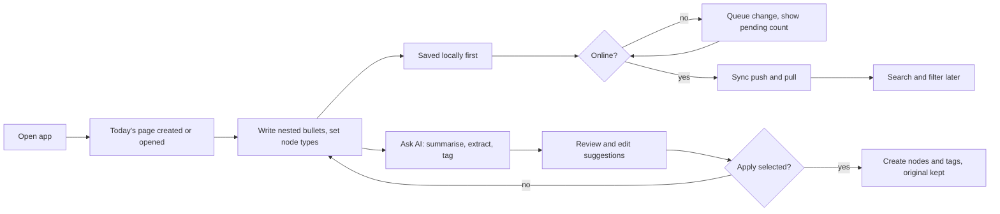
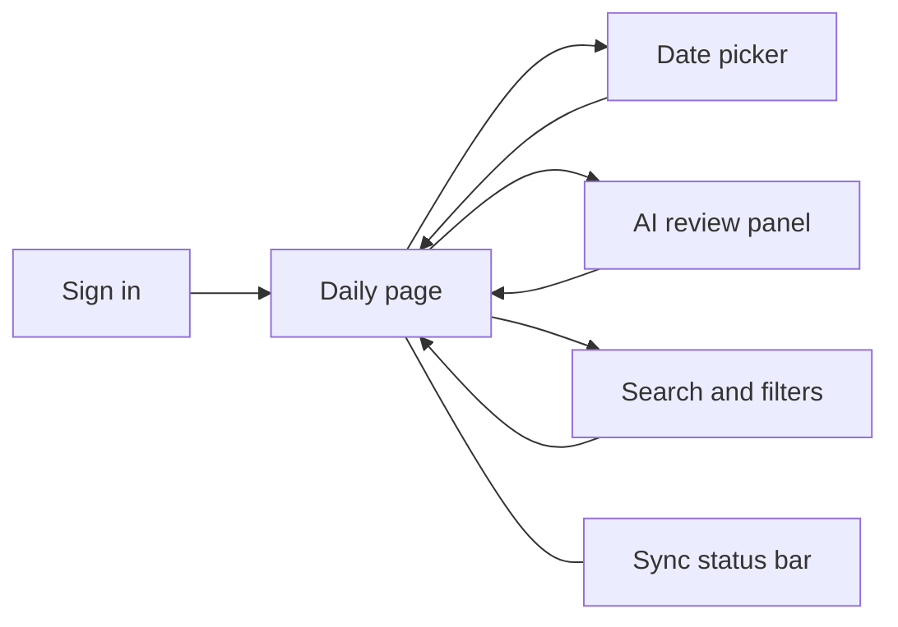

# Assignment 02 — Product Brief: What You Are Building

**v1.1 — 2026-11-23** · Added features, screens, configuration. Read this first. Then [requirements-and-directives.md](requirements-and-directives.md) for the rules, and [developer-guide.md](developer-guide.md) for the build path. Look and feel: [design-system/README.md](design-system/README.md) and [samples/](samples/).

## 1. Product in one view

| WH | Answer |
|---|---|
| What | **Daily knowledge app**: a daily page of nested bullets (an outliner), where each bullet is a typed node (text, task, meeting, idea, decision, link), plus an AI assistant that suggests summaries, tasks and tags |
| Why | Notes scattered across apps are hard to find and turn into action. Users want fast capture that works offline and helps them pull out tasks and decisions |
| Who | An individual user capturing thoughts, meetings, tasks, decisions and ideas |
| Where | A browser (PWA), on more than one device. Works offline |
| When | All day. Open today's page, capture, review later |
| How | Write locally first (IndexedDB), queue changes, sync to the server when online. AI runs on the server and only suggests; the user reviews before anything changes |
| Success | Typing never waits on the network. Offline edits survive refresh and sync later without duplicates. AI never overwrites the user's text |

## 2. Personas

| Persona | Goal | Pain today | Needs from the app |
|---|---|---|---|
| **Knowledge worker (main user)** | Capture quickly, find later, act on tasks | Notes lost in chats and docs, no structure | Keyboard-first outliner, node types, search |
| **Mobile or travelling user** (same person, another device) | Keep working with poor or no network | Apps that block or lose edits offline | Offline edit, clear sync status, sync across devices |
| **Busy reviewer of own notes** (same person) | Turn a long meeting note into tasks and decisions | Re-reading and copying by hand | AI summary, extraction and tags, reviewed before applying |

## 3. Main journey

## 4. Capabilities

| ID | Capability | What it means | Brief section |
|---|---|---|---|
| C1 | Daily page | Auto create or open today. Previous, next, today, date picker | A, design system |
| C2 | Outliner editor | Create, edit, delete, indent, outdent, reorder nested bullets. Basic Markdown. Keyboard first | A, design system |
| C3 | Typed nodes | Stable client-generated ID, parent, type, content, order | B |
| C4 | AI assistant | At least three of: summary, structured extraction, tagging. Provider interface, mock allowed | C, AI architecture |
| C5 | AI review and safety | Suggestions editable, accept or dismiss, explicit apply. Schema-validated. Original preserved. Keys server-side | C, Directives |
| C6 | Search and filter | Keyword search. Filter by date, node type, tag. Semantic search is a bonus | D |
| C7 | Local-first storage | IndexedDB. Works offline. Survives refresh and browser restart | E |
| C8 | Sync | Queue, idempotent push with retry, pull by cursor or version, documented conflict strategy | E, Sync scenarios |
| C9 | Status visibility | Online or offline badge. Sync state: synced, pending (count), syncing, error | E, design system |

## 5. Product features

Priority: **Must** = required for submission. **Should** = expected for a strong score. **Could** = optional extra.

| ID | Feature | Capability | Priority |
|---|---|---|---|
| F-01 | Auto create or open today's page, one page per date | C1 | Must |
| F-02 | Previous, next, today and date picker. Friendly empty day | C1 | Must |
| F-03 | Create, edit and delete nested bullets | C2 | Must |
| F-04 | Keyboard editing: Enter, Tab, Shift+Tab, Alt+Up/Down. Order and nesting persist | C2 | Must |
| F-05 | Drag to reorder bullets | C2 | Should |
| F-06 | Collapse chevron and indent guides | C2 | Should |
| F-07 | Basic Markdown: bold, italic, links | C2 | Must |
| F-08 | Node types (text, task, meeting, idea, decision, link) as chip or icon with text | C3 | Must |
| F-09 | Task checkbox, done shows strike-through and text | C3 | Must |
| F-10 | Stable client-generated node ID. Link node references another node | C3 | Must |
| F-11 | AI summary of a long daily note | C4 | Must |
| F-12 | AI extraction: tasks, owners, dates, decisions, follow-ups | C4 | Must |
| F-13 | AI tag suggestions from fixed categories | C4 | Must |
| F-14 | Provider interface with a documented mock provider | C4 | Must |
| F-15 | Schema validation of AI output. Invalid output rejected, not saved | C5 | Must |
| F-16 | Review panel: edit, Accept, Dismiss, "Apply selected". Applied items link to their AI output | C5 | Must |
| F-17 | AI timeout or error shows inline Retry. Notes stay usable | C5 | Must |
| F-18 | Avoid duplicate AI processing of the same input | C5 | Should |
| F-19 | Keyword search across all dates | C6 | Must |
| F-20 | Filter by date range, node type and tag, alone or combined | C6 | Must |
| F-21 | Semantic search | C6 | Could |
| F-22 | IndexedDB storage. Create, edit, delete and browse offline. Survives refresh and restart | C7 | Must |
| F-23 | Installable PWA | C7 | Should |
| F-24 | Sync queue with idempotent push and retry | C8 | Must |
| F-25 | Pull changes since last cursor or version | C8 | Must |
| F-26 | Documented and tested conflict rule: edit vs edit, edit vs delete | C8 | Must |
| F-27 | Online or offline badge and offline banner | C9 | Must |
| F-28 | Sync badge: synced, pending (count), syncing, offline, error | C9 | Must |

## 6. Screens

Wireframes in [samples/](samples/): S-02 matches `daily-outliner.svg`, S-04 matches `ai-review-panel.svg`, S-06 matches `sync-status-states.svg`.

| ID | Screen | Purpose | Key elements | States | Roles | Stories | Sample |
|---|---|---|---|---|---|---|---|
| S-01 | Sign in | Open the same account on any device | Email, password (assumption: simple local auth) | default, error | user | US-18 | [view](samples/screens/S-01-sign-in.svg) |
| S-02 | Daily page (outliner) | Capture and edit the day | Date header, previous / next / today, nested bullets with handle, chevron, type chip, task checkbox, status bar | loading, empty day, ready, offline | user | US-01, 03, 04, 05, 06, 07, 08, 16 | [view](samples/daily-outliner.svg) |
| S-03 | Date picker | Jump to any date | Calendar, today shortcut | default | user | US-02 | [view](samples/screens/S-03-date-picker.svg) |
| S-04 | AI review panel | Review suggestions before applying | Original text, Summarise / Extract / Tag actions, suggestion cards (edit, Accept, Dismiss), "Apply selected", AI label | idle, running, proposed, edited, applied, failed with Retry | user | US-09, 10, 11, 12, 13 | [view](samples/ai-review-panel.svg) |
| S-05 | Search and filters | Find notes | Search box, date range, node type, tag filters, results opening the page | idle, loading, empty, ready | user | US-14, 15 | [view](samples/screens/S-05-search-and-filters.svg) |
| S-06 | Sync status bar | Show sync health | Online or offline badge, sync state with pending count, offline banner, error detail | synced, pending, syncing, offline, error | user | US-16, 17, 19 | [view](samples/sync-status-states.svg) |

## 7. Configuration

| Setting | Scope | Default | Who can change | Where | Effect |
|---|---|---|---|---|---|
| AI provider (mock or real) | Environment | Mock (assumption) | Developer | Env var | Which `AIProvider` serves summary, extraction, tags |
| AI provider key | Environment | `.env.example`, empty | Developer | Server env var, never frontend or repo | Real provider access |
| AI request timeout | Environment | Candidate decides and documents | Developer | Env var or code constant | When the failure and Retry state shows |
| AI output schema | Business | Defined by candidate | Code | README | Which outputs are accepted |
| Tag categories | Workspace | Product, Engineering, Meeting, Ideas, Tasks, Personal | Code or seed | README | Tag suggestions and filters |
| Node types | Business | text, task, meeting, idea, decision, link | Code constant | README | Type chips and filters |
| Delete with children | Business | Children deleted with parent (assumption) | Code | README | Outliner delete and sync |
| Day boundary, timezone | User | Device local time (assumption) | Code | README | Which date page "today" opens |
| Conflict strategy | Business | Candidate decides and documents | Code | README | Edit vs edit, edit vs delete outcome |
| Sync retry and backoff | Device | Candidate decides and documents | Code constant | README | Push retries after failure |
| Sync trigger | Device | On reconnect, plus candidate's choice | Code | README | When queued changes push and pull |
| Device ID and pull cursor | Device | Created on first run (assumption) | System | IndexedDB and `devices` table | Pull only changes since last cursor |
| Users and workspace | User | Seeded user (assumption) | Developer | Seed script | Data container for sync |
| Database URL, port, secrets | Environment | `.env.example` | Developer | Env vars, never committed | Runtime |
| Seed data toggle | Environment | On for local | Developer | Env var or script | Loads synthetic notes |

## 8. User stories and acceptance criteria

Format: **As a** persona, **I want** action, **so that** benefit. Each has checkable acceptance criteria (AC).

### Daily page and editor

| ID | Story | Acceptance criteria |
|---|---|---|
| US-01 | As a user, I want today's page to open automatically so that I start writing at once | Opening the app shows today's date page. Created if missing. Only one page per date |
| US-02 | As a user, I want to move between dates so that I can find past notes | Previous, next, today and a date picker. Empty day shows a friendly empty state with one first action |
| US-03 | As a user, I want keyboard editing so that capture is fast | Enter adds a bullet. Tab indents. Shift+Tab outdents. Alt+Up/Down reorders. Order and nesting persist after refresh |
| US-04 | As a user, I want to delete a bullet so that I remove mistakes | Deletion is stored and synced. Behaviour for child bullets is documented (assumption: children deleted with parent unless the candidate documents otherwise) |
| US-05 | As a user, I want basic Markdown so that I can format text | Bold, italic, links render (assumption: this subset counts as basic) |

### Structured knowledge

| ID | Story | Acceptance criteria |
|---|---|---|
| US-06 | As a user, I want to set a node type so that tasks and decisions stand out | Types: text, task, meeting, idea, decision, link. Shown as a chip or icon with text, not colour alone |
| US-07 | As a user, I want to tick a task done so that I track progress | Checkbox. Done state shows strike-through and text |
| US-08 | As a user, I want every bullet to have its own ID so that it can be linked and synced | ID generated on the client at creation. Stays the same after sync. Link node can reference another node |

### AI assistant

| ID | Story | Acceptance criteria |
|---|---|---|
| US-09 | As a user, I want a summary of a long day so that I recall it quickly | Summary appears in the AI side panel next to the original. Original note unchanged |
| US-10 | As a user, I want tasks, owners, dates and decisions pulled out so that I can act on them | For the sample input, extracts the task, owner "Rahul" and "Friday". Output validated against a schema. Invalid output is rejected, not saved |
| US-11 | As a user, I want tags suggested so that notes are easy to filter | Tags from categories such as Product, Engineering, Meeting, Ideas, Tasks, Personal |
| US-12 | As a user, I want to review AI suggestions before they change my data so that I stay in control | Labelled "Suggested by AI. Review before applying." Each suggestion editable, with Accept and Dismiss. Nothing stored until "Apply selected". Applied items keep a link to the AI output that produced them |
| US-13 | As a user, I want AI failures to be harmless so that I can keep writing | Timeout or provider error shows an inline message with Retry. Notes stay usable. No provider key in the frontend |

### Search

| ID | Story | Acceptance criteria |
|---|---|---|
| US-14 | As a user, I want keyword search so that I find any note | One search box. Matches across all dates. Opens the matching page |
| US-15 | As a user, I want filters so that I narrow results | Filter by date range, node type and tag, alone or combined |

### Offline and sync

| ID | Story | Acceptance criteria |
|---|---|---|
| US-16 | As a user, I want to write offline so that the network never blocks me | Create, edit, delete and browse offline. Banner: "You're offline. Changes are saved on this device and will sync later." Data survives refresh and browser restart |
| US-17 | As a user, I want changes to sync when I reconnect so that my devices match | Pending count shown. On reconnect, queued changes push and the badge returns to synced. A retried push does not apply the same change twice |
| US-18 | As a user, I want my second device to show my edits so that I can switch devices | Second browser pulls only changes since its last cursor or version. Edits appear without a full re-download |
| US-19 | As a user, I want a predictable result when two devices edit or delete the same note so that nothing vanishes silently | The documented conflict rule is applied and tested for an edit-vs-edit and an edit-vs-delete case. Sync errors show the error state |

## 9. Traceability

| Capability | Stories | Tests you should write |
|---|---|---|
| C1–C2 | US-01–05 | One page per date. Indent, outdent, reorder persist |
| C3 | US-06, 07, 08 | Client ID stable after sync |
| C4–C5 | US-09–13 | Schema validation rejects bad output. Timeout handled. Original preserved. Nothing applied without review |
| C6 | US-14, 15 | Search and combined filters |
| C7 | US-16 | Offline create and refresh persistence |
| C8 | US-17, 18, 19 | Idempotent push on retry. Cursor pull. Conflict rule |
| C9 | US-16, 17, 19 | Sync badge states |

## 10. Out of scope

- A full CRDT or real-time collaborative editing (a basic, explained strategy is enough)
- Mandatory paid AI provider (a documented mock is acceptable)
- Semantic search (bonus only)
- Sharing notes with other users (assumption: single-user workspace)
- Real personal data (synthetic only)
