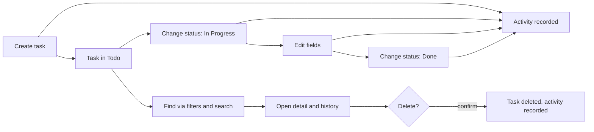
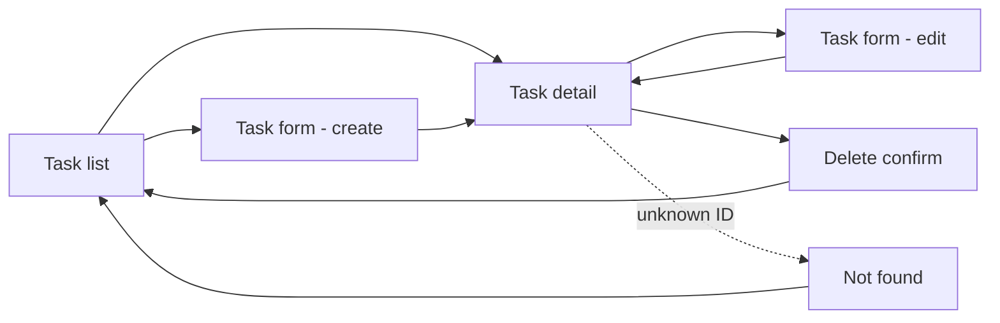

# Assignment 03 — Product Brief: What You Are Building

**v1.1 — 2026-11-23** · Added features, screens, configuration. Read this first. Then [requirements-and-directives.md](requirements-and-directives.md) for the rules, and [developer-guide.md](developer-guide.md) for the build path. Look and feel: [design-system/README.md](design-system/README.md).

## 1. Product in one view

| WH | Answer |
|---|---|
| What | **Mini workflow app**: create tasks, move them through statuses, and see a full change history for each task |
| Why | Small teams lose track of who changed what. A simple task tool with a trusted history fixes that |
| Who | A user who creates, edits, filters and tracks tasks |
| Where | A web browser. Runs locally |
| When | Daily, while planning and doing work |
| How | Each task change and its activity record are written together in one transaction. Filters, sorting and paging run in the database |
| Which | Stage 1 screen. Intentionally small: correctness over features |
| Success | Every change appears in history. No change is saved without its history row. Adding a new status (Blocked) is a small change |

## 2. Personas

| Persona | Goal | Pain today | Needs from the app |
|---|---|---|---|
| **Task owner (user)** | Track own work from Todo to Done | Lists in notes, no status, no history | Quick create and edit, status control, filters, search |
| **Team lead** (assumption: same user role, no separate permissions) | See what changed and when | Cannot tell when a task moved | Activity timeline per task |

## 3. Main journey

## 4. Capabilities

| ID | Capability | What it means | Brief section |
|---|---|---|---|
| C1 | Task CRUD | Create, view, edit, delete. Title, description, priority, status, created_at, updated_at | A, C |
| C2 | Status and priority rules | Allowed values from one shared definition. Easy to add a status | A, D, F, Directives |
| C3 | List, filter, search, page | Status and priority filters, text search, pagination, done in the database | A, C, Directives |
| C4 | Activity history | Recorded on create, edit, delete, status change. Same transaction as the change | A, B, Directives |
| C5 | Errors and validation | Useful messages. 404 and 400/422 with one consistent shape | A, D, Directives |
| C6 | UI states | Loading, empty, success, error. One reusable form | E, design system |

## 5. Product features

Priority: **Must** = required for submission. **Should** = expected for a strong score. **Could** = optional extra.

| ID | Feature | Capability | Priority |
|---|---|---|---|
| F-01 | Create task: title required, description, priority, status starts Todo | C1 | Must |
| F-02 | View task detail | C1 | Must |
| F-03 | Edit task in the same reusable form as create, with inline validation | C1, C6 | Must |
| F-04 | Delete task with confirmation | C1 | Must |
| F-05 | One clear status control. New status shown after success | C2 | Must |
| F-06 | Status and priority allowed values from one shared definition | C2 | Must |
| F-07 | Add a Blocked status as a small change (live follow-up) | C2 | Should |
| F-08 | Filter by status and priority, with clear-filters, in the database | C3 | Must |
| F-09 | Text search on title and description, combined with filters | C3 | Must |
| F-10 | Pagination in the database | C3 | Must |
| F-11 | Sorting in the database | C3 | Should |
| F-12 | Activity on create, edit, delete and status change, with old and new values | C4 | Must |
| F-13 | Task change and activity in one transaction. Rollback if either fails | C4 | Must |
| F-14 | Activity timeline in time order on the task detail | C4 | Must |
| F-15 | Consistent error shape: 404 for unknown ID, 400/422 for invalid input | C5 | Must |
| F-16 | Documented handling of two near-simultaneous updates | C1, C5 | Should |
| F-17 | Loading, empty, success and error states on every screen | C6 | Must |
| F-18 | Status and priority chips with text, not colour alone | C6 | Must |
| F-19 | Optional actor_id on activity | C4 | Could |

## 6. Screens

| ID | Screen | Purpose | Key elements | States | Roles | Stories | Sample |
|---|---|---|---|---|---|---|---|
| S-01 | Task list | Find and scan tasks | Filter row (status, priority, search, clear), table or cards with status and priority chips, pagination, New task | loading, empty, ready, error | user | US-06, 07, 08 | [view](samples/screens/S-01-task-list.svg) |
| S-02 | Task form | Create or edit a task | Title, description, priority, status, inline errors, Save | default, validation error, saving, saved, error | user | US-01, 02 | [view](samples/screens/S-02-task-form.svg) |
| S-03 | Task detail | One task and its history | Fields on top, status control, Edit, Delete, activity timeline (action, old, new, time) | loading, ready, error | user | US-03, 09, 10 | [view](samples/screens/S-03-task-detail.svg) |
| S-04 | Delete confirm dialog | Prevent accidental delete | Task title, Delete, Cancel | default, deleting, done, error | user | US-04 | [view](samples/screens/S-04-delete-confirm-dialog.svg) |
| S-05 | Not found | Explain a missing task | Message, back to list | ready | user | US-05 | [view](samples/screens/S-05-not-found.svg) |

## 7. Configuration

| Setting | Scope | Default | Who can change | Where | Effect |
|---|---|---|---|---|---|
| Status values | Business | Todo, In Progress, Done (Blocked in live follow-up) | Developer | One shared definition, plus DB constraint if any | UI options, API validation, activity, tests |
| Default status on create | Business | Todo (assumption) | Code constant | Shared definition | New task status |
| Priority values | Business | Low, Medium, High | Developer | One shared definition | UI options, API validation |
| Page size | Business | Candidate decides and documents | Code constant | README | List pagination |
| Default sort | Business | Candidate decides and documents | Code | README | List order |
| Search fields | Business | Title and description (assumption) | Code | README | Text search matches |
| Activity order | Business | Oldest to newest (assumption) | Code | README | Timeline order |
| Error response shape | Business | Candidate decides and documents | Code | README | All 404, 400/422 responses |
| Concurrent update rule | Business | Candidate decides and documents | Code | README | Outcome when two updates collide |
| Actor ID on activity | Business | Off (no auth) | Developer | Code | Who made the change, if added |
| Database URL, port, secrets | Environment | `.env.example` | Developer | Env vars, never committed | Runtime. SQLite acceptable |
| Seed data toggle | Environment | On for local | Developer | Env var or script | Loads synthetic tasks |

## 8. User stories and acceptance criteria

Format: **As a** persona, **I want** action, **so that** benefit. Each has checkable acceptance criteria (AC).

### Tasks

| ID | Story | Acceptance criteria |
|---|---|---|
| US-01 | As a user, I want to create a task so that I can track work | Title required. Priority Low, Medium or High. Status starts as Todo (assumption: default). created_at and updated_at set. Activity "created" recorded |
| US-02 | As a user, I want to edit a task so that it stays accurate | Same form as create. Inline validation. updated_at changes. Activity records old and new values |
| US-03 | As a user, I want to change a task's status so that progress is visible | One clear control. New status shows right after success. Invalid status rejected with 400/422. Activity "status changed" with old and new value |
| US-04 | As a user, I want to delete a task with confirmation so that I do not lose it by accident | Confirm dialog. Activity "deleted" recorded. Later fetch returns 404 |
| US-05 | As a user, I want a clear error when a task does not exist so that I know what happened | Update, fetch or delete of an unknown ID returns 404 in the consistent error shape. No raw database error |

### Finding tasks

| ID | Story | Acceptance criteria |
|---|---|---|
| US-06 | As a user, I want to filter by status and priority so that I see what matters | Filters in one row with a clear-filters action. Filtering runs in the database, not in memory |
| US-07 | As a user, I want to search by text so that I find a task fast | Matches title or description (assumption: both fields). Combines with filters. Paginated |
| US-08 | As a user, I want clear list states so that I always know what is happening | Loading, empty, success and error states all shown. Status and priority shown as chips with text |

### History

| ID | Story | Acceptance criteria |
|---|---|---|
| US-09 | As a team lead, I want a task's history in time order so that I know what changed | Detail shows fields on top, timeline below, oldest to newest (assumption: order). Each item shows action, old value, new value, time |
| US-10 | As a team lead, I want history to be complete so that I can trust it | If the activity write fails, the task change is rolled back too. Tested |

### Change readiness

| ID | Story | Acceptance criteria |
|---|---|---|
| US-11 | As a user, I want a Blocked status (live follow-up) so that I can flag stuck work | Adding it changes the one shared definition, plus DB constraint if any. UI, API validation, activity history and tests all accept it |

## 9. Traceability

| Capability | Stories | Tests you should write |
|---|---|---|
| C1 | US-01, 02, 04 | Create and update happy path |
| C2 | US-03, 11 | Invalid status or priority rejected |
| C3 | US-06, 07 | Filter and search return correct rows |
| C4 | US-09, 10 | Activity written with change. Rollback on failure |
| C5 | US-05 | Update missing task returns 404 |
| C6 | US-08 | UI state rendering (optional) |

## 10. Out of scope

- Authentication and user accounts (actor_id optional)
- Queues, microservices, caching
- Real-time updates between users
- Visual polish beyond clear, usable screens
