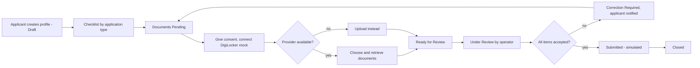
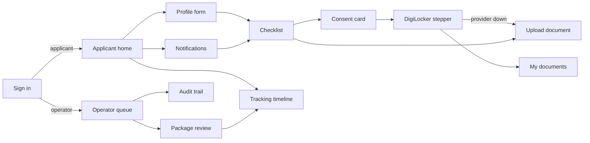

# Assignment 04 — Product Brief: What You Are Building

**v1.1 — 2026-11-23** · Added features, screens, configuration. Read this first. Then [requirements-and-directives.md](requirements-and-directives.md) for the rules, and [developer-guide.md](developer-guide.md) for the build path. Look and feel: [design-system/README.md](design-system/README.md).

## 1. Product in one view

| WH | Answer |
|---|---|
| What | **Passport assistance app**: helps an applicant prepare a passport application, gather documents through a consent-led DigiLocker flow (mock), get an operator review, and track status. It is **not** the official passport system |
| Why | Applicants miss documents, do not know what is pending, and cannot see progress. Assisting operators need a clear package and audit trail |
| Who | Applicant (prepares and tracks). Operator (reviews and decides) |
| Where | A web browser. Runs locally. Mock adapters, synthetic data |
| When | From first draft until the application is submitted (simulated) and closed |
| How | A server-side status state machine. Provider calls behind adapter interfaces. Every consent, document access, review and status change is audited |
| Success | No invalid status change is accepted. A duplicate callback causes no harm. One user can never see another's documents. Simulated data is always labelled |

## 2. Personas

| Persona | Goal | Pain today | Needs from the app |
|---|---|---|---|
| **Applicant** | Get a complete, correct package and know its status | Unclear checklist, repeated visits, no updates | Profile, checklist with status, DigiLocker link, timeline, notifications |
| **Operator (reviewer)** | Check a package and decide fast with reasons | Incomplete packages, no history of decisions | Package summary, accept or reject per item with reason, request corrections |
| **Compliance or audit reader** (assumption: operator or admin role) | Prove what happened, with consent | No record of who accessed what | Audit trail without document contents or secrets |

## 3. Main journey

## 4. Capabilities

| ID | Capability | What it means | Brief section |
|---|---|---|---|
| C1 | Applicant profile | Minimum required details. Review and edit before proceeding | A |
| C2 | Configurable checklist | Requirements by application type and scenario. Missing, pending, verified, rejected | A, C |
| C3 | DigiLocker adapter (mock) | Consent, connect, authorise, callback, discover, select, retrieve. Signed expiring state, idempotent callback | A, B |
| C4 | Consent management | Purpose-specific, visible, revocable, audited | A, B, design system |
| C5 | Document vault | Metadata and verification state only. Minimum data. Masked identity numbers | A, B |
| C6 | Operator review | Accept or reject each item with a required reason. Request corrections | A |
| C7 | Status state machine | Seven statuses, server-side, invalid transitions rejected, roles per transition | A, B |
| C8 | Tracking timeline | Status, actor, time, reason. Simulated label | A, design system |
| C9 | Notifications | In-app or email mock on status change or required action | A |
| C10 | Audit trail | Consent, document access, checklist decisions, status changes. No secrets or contents | A, B |
| C11 | Access control and privacy | Ownership and role checked on every query. No sensitive values in URLs or logs | B, Directives |
| C12 | Provider fallback | Another permitted upload route when the provider is down | E, Directives |

## 5. Product features

Priority: **Must** = required for submission. **Should** = expected for a strong score. **Could** = optional extra.

| ID | Feature | Capability | Priority |
|---|---|---|---|
| F-01 | Applicant profile with minimum fields, review and edit before proceeding | C1 | Must |
| F-02 | Mask identity numbers on screen | C1, C5 | Must |
| F-03 | Checklist by application type (for example fresh or re-issue) and scenario | C2 | Must |
| F-04 | Checklist row chip: missing, pending, verified, rejected, with reason when rejected | C2 | Must |
| F-05 | Versioned document requirement rules | C2 | Should |
| F-06 | Consent card: purpose, scopes, retention, Withdraw | C4 | Must |
| F-07 | Consent recorded with time and scope. Withdrawal removes access and is audited | C4 | Must |
| F-08 | DigiLocker mock stepper: connect, authorise, choose, retrieve. Mock labelled | C3 | Must |
| F-09 | Signed, expiring callback state. Replayed or unsigned state rejected | C3 | Must |
| F-10 | Idempotent callback: one connection, one set of linked documents | C3 | Must |
| F-11 | Provider adapter interface, mock swappable for an authorised sandbox | C3 | Must |
| F-12 | Document vault: metadata and verification state only, contents hidden by default | C5 | Must |
| F-13 | Provider-unavailable banner with Retry and "upload instead" | C12 | Must |
| F-14 | Operator package summary | C6 | Must |
| F-15 | Accept or reject each item, reason required for reject | C6 | Must |
| F-16 | Request corrections, applicant fixes and returns to Ready for Review | C6, C7 | Must |
| F-17 | Server-side state machine, seven statuses, roles per transition, invalid or wrong-role change rejected and audited | C7 | Must |
| F-18 | Tracking timeline: status, actor, time, reason, current step highlighted | C8 | Must |
| F-19 | Simulated label and wording on submission and tracking | C8 | Must |
| F-20 | Simulated passport tracking adapter | C8 | Should |
| F-21 | In-app notifications with unread state and clear action | C9 | Must |
| F-22 | Email mock notification channel | C9 | Could |
| F-23 | Audit trail: actor, action, resource, time, correlation ID. No contents or secrets | C10 | Must |
| F-24 | Audit trail view for the audit reader | C10 | Should |
| F-25 | Ownership and role checked on every document and application query | C11 | Must |
| F-26 | No tokens, identity numbers or contents in URLs, analytics, logs or audit | C11 | Must |
| F-27 | Continue on another device, server as source of truth | C11 | Should |
| F-28 | Documented consent retention and deletion choices | C4, C5 | Should |

## 6. Screens

| ID | Screen | Purpose | Key elements | States | Roles | Stories | Sample |
|---|---|---|---|---|---|---|---|
| S-01 | Sign in | Enter as applicant or operator | Email, password (assumption: simple local auth) | default, error | all | US-16, 19 | [view](samples/screens/S-01-sign-in.svg) |
| S-02 | Applicant home | Application at a glance | Current status, next action, unread notifications, simulated badge | loading, empty, ready | applicant | US-12, 15, 19 | [view](samples/screens/S-02-applicant-home.svg) |
| S-03 | Profile form | Start the application | Minimum fields, masked identity number, review step | default, validation error, review, saved | applicant | US-01 | [view](samples/screens/S-03-profile-form.svg) |
| S-04 | Checklist | Know what to provide | Rows by type and scenario, status chip, reject reason, connect or upload action | loading, ready, consent withdrawn, error | applicant | US-02, 03, 07 | [view](samples/screens/S-04-checklist.svg) |
| S-05 | Consent card | Agree before connecting | Purpose, scopes, retention, Agree, Withdraw, link to what happens after withdrawal | active, withdrawn, expired | applicant | US-04, 07 | [view](samples/screens/S-05-consent-card.svg) |
| S-06 | DigiLocker stepper (mock) | Link documents | Connect, authorise, choose documents, retrieve. Mock label. Provider banner | step 1–4, provider unavailable, retrying, done, error | applicant | US-05, 06, 08 | [view](samples/screens/S-06-digilocker-stepper.svg) |
| S-07 | Upload document | Fallback route | File picker, document type, joins checklist | default, uploading, done, error | applicant | US-08 | [view](samples/screens/S-07-upload-document.svg) |
| S-08 | My documents | See linked documents | Metadata, source, verification state, masked numbers | loading, empty, ready, consent withdrawn | applicant | US-07, 16 | [view](samples/screens/S-08-my-documents.svg) |
| S-09 | Tracking timeline | Follow progress | Vertical timeline (status, actor, time, reason), current step, simulated badge and text | loading, ready | applicant, operator | US-12, 14 | [view](samples/screens/S-09-tracking-timeline.svg) |
| S-10 | Notifications | Catch required actions | List, unread state, action link | loading, empty, ready | applicant | US-03, 11, 15 | [view](samples/screens/S-10-notifications.svg) |
| S-11 | Operator queue | Pick a package to review | Applications by status, open package | loading, empty, ready | operator | US-09 | [view](samples/screens/S-11-operator-queue.svg) |
| S-12 | Package review | Decide on a package | Profile, checklist rows, document metadata, accept or reject with reason, request corrections, status action | loading, ready, validation error, decided | operator | US-09, 10, 11, 13 | [view](samples/screens/S-12-package-review.svg) |
| S-13 | Audit trail | Prove what happened | Filter by application, actor, action, date. No contents or secrets | loading, empty, ready | audit reader (assumption: operator or admin) | US-17, 18 | [view](samples/screens/S-13-audit-trail.svg) |

## 7. Configuration

| Setting | Scope | Default | Who can change | Where | Effect |
|---|---|---|---|---|---|
| Application types and scenarios | Business | Fresh, re-issue (examples in brief) | Developer (assumption: seed data) | `document_requirements` | Which checklist applies |
| Document requirements and rules | Type or scenario | Versioned, seeded (assumption) | Developer (assumption: seed data) | `document_requirements` | Checklist rows and pass or fail rules |
| Status transitions and roles | Business | Seven statuses. Roles per transition: candidate decides and documents | Code | State machine, README | Allowed and rejected changes |
| DigiLocker provider (mock or sandbox) | Environment | Mock | Developer | Env var | Which adapter serves connect, callback, documents |
| DigiLocker sandbox credentials | Environment | Empty in `.env.example` | Developer | Env vars, never committed. Only if supplied | Sandbox access |
| Callback state signing secret | Environment | `.env.example` placeholder | Developer | Env var, never committed | Signs callback state |
| Callback state expiry | Environment | Candidate decides and documents | Code constant | README | Stale callbacks rejected |
| Consent purpose and scopes | Consent | Candidate decides and documents | Code | Consent card, README | What is shared and recorded |
| Consent retention | Business | Candidate decides and documents | Code | README | When consent and links are deleted |
| After consent withdrawal | Business | Linked items back to missing (assumption) | Code | README | Checklist state and access |
| Identity number masking | Business | Candidate decides and documents | Code constant | README | What part is shown |
| Tracking adapter | Environment | Simulated | Developer | Env var | Submitted and Closed status source |
| Notification channel | Environment | In-app (email mock optional) | Developer | Env var | Where notifications go |
| Simulation label text | Business | "Simulated. Not the official passport system" | Code constant | README | Badge on submission and tracking |
| Log redaction | Environment | On, always | Code | Logger config | No sensitive values in logs |
| Users and roles | User | Seeded applicants and operators (assumption) | Developer | Seed script | Access to screens and actions |
| Database URL, port, secrets | Environment | `.env.example` | Developer | Env vars, never committed | Runtime. PostgreSQL preferred |
| Seed data toggle | Environment | On for local | Developer | Env var or script | Loads synthetic applicants and documents |

## 8. User stories and acceptance criteria

Format: **As a** persona, **I want** action, **so that** benefit. Each has checkable acceptance criteria (AC).

### Profile and checklist

| ID | Story | Acceptance criteria |
|---|---|---|
| US-01 | As an applicant, I want to enter my profile so that the application can start | Only necessary fields. Review and edit before proceeding. Application created in Draft. Identity numbers masked on screen |
| US-02 | As an applicant, I want a checklist for my application type so that I know what to provide | Requirements depend on type (for example fresh or re-issue) and scenario. Each row shows missing, pending, verified or rejected as a chip with text |
| US-03 | As an applicant, I want to see why a document failed the rules so that I can fix it | Rejected row shows the reason. Applicant is notified that action is required |

### DigiLocker and consent

| ID | Story | Acceptance criteria |
|---|---|---|
| US-04 | As an applicant, I want to give clear consent before connecting so that I know what is shared | Consent card shows purpose, scopes, retention and a Withdraw action. Consent recorded with time and scope. App never asks for DigiLocker password or OTP |
| US-05 | As an applicant, I want to connect DigiLocker (mock) and pick documents so that I do not upload by hand | Stepper: connect, authorise, choose, retrieve. Mock clearly labelled. Callback state is signed and expires. Only selected documents are linked |
| US-06 | As an applicant, I want a repeated callback to be harmless so that I do not get duplicate links | Same callback twice creates one connection and one set of linked documents. Replayed or unsigned state is rejected |
| US-07 | As an applicant, I want to withdraw consent so that my documents stop being used | Withdrawal recorded. Linked documents no longer accessible to this application. Affected checklist items show their new state (assumption: back to missing). Audit event written |
| US-08 | As an applicant, I want another way when DigiLocker is down so that I am not blocked | Provider-unavailable banner with Retry and "upload instead". Uploaded document joins the same checklist |

### Operator review

| ID | Story | Acceptance criteria |
|---|---|---|
| US-09 | As an operator, I want a package summary so that I review quickly | Shows profile, checklist rows, document metadata and verification state. Document contents hidden by default |
| US-10 | As an operator, I want to accept or reject each item with a reason so that the applicant knows what to fix | Reason required for reject. Decision stored with reviewer and time. Audited |
| US-11 | As an operator, I want to request corrections so that the applicant can resubmit | Status moves to Correction Required. Applicant notified. Applicant can fix and return to Ready for Review |

### Status and tracking

| ID | Story | Acceptance criteria |
|---|---|---|
| US-12 | As an applicant, I want a status timeline so that I know where my application is | Draft, Documents Pending, Ready for Review, Under Review, Correction Required, Submitted (simulated), Closed. Each step shows actor, time, reason. Current step highlighted |
| US-13 | As an operator, I want invalid status changes blocked so that the process stays correct | Server rejects transitions not in the state machine, and transitions by the wrong role. Rejection is audited. Client-sent next status is never trusted |
| US-14 | As an applicant, I want simulated data clearly labelled so that I am not misled | Badge "Simulated. Not the official passport system" on submission and tracking. Text "Simulated submission. No real application has been filed." |
| US-15 | As an applicant, I want a notification when status changes or I must act so that I do not miss steps | In-app list with unread state (or email mock). Clear action when input is required |

### Security and audit

| ID | Story | Acceptance criteria |
|---|---|---|
| US-16 | As an applicant, I want only me and assigned operators to see my documents so that my data is private | Ownership and role checked on every document and application query. Another applicant's ID returns no data. Hidden buttons are not the control |
| US-17 | As an audit reader, I want a full audit trail so that every sensitive action is provable | Consent events, document access and retrieval, checklist decisions, status changes. Actor, action, resource, time, correlation ID |
| US-18 | As an audit reader, I want logs free of sensitive values so that a leak of logs leaks nothing | No tokens, identity numbers or document contents in URLs, analytics, logs or audit events |
| US-19 | As an applicant, I want to continue on another device so that I am not tied to one browser | Profile, checklist state and timeline load on the new device after sign-in (assumption: server is the source of truth) |

## 9. Traceability

| Capability | Stories | Tests you should write |
|---|---|---|
| C1–C2 | US-01, 02, 03 | Checklist by type. Failed-rule reason |
| C3 | US-05, 06 | Signed state check. Duplicate callback |
| C4 | US-04, 07 | Consent recorded. Withdrawal blocks access |
| C5 | US-09, 18 | Minimal stored fields. Masking |
| C6 | US-10, 11 | Reject needs reason |
| C7–C8 | US-11, 12, 13, 14 | Invalid transition. Wrong role |
| C9 | US-03, 11, 15 | Notification on status change |
| C10 | US-07, 10, 13, 17 | Audit event per action |
| C11 | US-16, 18, 19 | Cross-applicant access denied |
| C12 | US-08 | Provider failure falls back to upload |

## 10. Out of scope

- Real DigiLocker or Passport Seva integration (unless authorised sandbox credentials are supplied)
- Filing a real application or pretending to be the official system
- Scraping government portals
- Handling DigiLocker passwords, OTPs or any user authentication secret
- Real personal data or real credentials
- Storing document copies or identity numbers not needed by the workflow
