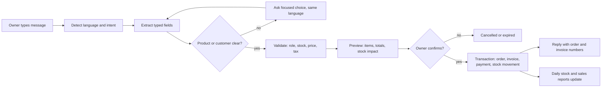
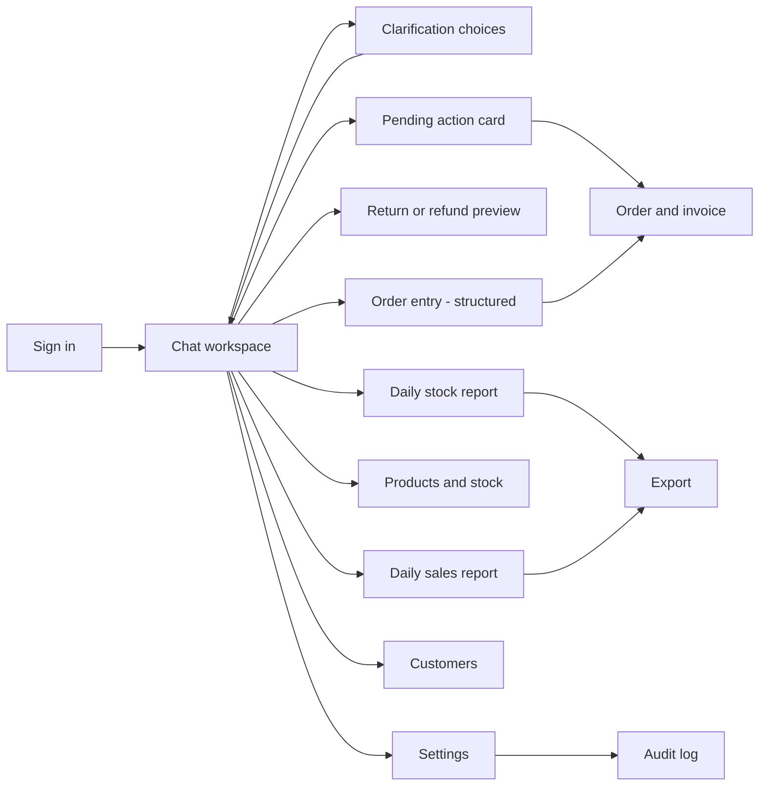

# Assignment 05 — Product Brief: What You Are Building

**v1.1 — 2026-11-23** · Added features, screens, configuration. Read this first. Then [requirements-and-directives.md](requirements-and-directives.md) for the rules, and [developer-guide.md](developer-guide.md) for the build path. Look and feel: [design-system/README.md](design-system/README.md).

## 1. Product in one view

| WH | Answer |
|---|---|
| What | **Chat-first shop app**: a small retailer runs inventory, orders, billing and daily reports by typing in Hindi, English or Hinglish |
| Why | Shop owners find forms and menus slow. They want to say "Rahul ke naam se order banao" and get a correct bill, correct stock and correct reports |
| Who | Shop owner. Staff by role |
| Where | A phone or counter PC. Chat on one side, preview or report on the other |
| When | All day for sales and stock. End of day for reports |
| How | Chat becomes a typed action. The server validates, previews, waits for confirmation, then runs deterministic services in a transaction. All figures come from the database |
| Success | The AI never invents a figure. Nothing changes without confirmation. A retried confirm creates no duplicate. Reports match the ledger |

## 2. Personas

| Persona | Goal | Pain today | Needs from the app |
|---|---|---|---|
| **Shop owner** | Sell, bill and know stock and sales for the day | Manual registers, wrong totals, stock surprises | Chat orders, previews, daily stock and sales reports, language choice |
| **Staff (counter)** | Take orders fast in their own language | Complex billing software | Hindi, English or Hinglish chat, clear choices when unsure |
| **Customer** (indirect) | Get a correct bill and know dues | Disputed totals and credit | Invoice, payment record, outstanding credit |
| **Accountant** (assumption: read-only staff role) | Review sales and stock offline | No export | CSV or PDF export in Hindi or English |

## 3. Main journey

## 4. Capabilities

| ID | Capability | What it means | Brief section |
|---|---|---|---|
| C1 | Product setup | SKU, unit, prices, tax setting, opening stock, aliases. Update price or stock by chat | A, D |
| C2 | Orders and billing | Walk-in or named customer, many items, stock check, discount, tax, unique order and invoice numbers | A |
| C3 | Payments | Cash, UPI, card, credit. Payment status. Outstanding credit | A |
| C4 | Customers | Find or create. Minimum contact details. Order and payment history | A |
| C5 | Inventory ledger | Purchases, sales, returns, damage, adjustments with reason. Balances derived from movements | A, D, Directives |
| C6 | Chat-to-action pipeline | Understand, extract, resolve, validate, preview, confirm, execute, report | C |
| C7 | Human confirmation | Required before order confirm, invoice, payment, refund, stock change | A, C, Directives |
| C8 | Bilingual handling | Hindi, English, Hinglish. Spoken-style numbers and units. Language switch mid-chat | B |
| C9 | Daily stock report | Opening, inward, sold, returns, adjustments, closing, low stock. Filters | A, F |
| C10 | Daily sales report | Gross, discounts, tax, net, order count, average order value, top products, payment split, refunds, dues | A, F |
| C11 | Export | Hindi or English CSV or PDF summary | A, B |
| C12 | Safety and scope | Idempotent retries, transactions, shop and role scope, works without an AI key | C, G, Directives |

## 5. Product features

Priority: **Must** = required for submission. **Should** = expected for a strong score. **Could** = optional extra.

| ID | Feature | Capability | Priority |
|---|---|---|---|
| F-01 | Add product by chat: SKU, unit, purchase and selling price, tax setting, opening stock, local-language aliases | C1 | Must |
| F-02 | Update price or stock by chat, preview shows old and new value | C1, C5 | Must |
| F-03 | Order from one chat message: walk-in or named customer, several items | C2 | Must |
| F-04 | Stock check blocks a short order and states the available quantity | C2 | Must |
| F-05 | Discount, tax and totals computed by the server, never the AI | C2 | Must |
| F-06 | Unique order and invoice numbers | C2 | Must |
| F-07 | Payment by cash, UPI, card or credit, with payment status and outstanding credit | C3 | Must |
| F-08 | Find or create customer by name or phone, choices when several match | C4 | Must |
| F-09 | Customer history: orders, payments, outstanding | C4 | Must |
| F-10 | Inventory ledger: purchase, sale, return, damage, adjustment with reason. Balance derived from movements | C5 | Must |
| F-11 | Chat pipeline: understand, extract, resolve, validate, preview, confirm, execute, report | C6 | Must |
| F-12 | Focused clarification with choice chips in the same language. Never guess | C6, C8 | Must |
| F-13 | Preview card with Confirm and Cancel. Unconfirmed action expires | C7 | Must |
| F-14 | Idempotent confirm with key, in one transaction | C7, C12 | Must |
| F-15 | Return or refund flow keeping order, payment, stock and reports consistent (live follow-up) | C2, C5, C7 | Should |
| F-16 | Understand Hindi, English and Hinglish, reply in selected or detected language | C8 | Must |
| F-17 | Language toggle and mid-chat switch without losing the pending action. Preference remembered | C8 | Must |
| F-18 | Spoken-style numbers and units (kg, litre, packet, piece, dozen, rupees) | C8 | Must |
| F-19 | Daily stock report with low-stock marks and date, category, product filters | C9 | Must |
| F-20 | Daily sales report: gross, discounts, tax, net, orders, AOV, top products, payment split, refunds, dues | C10 | Must |
| F-21 | Documented live vs snapshot reports and late-correction handling | C9, C10 | Should |
| F-22 | CSV or PDF export in Hindi or English | C11 | Must |
| F-23 | Shop and role scope checked server-side on every query | C12 | Must |
| F-24 | Mock or deterministic parser when no AI key. Search, order entry, reports still work | C12 | Must |
| F-25 | Audit events for confirmed actions, returns and corrections | C5, C12 | Must |
| F-26 | Send the AI provider only what it needs | C12 | Should |
| F-27 | Voice input, never auto-confirmed | C8 | Could |

## 6. Screens

| ID | Screen | Purpose | Key elements | States | Roles | Stories | Sample |
|---|---|---|---|---|---|---|---|
| S-01 | Sign in | Enter the shop | Phone or email, password, language | default, error | all | US-20 | [view](samples/screens/S-01-sign-in.svg) |
| S-02 | Chat workspace | Run the shop by chat | Message list (user, assistant, system), input, language toggle, side panel for preview or report | loading, ready, AI unavailable (mock parser) | owner, staff | US-04, 12, 13, 14, 21 | [view](samples/screens/S-02-chat-workspace.svg) |
| S-03 | Clarification choices | Resolve ambiguity | Short question, tappable product or customer chips, same language | default, selected | owner, staff | US-10, 15 | [view](samples/screens/S-03-clarification-choices.svg) |
| S-04 | Pending action card | Check before anything changes | Items, quantities, unit price, discount, tax, total, stock impact, old and new values, Confirm, Cancel | proposed, confirmed, cancelled, expired, failed | owner, staff (by role) | US-01, 02, 05, 06, 07, 08 | [view](samples/screens/S-04-pending-action-card.svg) |
| S-05 | Order and invoice | Show the result | Order number, invoice number, items, totals, payment mode and status | loading, ready | owner, staff | US-04, 07, 08 | [view](samples/screens/S-05-order-and-invoice.svg) |
| S-06 | Return or refund preview | Fix a sale cleanly | Original order, items returned, refund amount, restock impact, Confirm | proposed, confirmed, cancelled, failed | owner | US-09 | [view](samples/screens/S-06-return-refund-preview.svg) |
| S-07 | Products and stock | Structured search and stock | Search (both scripts), SKU, unit, prices, balance, low-stock mark, movement history | loading, empty, ready | owner, staff | US-01, 02, 03, 21 | [view](samples/screens/S-07-products-and-stock.svg) |
| S-08 | Order entry (structured) | Bill without the AI | Customer, product search, quantities, preview, Confirm | draft, preview, confirmed, failed | owner, staff | US-21 | [view](samples/screens/S-08-order-entry-structured.svg) |
| S-09 | Customers | Find a customer and dues | Search by name or phone, orders, payments, outstanding credit | loading, empty, ready | owner, staff | US-10, 11 | [view](samples/screens/S-09-customers.svg) |
| S-10 | Daily stock report | Know what to reorder | Date, category, product filters. Opening, inward, sold, returns, adjustments, closing, low stock | loading, empty, ready, exported | owner, accountant | US-16, 18 | [view](samples/screens/S-10-daily-stock-report.svg) |
| S-11 | Daily sales report | Know how the day went | Gross, discounts, tax, net, order count, AOV, top products, payment split, refunds, dues | loading, empty, ready, exported | owner, accountant | US-17, 18 | [view](samples/screens/S-11-daily-sales-report.svg) |
| S-12 | Export | Share a report | Report, date, format (CSV, PDF), language | default, exporting, done, error | owner, accountant | US-19 | [view](samples/screens/S-12-export.svg) |
| S-13 | Audit log | Who changed what | Filter by actor, entity, date. Before and after reference | loading, ready | owner | US-09, 18 | [view](samples/screens/S-13-audit-log.svg) |
| S-14 | Settings | Configure the shop | Language, timezone, business-day boundary, users and roles | ready, saved | owner | US-12, 17, 20 | [view](samples/screens/S-14-settings.svg) |

## 7. Configuration

| Setting | Scope | Default | Who can change | Where | Effect |
|---|---|---|---|---|---|
| Shop name, timezone | Shop | Asia/Kolkata (assumption) | Owner | Settings | Report headers, business date |
| Business-day boundary | Shop | Candidate decides and documents | Owner | Settings | Which day an order, payment or movement belongs to |
| Language preference | User or shop | Candidate decides and documents | Each user or owner | Toggle, saved per user or shop | Replies, labels, errors, previews, exports |
| Product prices and tax setting | Product | Set by owner | Owner | Chat or Products screen | Totals and tax on orders |
| Reorder level | Product | Set by owner | Owner | Products screen | Low-stock mark in stock report |
| Product aliases | Product | Set by owner | Owner | Products screen | Hindi and Hinglish name matching |
| Units list | Business | kg, litre, packet, piece, dozen | Code constant | README | Parsing and product units |
| Payment modes | Business | Cash, UPI, card, credit | Code constant | README | Payment recording |
| Short-stock options | Business | Reduce quantity or cancel (assumption) | Code | README | Order flow when stock is short |
| Pending action expiry | Business | Candidate decides and documents | Code constant | README | When an unconfirmed preview expires |
| Order and invoice number format | Shop | Candidate decides and documents | Code | README | Unique references |
| Report mode (live or snapshot) | Shop | Candidate decides and documents | Code | README | How late returns change reports |
| AI provider (real or mock parser) | Environment | Mock or deterministic parser when no key | Developer | Env var | Which parser runs the pipeline |
| AI provider key | Environment | Empty in `.env.example` | Developer | Server env var, never frontend or repo | Real provider access |
| Users and roles | User | Owner, staff, accountant (assumption: read-only) | Owner | Settings | Access to screens and actions |
| Database URL, port, secrets | Environment | `.env.example` | Developer | Env vars, never committed | Runtime. PostgreSQL preferred |
| Seed data toggle | Environment | On for local | Developer | Env var or script | Loads synthetic products and customers |

## 8. User stories and acceptance criteria

Format: **As a** persona, **I want** action, **so that** benefit. Each has checkable acceptance criteria (AC).

### Products and stock

| ID | Story | Acceptance criteria |
|---|---|---|
| US-01 | As an owner, I want to add a product by chat so that setup is quick | "Add 20 packets of Amul butter at ₹58 each" and the Hindi version both produce the same preview. SKU, unit, prices, tax setting, opening stock saved only after confirm. Opening stock written as a ledger movement |
| US-02 | As an owner, I want to change a price or stock by chat so that records stay current | Preview shows old and new value. Stock change needs a reason and creates a movement. Balance never overwritten without history |
| US-03 | As an owner, I want to record purchases, damage and adjustments so that stock is right | Each is a signed movement with type, source, reason, actor, time. Balance equals the sum of movements |

### Orders and billing

| ID | Story | Acceptance criteria |
|---|---|---|
| US-04 | As staff, I want to create an order from one chat message so that billing is fast | "Rahul ke naam se order banao: 2 rice bags aur 1 oil bottle" gives a draft with customer, items, quantities. Walk-in allowed. Several items in one message |
| US-05 | As an owner, I want a preview before anything changes so that I catch mistakes | Preview card: items, quantities, unit price, discount, tax, total, stock impact, in the chosen language. Confirm and Cancel. Never auto-confirmed. Unconfirmed action expires |
| US-06 | As an owner, I want orders blocked when stock is short so that I do not sell what I lack | 5 ordered, 3 available: not confirmed as is. User told the available quantity and asked how to proceed (assumption: options are reduce quantity or cancel) |
| US-07 | As an owner, I want confirm to be safe on retry so that a timeout does not double bill | Retried confirm with the same key returns the same order and invoice. One stock deduction. One payment |
| US-08 | As an owner, I want to record payment by mode so that dues are clear | Cash, UPI, card or credit. Credit adds to the customer's outstanding. Needs confirmation |
| US-09 | As an owner, I want a return or refund flow (live follow-up) so that a mistake is fixed cleanly | Needs confirmation. Order, payment adjustment, restock movement and reports stay consistent. Audit event recorded |

### Customers

| ID | Story | Acceptance criteria |
|---|---|---|
| US-10 | As staff, I want to find or create a customer so that orders carry the right name | Search by name or phone. Several matches show tappable choices. Only needed contact details stored |
| US-11 | As an owner, I want a customer's history so that I can answer questions about dues | Orders, payments and outstanding credit listed from the database |

### Language and understanding

| ID | Story | Acceptance criteria |
|---|---|---|
| US-12 | As staff, I want to type in Hindi, English or Hinglish so that I use my own words | Mixed-language sentence understood. Reply in selected or detected language. Preference remembered per user or shop |
| US-13 | As an owner, I want to switch language mid-chat so that I can show a customer | "Hindi mein batao" and "Tell me in English" switch replies without losing the pending action. Every label, error, confirmation and export follows the toggle |
| US-14 | As an owner, I want numbers and units read correctly so that quantities are right | "pachaas" and "50" both read as 50. kg, litre, packet, piece, dozen, rupees supported. Mismatch is visible in the preview before saving |
| US-15 | As staff, I want a question instead of a guess so that the wrong SKU is never billed | Similar product or customer names give a short choice in the same language. Product, customer and quantity never guessed |

### Reports

| ID | Story | Acceptance criteria |
|---|---|---|
| US-16 | As an owner, I want today's stock report so that I know what to reorder | Opening, inward, sold, returns, adjustments, closing per product. Closing follows the stated formula. Low stock marked with text and icon. Filter by date, category, product |
| US-17 | As an owner, I want today's sales report so that I know how the day went | Gross, discounts, tax, net, order count, average order value, top products, payment split, refunds, outstanding dues. Uses shop timezone and business-day boundary. Computed from persisted data, not the chat or the AI |
| US-18 | As an owner, I want a late return to correct reports so that numbers stay true | Return after report generation updates the live report and is visible in the audit trail. Snapshot vs live behaviour documented |
| US-19 | As an accountant, I want to export a report so that I can review it offline | "Kal ke sales ka report English mein bhejo" gives yesterday's report. CSV or PDF in Hindi or English |

### Access and resilience

| ID | Story | Acceptance criteria |
|---|---|---|
| US-20 | As an owner, I want staff limited by role and shop so that data stays safe | Shop and role checked server-side on every query. Client-sent shop ID not trusted |
| US-21 | As an owner, I want the shop to keep working without the AI so that sales never stop | With no AI key or provider down, a mock or deterministic parser, structured product search, order entry and reports still work |

## 9. Traceability

| Capability | Stories | Tests you should write |
|---|---|---|
| C1, C5 | US-01, 02, 03 | Balance equals sum of movements |
| C2 | US-04, 05, 06 | Stock shortfall. Totals with discount and tax |
| C3–C4 | US-08, 10, 11 | Credit outstanding |
| C6–C7 | US-05, 07, 09 | No mutation without confirm. Duplicate confirm retry. Transaction failure rolls back |
| C8 | US-12–15 | Bilingual parsing. Spoken numbers. Ambiguity asks |
| C9 | US-16, 18 | Closing stock formula |
| C10 | US-17, 18 | Sales report figures. Business-day boundary |
| C11 | US-19 | Export in both languages |
| C12 | US-07, 20, 21 | Shop scope. Works with mock parser |

## 10. Out of scope

- Real payment processing or payment gateways (payments are recorded, not processed)
- GST filing or e-invoicing (assumption: tax is calculated, not filed)
- Mandatory voice input (typed input required, voice optional)
- Multi-branch stock (explain how you would scope by branch, if asked)
- Real shop or customer data
