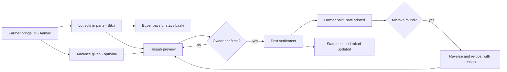
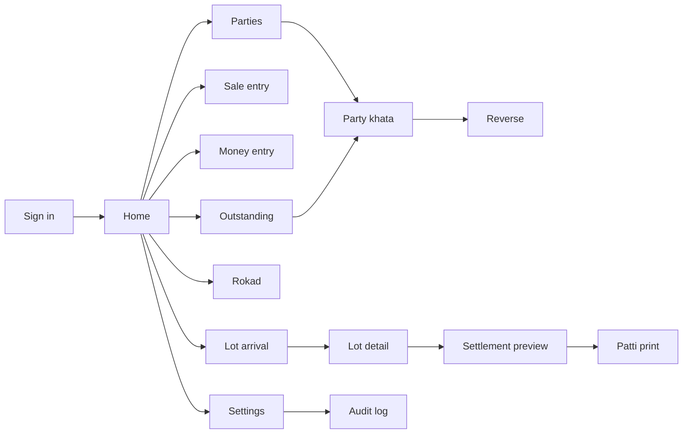

# Assignment 06 — Product Brief: What You Are Building

**v1.1 — 2026-11-23** · Added features, screens, configuration. Read this first. Then [requirements-and-directives.md](requirements-and-directives.md) for the rules, and [developer-guide.md](developer-guide.md) for the build path.

## 1. Product in one view

| WH | Answer |
|---|---|
| What | **Digital Hal Khata**: a ledger app for a mandi commission-agent business. It replaces the paper khata the munshi writes by hand |
| Why | Paper khatas cause arithmetic slips, disputes over what was agreed, lost pages and slow settlements. Owners want a trusted, fast, searchable record |
| Who | Owner (reviews and approves), munshi (enters daily), viewer (accountant, read-only). Parties: farmers who sell, buyers who pay |
| Where | A counter PC or phone in the mandi. Hindi and English |
| When | Used all day during mandi hours. Settlement (hisaab) when a lot is sold, or at period end |
| How | Every money event becomes a balanced, append-only ledger entry. Everything else (balances, rokad, statements) is derived |
| Success | The munshi posts a sale in under 30 seconds. A farmer's statement always matches the ledger. A correction never erases history |

## 2. Personas

| Persona | Goal | Pain today | Needs from the app |
|---|---|---|---|
| **Owner (Seth ji)** | Know who owes what, today's cash, and approve settlements | Cannot trust handwritten totals. Disputes with farmers | Reports, approval, audit trail, reversal rights |
| **Munshi (clerk)** | Enter arrivals, sales and payments fast | Rewriting, arithmetic, corrections that mess the page | Quick forms, preview, safe correction |
| **Farmer (kisan)** | Get a clear hisaab with every deduction explained | Unclear cuts, delays, no copy | Printable patti, statement |
| **Buyer (vyapari)** | Know what is baaki and pay against it | Disputed old balances | Statement and outstanding ageing |
| **Accountant (viewer)** | Check books and export | Paper, no export | Read-only reports and CSV |

## 3. Main journey

## 4. Capabilities

| ID | Capability | What it means | Brief section |
|---|---|---|---|
| C1 | Party management | Create, search and view farmers and buyers, with opening balance | A |
| C2 | Lot arrival | Record crop, quantity, unit, date, status | A |
| C3 | Sales | Sell part or all of a lot to buyers. Cannot oversell | A, G |
| C4 | Advances, receipts, payments | Money in and out, by mode, with allocation | A, G |
| C5 | Deductions engine | Configurable commission, mandi fee, hamali, tulai, other, with effective dates | A, G |
| C6 | Settlement | Preview, confirm, post. Net payable formula | A, F |
| C7 | Ledger core | Balanced, append-only, integer money, idempotent posting | B |
| C8 | Corrections | Reverse and re-post with reason. Full audit | A, B, H |
| C9 | Reports | Party statement, rokad, outstanding ageing, lot summary, export | C |
| C10 | Access control | Owner, munshi, viewer, enforced server-side | E |
| C11 | Bilingual UI | Hindi and English across screens, reports, prints | D, design system |

## 5. Product features

Priority: **Must** = required for submission. **Should** = expected for a strong score. **Could** = optional extra.

| ID | Feature | Capability | Priority |
|---|---|---|---|
| F-01 | Add, edit and search parties (farmer, buyer) in Hindi or English | C1 | Must |
| F-02 | Opening balance with Dr/Cr side | C1, C7 | Must |
| F-03 | Record lot arrival (crop, quantity, unit, date) | C2 | Must |
| F-04 | Lot status: open, partly sold, sold, settled | C2 | Must |
| F-05 | Sell part or all of a lot, cash or credit, with oversell block | C3 | Must |
| F-06 | Advance to farmer, optionally linked to a lot | C4 | Must |
| F-07 | Buyer receipt with allocation (oldest first or chosen sales) | C4 | Must |
| F-08 | Farmer payment | C4 | Must |
| F-09 | Deduction rules per crop or party with effective-from date | C5 | Must |
| F-10 | Settlement preview with line-by-line deductions | C6 | Must |
| F-11 | Settlement post with explicit confirmation | C6 | Must |
| F-12 | Printable patti in Hindi or English | C6, C11 | Should |
| F-13 | Balanced, append-only journal with idempotent posting | C7 | Must |
| F-14 | Reverse and re-post with required reason | C8 | Must |
| F-15 | Audit log view (actor, time, reason) | C8 | Should |
| F-16 | Party statement with running balance | C9 | Must |
| F-17 | Daily rokad by payment mode | C9 | Must |
| F-18 | Outstanding report with ageing buckets | C9 | Must |
| F-19 | Lot summary (in, sold, remaining, commission, net payable) | C9 | Should |
| F-20 | CSV and printable export | C9 | Should |
| F-21 | Roles: owner, munshi, viewer | C10 | Must |
| F-22 | Hindi / English toggle across every screen | C11 | Must |
| F-23 | Remember last party, crop and date on entry forms | C11 | Should |
| F-24 | Voice or photo of the paper khata, never auto-posted | — | Could |

## 6. Screens

| ID | Screen | Purpose | Key elements | States | Roles | Stories | Sample |
|---|---|---|---|---|---|---|---|
| S-01 | Sign in | Enter the business | Phone or email, password, language | default, error | all | US-19, 20 | [view](samples/screens/S-01-sign-in.svg) |
| S-02 | Home (today) | Day at a glance and quick entry | Today's rokad totals, open lots, top outstanding, quick buttons (Aamad, Bikri, Advance, Receipt, Payment) | loading, ready, empty | all | US-16, 17 | [view](samples/screens/S-02-home-today.svg) |
| S-03 | Parties list | Find a party | Search (both scripts), type filter, balance column | loading, empty, ready | all | US-01 | [view](samples/screens/S-03-parties-list.svg) |
| S-04 | Party form | Add or edit a party | Names, type, phone, opening balance Dr/Cr | default, validation error, saved | owner, munshi | US-01 | [view](samples/screens/S-04-party-form.svg) |
| S-05 | Party khata (statement) | Account history | Date range, entries, Dr, Cr, running balance, reversed marks, export | loading, empty, ready | all | US-15 | [view](samples/screens/S-05-party-khata-statement.svg) |
| S-06 | Lot arrival form | Record aamad | Party, crop, quantity, unit, date | default, error, saved | owner, munshi | US-02 | [view](samples/screens/S-06-lot-arrival-form.svg) |
| S-07 | Lots list | Track lots | Status filter, in / sold / remaining | loading, empty, ready | all | US-03 | [view](samples/screens/S-07-lots-list.svg) |
| S-08 | Lot detail | One lot's story | Sales list, advances, remaining qty, settle button | ready, settled | all | US-03, 19 | [view](samples/screens/S-08-lot-detail.svg) |
| S-09 | Sale entry | Record bikri | Lot, buyer, quantity, rate, amount, mode, Dr/Cr preview | draft, preview, posted, failed | owner, munshi | US-04 | [view](samples/screens/S-09-sale-entry.svg) |
| S-10 | Money entry | Advance, receipt or payment | Type, party, amount, mode, allocation, preview | draft, preview, posted, failed | owner, munshi | US-05, 06, 07 | [view](samples/screens/S-10-money-entry.svg) |
| S-11 | Settlement preview | Check hisaab | Sale lines, deductions with rate and base, advances, net payable, Post / Cancel | draft, posted, reversed | owner | US-09, 10, 11 | [view](samples/screens/S-11-settlement-preview.svg) |
| S-12 | Patti print | Give farmer a slip | Printable layout in chosen language | ready | owner, munshi | US-10 | [view](samples/screens/S-12-patti-print.svg) |
| S-13 | Reverse entry dialog | Correct a mistake | Original entry, reason (required), confirm | default, error, done | owner, munshi (not settlements) | US-12, 13 | [view](samples/screens/S-13-reverse-entry-dialog.svg) |
| S-14 | Daily rokad | Cash and bank | Date, opening, receipts, payments, closing by mode | loading, ready | owner, viewer | US-16 | [view](samples/screens/S-14-daily-rokad.svg) |
| S-15 | Outstanding | Chase dues | Ageing buckets, party links, export | loading, empty, ready | owner, viewer | US-17, 18 | [view](samples/screens/S-15-outstanding.svg) |
| S-16 | Audit log | Who did what | Filter by actor, entity, date | loading, ready | owner | US-14 | [view](samples/screens/S-16-audit-log.svg) |
| S-17 | Settings | Configure business | Deduction rules, users and roles, language, timezone | ready, saved | owner | US-08, 19 | [view](samples/screens/S-17-settings.svg) |

## 7. Configuration

| Setting | Scope | Default | Who can change | Where | Effect |
|---|---|---|---|---|---|
| Business name, timezone | Business | Asia/Kolkata | Owner | Settings screen | Report headers, business-day boundary |
| Business-day boundary | Business | 00:00 local (assumption) | Owner | Settings | Which day an entry and rokad belong to |
| Default language | User | Hindi (assumption) | Each user | Toggle, saved per user | All labels, reports, prints |
| Commission % | Crop or party | Set by owner | Owner | Deduction rules | Settlement deduction line |
| Mandi fee % | Crop | Set by owner | Owner | Deduction rules | Settlement deduction line |
| Hamali, tulai per unit | Crop | Set by owner | Owner | Deduction rules | Settlement deduction line |
| Rule effective-from date | Rule | Today | Owner | Deduction rules | Which rate applies to a sale |
| Rounding rule | Business | Half-up to the paisa | Code constant, documented | README | Percentage deductions |
| Quantity precision | Business | 3 decimals (assumption) | Code constant | README | Lot and sale quantities |
| Units list | Business | kg, quintal, bag, crate | Owner | Settings | Lot and sale forms |
| Ageing buckets | Business | 0–7, 8–30, 31–60, 60+ days | Code constant | README | Outstanding report |
| Closed-period rule | Business | Candidate decides and documents | Code | README | Posting into a settled lot or closed day |
| Users and roles | User | — | Owner | Settings | Access to screens and actions |
| Database URL, port, secrets | Environment | `.env.example` | Developer | Env vars, never committed | Runtime |
| Seed data toggle | Environment | On for local | Developer | Env var or script | Loads synthetic data |

## 8. User stories and acceptance criteria

Format: **As a** persona, **I want** action, **so that** benefit. Each has checkable acceptance criteria (AC).

### Parties and lots

| ID | Story | Acceptance criteria |
|---|---|---|
| US-01 | As a munshi, I want to add a farmer or buyer so that I can post entries against them | Name in Hindi or English, type, optional phone, opening balance with Dr/Cr. Duplicate name warns. Appears in search by either script |
| US-02 | As a munshi, I want to record a farmer's lot arrival so that sales can be tied to it | Crop, quantity, unit and date required. Status starts as open. Quantity must be greater than zero |
| US-03 | As an owner, I want to see each lot's remaining quantity so that no one oversells | Shows in, sold, remaining. Updates after every sale |

### Sales and money

| ID | Story | Acceptance criteria |
|---|---|---|
| US-04 | As a munshi, I want to sell part of a lot to a buyer so that I record real trade | Quantity, rate, amount, cash or credit. Rejected if it exceeds remaining quantity, even with two parallel requests. Preview shows Dr/Cr lines before post |
| US-05 | As a munshi, I want to give an advance to a farmer so that it is recovered at hisaab | Amount, mode, date, optional lot link. Increases what the farmer owes. Appears on the statement |
| US-06 | As a munshi, I want to record a buyer's receipt so that baaki goes down | Allocates to chosen sales or oldest first. Owner can override. Retrying the same request does not double credit |
| US-07 | As a munshi, I want to pay a farmer so that the payable is cleared | Amount, mode, date. Cannot silently exceed what is owed. Appears in rokad |

### Settlement

| ID | Story | Acceptance criteria |
|---|---|---|
| US-08 | As an owner, I want to configure deduction rules so that hisaab follows our practice | Rates per crop or party, with effective-from date. A sale uses the rate valid on its date |
| US-09 | As an owner, I want to preview a farmer's hisaab so that I can check before posting | Shows sale lines, each deduction with rate and base, advances recovered, net payable. Same figures as the posted result |
| US-10 | As an owner, I want to confirm and post the hisaab so that the books close the lot | Needs explicit confirm. Creates balanced entries. Lot becomes settled. Printable patti in Hindi or English |
| US-11 | As an owner, I want advances larger than proceeds to show clearly so that the farmer's debt is not hidden | Net payable is negative, labelled, and carried forward |

### Corrections and audit

| ID | Story | Acceptance criteria |
|---|---|---|
| US-12 | As a munshi, I want to correct a wrong entry so that books are right without erasing history | Reverse plus re-post, with required reason. Original, reversal and new entry all visible on the statement. Nothing edited in place |
| US-13 | As an owner, I want to reverse a posted settlement so that a corrected rate flows through | Only owner can. Buyer khata, farmer hisaab and rokad stay balanced. Audit event recorded |
| US-14 | As an owner, I want an audit trail so that I know who did what and why | Every post and reversal has actor, time, reason, reference |

### Reports

| ID | Story | Acceptance criteria |
|---|---|---|
| US-15 | As a farmer or buyer, I want a statement so that I can verify my account | Opening, entries with running balance, closing. Date filter. Equals the sum of ledger lines |
| US-16 | As an owner, I want the daily rokad so that I know cash and bank for the day | Opening, receipts, payments, closing, by mode. Reconciles to the ledger |
| US-17 | As an owner, I want an outstanding report with ageing so that I chase the oldest dues | Buckets 0–7, 8–30, 31–60, 60+ days. Oldest first. Opens the party's khata |
| US-18 | As an accountant, I want to export reports so that I can review offline | CSV and printable summary, in Hindi or English |

### Access and language

| ID | Story | Acceptance criteria |
|---|---|---|
| US-19 | As an owner, I want roles so that clerks cannot do sensitive actions | Viewer is read-only. Munshi cannot reverse a settlement. Enforced by the server |
| US-20 | As any user, I want to switch Hindi or English so that I work in my language | Toggle changes every label, error, report and print. Devanagari renders correctly |

## 9. Traceability

| Capability | Stories | Tests you should write |
|---|---|---|
| C1–C2 | US-01, 02, 03 | Create and search party. Lot status |
| C3 | US-04 | Oversell race |
| C4 | US-05, 06, 07 | Idempotent receipt. Allocation |
| C5–C6 | US-08–11 | Settlement formula. Rate by effective date. Negative net |
| C7 | all | Balanced entries. Rounding |
| C8 | US-12, 13, 14 | Reversal. Reverse a posted settlement |
| C9 | US-15–18 | Report reconciliation |
| C10 | US-19 | Role access |
| C11 | US-20 | Language switch |

## 10. Out of scope

- Real payment processing, banking APIs, GST filing, e-way bills
- Weighbridge or hardware integration
- Mandatory AI, OCR or voice (optional extras must never auto-post)
- Multi-branch consolidation (describe how you would, if asked)
