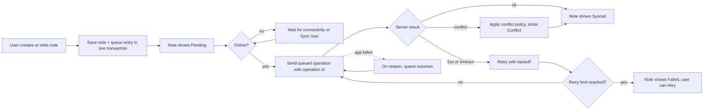
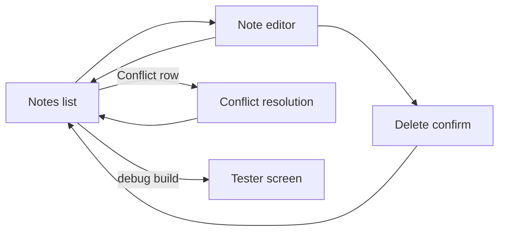

# Assignment 01 — Product Brief: What You Are Building

**v0.2 DRAFT — 2026-11-23** · Added features, screens, configuration. Read this first. Then [requirements-and-directives.md](requirements-and-directives.md) for the rules, and [developer-guide.md](developer-guide.md) for the build path.

## 1. Product in one view

| WH | Answer |
|---|---|
| What | **Offline-first notes app**: create, edit, delete and search notes on the phone. Every change is saved locally first, queued, and synced to a mocked backend later |
| Why | Notes typed on a train or in a lift must never be lost, blocked or duplicated because the network is weak or the app was killed |
| Who | A user who writes notes on a weak or missing connection. The same notes may also be edited elsewhere |
| Where | Phone (emulator or device), at least two screen sizes. Mocked backend runs locally |
| When | Any time, online or offline. Sync runs on "Sync now" and automatically when connectivity returns |
| How | Local database is the UI's source of truth. Each change writes the note and its queue entry in one transaction. A queue syncs with retry, backoff and operation ids |
| Success | No action ever waits on the network. After offline edits, a kill and a reconnect, every note syncs once: none lost, none duplicated. Each note shows its true sync state |

## 2. Personas

| Persona | Goal | Pain today | Needs from the app |
|---|---|---|---|
| **Commuter note-taker** | Capture and edit notes anywhere | Apps that spin, block or lose text when the signal drops | Instant local save, clear sync state, no lost work |
| **Same user, another device** (assumption) | Edit the same note from elsewhere | Silent overwrites between devices | A documented conflict policy that is shown in the UI |
| **Tester / reviewer** | Prove the app survives bad networks | Cannot reproduce failures on demand | Mock backend with latency and failure switches |

## 3. Main journey

## 4. Capabilities

| ID | Capability | What it means | Brief section |
|---|---|---|---|
| C1 | Note management | Create, view, edit, delete. Fields: id, title, body, updated_at, sync_status, version | A |
| C2 | Offline-first local store | Local database is the source of truth. UI never blocks on the network | A, B, Directives |
| C3 | Sync queue (outbox) | Ordered create / update / delete operations with client id and operation id, written atomically with the note | B, Directives |
| C4 | Sync triggers | Manual "Sync now" plus automatic sync when connectivity returns | A |
| C5 | Retry and idempotency | Exponential backoff with cap and jitter. Server ignores repeated operation ids | B, D |
| C6 | Sync state display | Per-note Pending / Synced / Failed / Conflict | A |
| C7 | Conflict handling | One chosen policy (LWW, version check with keep mine / keep theirs, or field merge), documented and shown | C, D |
| C8 | Restart recovery | Queue resumes after the app is killed mid-sync | D |
| C9 | Local search / filter | Find notes without the network | A |
| C10 | Mock backend | Local server or in-app fake with latency and failure-rate switches | B, Deliverables |
| C11 | Accessible, responsive UI | Two screen sizes, large text, screen reader labels | E, mobile-instructions |

## 5. Product features

Priority: **Must** = required for submission. **Should** = expected for a strong score. **Could** = optional extra.

| ID | Feature | Capability | Priority |
|---|---|---|---|
| F-01 | Create a note (title, body) with a client-generated id | C1 | Must |
| F-02 | View and edit a note; updated_at and version change on save | C1 | Must |
| F-03 | Delete a note; delete of a pending create collapses or orders correctly | C1, C3 | Must |
| F-04 | Local database as the UI's source of truth; every action works offline | C2 | Must |
| F-05 | Note change and its queue entry written in one transaction | C2, C3 | Must |
| F-06 | Ordered outbox of create / update / delete operations, each with an operation id | C3 | Must |
| F-07 | "Sync now" button that cannot double-submit | C4 | Must |
| F-08 | Automatic sync when connectivity returns | C4 | Must |
| F-09 | Retry on 5xx or timeout with exponential backoff, cap and jitter | C5 | Must |
| F-10 | Failed state after the retry limit, item kept in queue, manual retry | C5, C6 | Must |
| F-11 | Mock server ignores a repeated operation id | C5, C10 | Must |
| F-12 | Per-note sync state: Pending / Synced / Failed / Conflict, as text, not colour only | C6 | Must |
| F-13 | One conflict policy applied and shown; keep mine / keep theirs if version check is chosen | C7 | Must |
| F-14 | Queue resumes after the app is killed mid-sync | C8 | Must |
| F-15 | Local search or filter, results update as you type (assumption) | C9 | Must |
| F-16 | Mock backend with latency and failure-rate switches, no code change needed | C10 | Must |
| F-17 | Tester screen or config file for mock switches (assumption: either is fine) | C10 | Should |
| F-18 | Offline indicator on the list (assumption) | C2, C6 | Should |
| F-19 | Two screen sizes, large text, screen reader labels | C11 | Must |

## 6. Screens

| ID | Screen | Purpose | Key elements | States | Users | Stories | Sample |
|---|---|---|---|---|---|---|---|
| S-01 | Notes list | See and find notes | Search box, note rows (title, snippet, sync state), New note, Sync now, retry on Failed rows | loading, empty, ready, offline, syncing, no results | note-taker | US-01, 03, 04, 05, 06, 07, 08, 09 | [view](samples/screens/S-01-notes-list.svg) |
| S-02 | Note editor | Create, view or edit a note | Title, body, sync state, Save, Delete | new, editing, saved (Pending), offline | note-taker | US-01, 02, 05, 12 | [view](samples/screens/S-02-note-editor.svg) |
| S-03 | Delete confirm (assumption) | Avoid accidental delete | Note title, Delete, Cancel | default | note-taker | US-03 | [view](samples/screens/S-03-delete-confirm.svg) |
| S-04 | Conflict resolution | Resolve a version conflict | Mine vs theirs, Keep mine, Keep theirs | shown only if the version-check policy is chosen | note-taker, other device | US-13 | [view](samples/screens/S-04-conflict-resolution.svg) |
| S-05 | Tester / debug screen | Reproduce bad networks | Latency, failure rate, queue contents (assumption) | default, saved | tester | US-14 | [view](samples/screens/S-05-tester-debug.svg) |

No OS permission prompts: the app needs no permissions (Directives: request none you do not need).

## 7. Configuration

| Setting | Scope | Default | Who can change | Where | Effect |
|---|---|---|---|---|---|
| Mock latency | Mock backend | Candidate decides and documents | Tester | Config file or tester screen | Delay on every sync request (US-12, 14) |
| Mock failure rate | Mock backend | Candidate decides and documents | Tester | Config file or tester screen | Share of requests returning 5xx (US-09, 14) |
| Force conflict (assumption) | Mock backend | Off | Tester | Tester screen or mock API | Simulates the same note edited elsewhere (US-13) |
| Retry base delay, cap, jitter, max attempts | App | Candidate decides and documents | Developer | Code constant, README | Backoff curve and when a note turns Failed (US-09) |
| Request timeout | App | Candidate decides and documents | Developer | Code constant, README | When a slow request counts as failed (US-12) |
| Conflict policy | App | Candidate decides and documents (LWW, version check or field merge) | Developer | Code, README | How conflicts resolve and what data can be lost (US-13) |
| Auto sync on reconnect | App | On | Code constant | README | Queue sends without user action (US-08) |
| Local data encryption | App | Candidate decides and documents | Developer | Code, README | Whether notes at rest are encrypted (Requirements E) |
| Text size | Device | OS setting | User | OS accessibility settings | Layout scales without clipping actions (US-15) |
| Mock API base URL | Environment | Local mock address | Developer | Env var or build config | Where the queue syncs. No secrets committed |
| Tester screen visibility | Build | Debug builds only (assumption) | Developer | Build flag | Hides switches from normal users |
| Synthetic seed notes | Environment | Candidate decides and documents | Developer | Script or mock data file | Demo data only. No real user data |

## 8. User stories and acceptance criteria

Format: **As a** persona, **I want** action, **so that** benefit. Each has checkable acceptance criteria (AC).

### Notes

| ID | Story | Acceptance criteria |
|---|---|---|
| US-01 | As a note-taker, I want to create a note so that I capture an idea at once | Title and body saved locally with a client-generated id. Appears in the list immediately, with or without network. Shows Pending until synced |
| US-02 | As a note-taker, I want to edit a note so that I can fix or extend it | Edit saved locally at once, updated_at and version change. A queue entry is written in the same transaction as the change |
| US-03 | As a note-taker, I want to delete a note so that my list stays clean | Note leaves the list at once. A delete operation is queued. Delete of a note whose create is still pending collapses or orders correctly: the server never ends up with the note |
| US-04 | As a note-taker, I want to search or filter my notes so that I find one fast | Works fully offline against the local store. Results update as I type (assumption) |

### Offline and sync

| ID | Story | Acceptance criteria |
|---|---|---|
| US-05 | As a note-taker, I want every action to work offline so that a weak signal never stops me | With network off: create, edit, delete and search all work. No spinner blocks input. Changes show Pending |
| US-06 | As a note-taker, I want to see each note's sync state so that I know what is safe on the server | Each note shows one of Pending / Synced / Failed / Conflict. State is readable by a screen reader, not colour only (assumption) |
| US-07 | As a note-taker, I want a "Sync now" button so that I can push changes when I choose | Starts a sync of the queue. Tapping twice does not double-submit. Result reflected in each note's state |
| US-08 | As a note-taker, I want sync to start by itself when I reconnect so that I do not have to remember | On connectivity return, queued operations are sent in order without user action |

### Failure and recovery

| ID | Story | Acceptance criteria |
|---|---|---|
| US-09 | As a note-taker, I want failed syncs retried so that a server blip does not lose my change | On 5xx or timeout: retry with exponential backoff, a cap and jitter. No tight loop. After the limit the note shows Failed and stays in the queue, with a way to retry |
| US-10 | As a note-taker, I want retries never to duplicate a note so that my list stays correct | Each operation has an operation id. Mock server ignores a repeated id. Test: same operation sent twice gives one note |
| US-11 | As a note-taker, I want my unsynced changes to survive the app being killed so that nothing is lost | Kill the app mid-sync, reopen: queue resumes, no lost and no duplicated notes. Shown in the demo video |
| US-12 | As a note-taker, I want the UI to stay usable on a slow network so that I can keep working | Requests time out and retry. UI never freezes. No double submit while a request is in flight |

### Conflicts

| ID | Story | Acceptance criteria |
|---|---|---|
| US-13 | As a user editing on another device, I want conflicts handled by a clear rule so that edits are not silently lost | One policy chosen and documented in the README, including what data it can lose. When a conflict occurs the note shows Conflict, or the user picks keep mine / keep theirs if that policy is chosen |

### Testability and access

| ID | Story | Acceptance criteria |
|---|---|---|
| US-14 | As a tester, I want switches for latency and failure rate so that I can reproduce bad networks | Mock backend runs locally. Latency and failure rate are configurable without code changes (assumption: config file or debug screen) |
| US-15 | As a note-taker with large text or a small phone, I want the app to stay usable so that I can read and edit notes | Works on at least two screen sizes. Large text does not clip actions. Controls have screen reader labels |

## 9. Traceability

| Capability | Stories | Tests you should write |
|---|---|---|
| C1 | US-01, 02, 03 | Create, edit, delete update local store and queue |
| C2 | US-05 | Actions succeed with network off |
| C3 | US-02, 03 | Note and queue entry commit together. Delete-while-pending-create collapse |
| C4 | US-07, 08 | Sync now and reconnect trigger the queue |
| C5 | US-09, 10, 12 | Backoff with cap. Repeated operation id ignored |
| C6 | US-06 | State transitions Pending → Synced / Failed / Conflict |
| C7 | US-13 | Conflict policy outcome |
| C8 | US-11 | Restart recovery: queue resumes, no duplicate |
| C9 | US-04 | Local search with network off |
| C10 | US-14 | Failure-rate switch drives the 5xx path (one error case) |
| C11 | US-15 | Manual check on two screen sizes and large text |

## 10. Out of scope

- Real backend, real accounts, paid services or real user data
- Sign-in, multi-user sharing or collaboration (assumption: single user)
- Attachments, rich text or images in notes
- Analytics, ads or extra libraries not needed for the brief
- The pinned flag or tags field (only as a live follow-up in the discussion)
