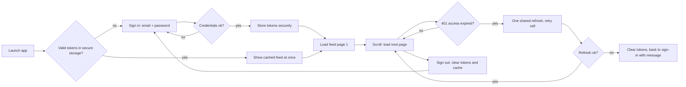
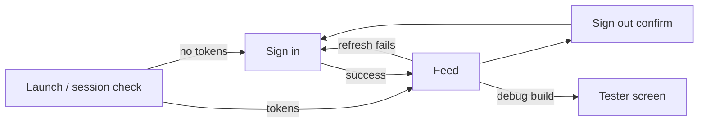

# Assignment 02 — Product Brief: What You Are Building

**v0.2 DRAFT — 2026-11-23** · Added features, screens, configuration. Read this first. Then [requirements-and-directives.md](requirements-and-directives.md) for the rules, and [developer-guide.md](developer-guide.md) for the build path.

## 1. Product in one view

| WH | Answer |
|---|---|
| What | **Signed-in feed app**: the user signs in with email and password, then scrolls a paginated feed that is cached on the device. Backend is a mocked authenticated API |
| Why | Users expect to stay signed in, see content instantly and never hit a blank screen, while tokens stay safe and expired sessions end cleanly |
| Who | A signed-in user who scrolls the feed, pulls to refresh and comes back to the app later |
| Where | Phone (emulator or device), at least two screen sizes, large text. Mock API runs locally |
| When | On every launch, during scrolling, and on return after the app was killed or left idle |
| How | One API client handles 401 and token refresh. Tokens in platform secure storage. Feed cached locally with a timestamp and staleness rule: show cache first, then revalidate |
| Success | Reopen shows the cached feed at once and stays signed in. A token expiry mid-scroll is invisible to the user. Sign out leaves no tokens or user data behind |

## 2. Personas

| Persona | Goal | Pain today | Needs from the app |
|---|---|---|---|
| **Feed reader** | Sign in once and browse quickly | Re-login prompts, blank screens, lost scroll position | Fast cached start, silent refresh, clear states |
| **Returning user on a bad network** | See something useful offline or on slow data | Spinners forever, errors that wipe content | Cached feed with offline indicator, inline retry |
| **Shared-device user** (assumption) | Sign out and leave nothing behind | Previous user's data visible | Sign out clears tokens and cache |
| **Tester / reviewer** | Reproduce expiry and failures on demand | Cannot force a 401 or 5xx | Mock API switches for token lifetime, latency, 401, 5xx |

## 3. Main journey

## 4. Capabilities

| ID | Capability | What it means | Brief section |
|---|---|---|---|
| C1 | Sign in | Email and password against the mock API, input validation, clear errors | A |
| C2 | Secure token storage | Access and refresh tokens in Keychain / Keystore or equivalent. Never in plain preferences, files or logs | B, Directives |
| C3 | Token refresh | One in-flight refresh shared by concurrent calls, then retry the original call | B, C |
| C4 | Expired session | Refresh fails: clear tokens, return to sign-in with a clear message, keep place if safe | B, C |
| C5 | Paginated feed | Cursor or page based, infinite scroll, no duplicate page requests | A, C |
| C6 | Feed cache | Local cache with timestamp and staleness rule. Shown instantly on launch, then updated | A, B |
| C7 | Pull to refresh | Manual refresh of the feed | A |
| C8 | Screen states | Loading, empty, error with retry, offline with cached data | A, C |
| C9 | Sign out | Clears tokens and cached user data | A, Directives |
| C10 | Single API client | All calls go through one client that handles 401 and refresh | Directives |
| C11 | Mock API | Configurable token lifetime, latency, 401 and 5xx injection | B, Deliverables |
| C12 | Accessible, responsive UI | Two screen sizes, large text, screen reader labels in the feed | D, Constraints |

## 5. Product features

Priority: **Must** = required for submission. **Should** = expected for a strong score. **Could** = optional extra.

| ID | Feature | Capability | Priority |
|---|---|---|---|
| F-01 | Sign in with email and password, with input validation before the call | C1 | Must |
| F-02 | Clear error on wrong credentials | C1 | Must |
| F-03 | Access and refresh tokens kept only in platform secure storage | C2 | Must |
| F-04 | Stay signed in after kill and reopen | C2, C6 | Must |
| F-05 | Silent token refresh on 401, then retry the original call | C3, C10 | Must |
| F-06 | One shared in-flight refresh for concurrent 401s | C3, C10 | Must |
| F-07 | Expired session: clear tokens, sign-in with a clear message, keep place if safe | C4 | Must |
| F-08 | Infinite-scroll feed, cursor or page based, no duplicate page requests | C5 | Must |
| F-09 | Cached feed shown instantly on launch, then revalidated | C6 | Must |
| F-10 | Cache timestamp and documented staleness rule | C6 | Must |
| F-11 | Pull to refresh; failure keeps current items | C7 | Must |
| F-12 | Distinct loading, empty, error with retry and offline states | C8 | Must |
| F-13 | Offline indicator over cached content | C8 | Must |
| F-14 | Inline retry for a failed later page, earlier pages kept | C5, C8 | Must |
| F-15 | Sign out clears tokens and all cached feed and user data | C9 | Must |
| F-16 | Single API client for every call | C10 | Must |
| F-17 | Mock API with token lifetime, latency, 401 and 5xx switches | C11 | Must |
| F-18 | Tester screen or config file for mock switches (assumption: either is fine) | C11 | Should |
| F-19 | Two screen sizes, large text, screen reader labels on feed items and actions | C12 | Must |
| F-20 | "Like" with optimistic update and rollback (live follow-up only) | C5, C10 | Could |

## 6. Screens

| ID | Screen | Purpose | Key elements | States | Users | Stories | Sample |
|---|---|---|---|---|---|---|---|
| S-01 | Launch / session check | Route to feed or sign-in | Reads tokens from secure storage, shows cached feed if signed in | checking, signed in, signed out | all | US-03, 08 | [view](samples/screens/S-01-launch-session-check.svg) |
| S-02 | Sign in | Start a session | Email, password, Sign in, inline validation | default, validation error, submitting, wrong credentials, session expired message, offline (assumption) | feed reader | US-01, 02, 05 | [view](samples/screens/S-02-sign-in.svg) |
| S-03 | Feed | Browse content | Feed items, pull to refresh, next-page loader, inline retry, offline banner, Sign out | loading (skeleton), ready (cached), revalidating, empty, error with retry, offline with cache, page error | feed reader, returning user | US-04, 07, 08, 09, 10, 11, 12, 13, 15 | [view](samples/screens/S-03-feed.svg), [offline](samples/screens/S-03-feed-offline.svg) |
| S-04 | Sign out confirm (assumption) | Avoid accidental sign out | Confirm, Cancel | default | shared-device user | US-06 | [view](samples/screens/S-04-sign-out-confirm.svg) |
| S-05 | Tester / debug screen | Force expiry and failures | Token lifetime, latency, force 401, force 5xx (assumption) | default, saved | tester | US-14 | [view](samples/screens/S-05-tester-debug.svg) |

No OS permission prompts: the brief needs none beyond network access.

## 7. Configuration

| Setting | Scope | Default | Who can change | Where | Effect |
|---|---|---|---|---|---|
| Access token lifetime | Mock API | Candidate decides and documents; must work at 10 seconds | Tester | Config file or tester screen | How often silent refresh runs (US-04, 14) |
| Refresh token lifetime / revoke | Mock API | Candidate decides and documents | Tester | Config file or tester screen | Drives the expired-session path (US-05) |
| Mock latency | Mock API | Candidate decides and documents | Tester | Config file or tester screen | Slow-network states (US-11) |
| Force 401 / 5xx | Mock API | Off | Tester | Config file or tester screen | Refresh and page-error paths (US-04, 12, 14) |
| Page size | App or mock API | Candidate decides and documents | Developer | Code constant, README | Items per feed page (US-07) |
| Next-page trigger distance | App | Candidate decides and documents | Developer | Code constant | When the next page loads near the list end (US-07) |
| Cache staleness rule | App | Candidate decides and documents | Developer | Code constant, README | When cached feed is revalidated (US-08) |
| Request timeout | App | Candidate decides and documents | Developer | Code constant, README | When a slow request fails (US-11) |
| Token storage | App | Platform secure storage | Code | README | Where tokens live; never preferences, files or logs (US-02) |
| Text size | Device | OS setting | User | OS accessibility settings | Feed scales without clipping (US-15) |
| Mock API base URL | Environment | Local mock address | Developer | Env var or build config | Where the client calls. No secrets or fixed credentials committed |
| Synthetic test user | Mock API | Candidate decides and documents | Developer | Mock data file, README | Demo sign-in. Synthetic only, never in the app bundle |
| Tester screen visibility | Build | Debug builds only (assumption) | Developer | Build flag | Hides switches from normal users |

## 8. User stories and acceptance criteria

Format: **As a** persona, **I want** action, **so that** benefit. Each has checkable acceptance criteria (AC).

### Sign in and session

| ID | Story | Acceptance criteria |
|---|---|---|
| US-01 | As a feed reader, I want to sign in with email and password so that I can see my feed | Invalid email format or empty password is caught before the call. Wrong credentials show a clear error. Success stores an access token and a refresh token |
| US-02 | As a feed reader, I want my tokens kept safe so that no one can lift my session from the device | Tokens only in platform secure storage. Not in plain preferences, files or logs. No fixed credentials or secrets in the app bundle |
| US-03 | As a feed reader, I want to stay signed in after the app is killed so that I do not log in again | Kill and reopen: still signed in, cached feed shown immediately |
| US-04 | As a feed reader, I want an expired access token renewed silently so that scrolling is not interrupted | On 401, one silent refresh, the original request is retried, user sees no error. Ten parallel 401s trigger exactly one refresh |
| US-05 | As a feed reader, I want a clear message when my session cannot be renewed so that I know why I must sign in again | Refresh token invalid or revoked: tokens cleared, sign-in shown with a clear message. Place kept only if safe (assumption: return to feed top if not) |
| US-06 | As a shared-device user, I want sign out to remove my data so that the next person sees nothing of mine | Sign out clears both tokens and all cached feed and user data. Reopen after sign out shows sign-in, no cached content |

### Feed

| ID | Story | Acceptance criteria |
|---|---|---|
| US-07 | As a feed reader, I want an infinite-scroll feed so that I can keep browsing | Next page loads near the end of the list. Cursor or page based. A page is never requested twice at once |
| US-08 | As a feed reader, I want the cached feed shown instantly on launch so that I never wait on a blank screen | Cached items render before the network returns, then the feed revalidates. Staleness rule documented in the README |
| US-09 | As a feed reader, I want to pull to refresh so that I get the latest items | Pull triggers a fresh load. Success replaces stale data. Failure keeps current items and shows an error |

### Network and failure states

| ID | Story | Acceptance criteria |
|---|---|---|
| US-10 | As a returning user offline, I want to see my cached feed so that the app is still useful | Cached feed shown with an offline indicator. Refresh fails gracefully with a message, content stays |
| US-11 | As a feed reader on a slow network, I want clear loading feedback so that I know the app is working | Skeleton or spinner while loading. Requests time out. No duplicate page requests |
| US-12 | As a feed reader, I want an error on a later page not to wipe what I see so that I keep my place | Server error on page 3: pages 1–2 stay visible, inline retry loads page 3 |
| US-13 | As a feed reader with no items, I want a helpful empty state so that I know the feed is empty, not broken | Empty response shows a message, not a blank screen. Error, empty and offline states are distinct |

### Testability and access

| ID | Story | Acceptance criteria |
|---|---|---|
| US-14 | As a tester, I want mock API switches so that I can force expiry and failures | Token lifetime, latency, 401 and 5xx injection configurable locally. Access token lifetime can be set to 10 seconds and the app stays signed in |
| US-15 | As a feed reader using large text or a screen reader, I want the feed readable so that I can use it | Works on two screen sizes and large text without clipping. Feed items and actions have screen reader labels |

## 9. Traceability

| Capability | Stories | Tests you should write |
|---|---|---|
| C1 | US-01 | Input validation. Wrong credentials error |
| C2 | US-02, 03 | Tokens read from secure storage on restart |
| C3, C10 | US-04 | Refresh then retry. Concurrent 401s give one refresh |
| C4 | US-05 | Invalid refresh token leads to clean sign-out |
| C5 | US-07, 11 | Pagination: next page, no duplicate request |
| C6 | US-03, 08 | Cache shown first, staleness rule |
| C7 | US-09 | Pull to refresh success and failure |
| C8 | US-10, 12, 13 | Offline state. Page 3 error keeps pages 1–2 (one error case) |
| C9 | US-06 | Sign out clears tokens and cache |
| C11 | US-14 | Short token lifetime keeps user signed in |
| C12 | US-15 | Manual check on two screen sizes and large text |

## 10. Out of scope

- Real identity provider, OAuth / social login, real accounts or paid services
- Sign up, password reset, multi-factor authentication (assumption: not in the brief)
- Creating or editing feed content (the "like" action is only a live follow-up)
- Push notifications, analytics, ads
- Real user content (synthetic users and content only)
