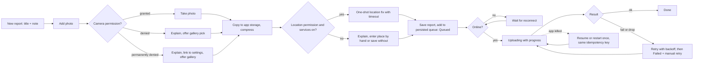
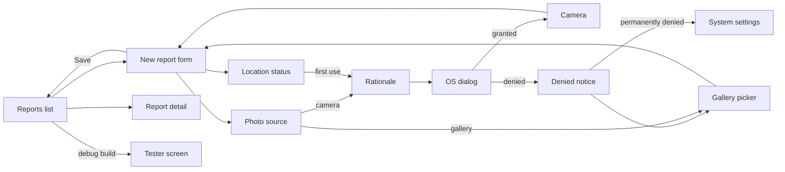

# Assignment 03 — Product Brief: What You Are Building

**v0.2 DRAFT — 2026-11-23** · Added features, screens, configuration. Read this first. Then [requirements-and-directives.md](requirements-and-directives.md) for the rules, and [developer-guide.md](developer-guide.md) for the build path.

## 1. Product in one view

| WH | Answer |
|---|---|
| What | **Field report app**: the user creates a report with a title, a note, one photo (camera or gallery) and the current location, then it uploads reliably to a mocked backend |
| Why | Field users work on unreliable connections and may refuse permissions. Reports must never be lost, duplicated or dead-ended |
| Who | A field user who attaches photos and locations to reports on an unreliable connection |
| Where | Phone (a real device is better for camera; emulator acceptable), at least two screen sizes, large text. Mock upload endpoint runs locally |
| When | At the moment of capture. Upload runs immediately if online, otherwise on reconnect, including after backgrounding or a kill |
| How | Permissions asked in context with a rationale. Photo copied to app storage and compressed. Persisted upload queue with idempotency key, backoff and platform background APIs |
| Success | A report saved offline uploads once on reconnect. A refused permission still leaves a way to finish the report. A kill mid-upload never creates a duplicate |

## 2. Personas

| Persona | Goal | Pain today | Needs from the app |
|---|---|---|---|
| **Field user** | Capture a photo report on site and move on | Uploads that fail silently or restart from scratch, lost photos | Fast capture, visible progress, reliable queue |
| **Privacy-cautious field user** | Use the app without granting every permission | Apps that ask for everything at launch or stop working on "Deny" | In-context asks, rationale, alternatives (gallery, typed place) |
| **Tester / reviewer** | Reproduce drops and errors on demand | Cannot force a failed or oversized upload | Mock endpoint with latency, mid-upload drop, 5xx and 413 switches |

## 3. Main journey

## 4. Capabilities

| ID | Capability | What it means | Brief section |
|---|---|---|---|
| C1 | Report creation | Title, note, one photo, current location | A |
| C2 | Photo capture / pick | Camera or gallery. File copied to app storage, not a temporary path | A, B |
| C3 | Photo processing | Compress or resize before upload. Large photo handled without crash | A, C |
| C4 | Location | Coarse unless precise is justified. One-shot fix with a timeout. Report can be saved without location | B, C |
| C5 | Permission handling | One wrapper returning granted / denied / permanently denied / limited. Asked at moment of use with rationale. Revoked state handled | A, B, C, Directives |
| C6 | Alternatives on refusal | Gallery pick instead of camera, typed place instead of GPS, settings link when permanently denied | C, Directives |
| C7 | Persisted upload queue | Survives kill. States Queued / Uploading / Done / Failed | A, B |
| C8 | Progress and cancel | Real per-report progress, cancel option | A, C |
| C9 | Retry and idempotency | Auto retry with backoff and cap, manual retry, idempotency key per report | A, B, Directives |
| C10 | Background safety | Platform background task API. Upload resumes or restarts once after backgrounding or kill | A, B, C |
| C11 | Mock upload API | Configurable latency, mid-upload drops, 5xx and 413 | B, Deliverables |
| C12 | Accessible, responsive UI | Two screen sizes, large text, screen reader support | D, Constraints |

## 5. Product features

Priority: **Must** = required for submission. **Should** = expected for a strong score. **Could** = optional extra.

| ID | Feature | Capability | Priority |
|---|---|---|---|
| F-01 | Create a report with title, note, one photo and location | C1 | Must |
| F-02 | Take a photo with the camera | C2 | Must |
| F-03 | Pick a photo from the gallery | C2, C6 | Must |
| F-04 | Copy the chosen photo to app storage | C2 | Must |
| F-05 | Compress or resize before queueing; graceful error on low storage or oversized photo | C3 | Must |
| F-06 | EXIF handling stated in README | C3 | Must |
| F-07 | One-shot location fix with timeout, coarse unless precise is justified | C4 | Must |
| F-08 | Save without location, or with a place typed by hand | C4, C6 | Must |
| F-09 | One permission wrapper: granted / denied / permanently denied / limited | C5 | Must |
| F-10 | Ask at moment of use with a short rationale; no prompt on first launch | C5 | Must |
| F-11 | Settings link when permanently denied, no repeated system prompts | C5, C6 | Must |
| F-12 | Detect revoked or limited state on next use and offer the same alternatives | C5, C6 | Must |
| F-13 | Persisted upload queue: Queued / Uploading / Done / Failed | C7 | Must |
| F-14 | Real per-report progress and cancel | C8 | Must |
| F-15 | Auto retry with backoff and cap, then Failed with manual retry | C9 | Must |
| F-16 | Idempotency key per report; mock treats a repeat as the same report | C9, C11 | Must |
| F-17 | Upload on reconnect without user action | C7, C10 | Must |
| F-18 | Platform background task API; resume or restart once after kill | C10 | Must |
| F-19 | 413 shown as a clear error, not retried (assumption) | C9, C11 | Must |
| F-20 | Mock endpoint with latency, mid-upload drop, 5xx and 413 switches | C11 | Must |
| F-21 | Tester screen or config file for mock switches (assumption: either is fine) | C11 | Should |
| F-22 | Resumable or chunked upload | C7 | Could |
| F-23 | Multiple photos per report with per-file progress (live follow-up only) | C2, C8 | Could |
| F-24 | Two screen sizes, large text, screen reader labels on photo, location and status controls | C12 | Must |

## 6. Screens

| ID | Screen | Purpose | Key elements | States | Users | Stories | Sample |
|---|---|---|---|---|---|---|---|
| S-01 | Reports list | Track uploads | Report rows (title, state, progress), New report, Retry on Failed, Cancel on Uploading | empty, ready, offline, uploading, failed | field user | US-10, 11, 12, 13 | [view](samples/screens/S-01-reports-list.svg) |
| S-02 | New report form | Capture a report | Title, note, Add photo, location field, Save | draft, saving, saved (Queued), offline, storage error | field user | US-01, 03, 04, 08, 11 | [view](samples/screens/S-02-new-report-form.svg) |
| S-03 | Photo source choice | Pick camera or gallery | Take photo, Choose from gallery | default, camera unavailable (denied) | field user | US-02, 06 | [view](samples/screens/S-03-photo-source-choice.svg) |
| S-04 | Permission rationale (in-app) | Explain why before the OS asks | Short reason, Continue, Not now | camera, location | privacy-cautious user | US-05 | [view](samples/screens/S-04-permission-rationale.svg) |
| S-05 | OS permission dialog (system) | Platform grant prompt | Allow, Deny, precise / approximate (where the OS offers it) | granted, denied, permanently denied, limited | privacy-cautious user | US-05, 06, 07 | [view](samples/screens/S-05-os-permission-dialog.svg) |
| S-06 | Permission denied notice | Avoid a dead end | Effect explained, alternative (gallery or type place), Open settings if permanently denied | denied, permanently denied, revoked | privacy-cautious user | US-06, 07, 09 | [view](samples/screens/S-06-permission-denied-notice.svg) |
| S-07 | Camera | Take the photo | Platform or in-app camera, retake, use photo | capturing, captured, error | field user | US-02 | [view](samples/screens/S-07-camera.svg) |
| S-08 | Gallery picker (system) | Choose an existing photo | Platform picker, limited selection where the OS offers it | picked, cancelled, limited | field user | US-02, 06 | [view](samples/screens/S-08-gallery-picker.svg) |
| S-09 | Location status | Show the fix or the reason it is missing | Getting location, place, Enter place by hand, Save without | locating, located, timeout, services off, permission denied | field user | US-04, 08 | [view](samples/screens/S-09-location-status.svg) |
| S-10 | Report detail | See one report and its upload | Photo, title, note, location, state, progress, Cancel, Retry | queued, uploading, done, failed, too large (413) | field user | US-10, 12, 15 | [view](samples/screens/S-10-report-detail.svg), [too large](samples/screens/S-10-report-detail-too-large.svg) |
| S-11 | Tester / debug screen | Reproduce bad networks | Latency, mid-upload drop, force 5xx, force 413 (assumption) | default, saved | tester | US-15 | [view](samples/screens/S-11-tester-debug.svg) |

## 7. Configuration

| Setting | Scope | Default | Who can change | Where | Effect |
|---|---|---|---|---|---|
| Mock latency | Mock endpoint | Candidate decides and documents | Tester | Config file or tester screen | Slow-network progress and cancel (US-10, 15) |
| Mid-upload drop | Mock endpoint | Off | Tester | Config file or tester screen | Drives retry and resume (US-12, 13) |
| Force 5xx | Mock endpoint | Off | Tester | Config file or tester screen | Retry with backoff path (US-12) |
| Force 413 | Mock endpoint | Off | Tester | Config file or tester screen | Too-large error, not retried (assumption) (US-15) |
| Retry base delay, cap, max attempts | App | Candidate decides and documents | Developer | Code constant, README | When a report turns Failed (US-12) |
| Request timeout | App | Candidate decides and documents | Developer | Code constant, README | When a slow upload counts as failed |
| Photo max dimension and quality | App | Candidate decides and documents | Developer | Code constant, README | Size sent to the mock endpoint (US-03) |
| EXIF stripping | App | Candidate decides and documents | Developer | Code, README | Which photo metadata leaves the device (US-03) |
| Location accuracy | App | Coarse | Developer, justified in README | Manifest / Info.plist, code | Precise only if justified (US-04) |
| Location fix timeout | App | Candidate decides and documents | Developer | Code constant | When to give up and allow saving without (US-04) |
| Declared permissions | App | Minimum needed: camera, location; gallery via system picker where possible (assumption) | Developer | Manifest / Info.plist, README | What the OS can prompt for (US-05) |
| Camera / location permission | Device | Not granted | User | OS dialog or system settings | Unlocks camera and auto location (US-05–09) |
| Text size | Device | OS setting | User | OS accessibility settings | Layout scales without clipping (US-16) |
| Mock endpoint base URL | Environment | Local mock address | Developer | Env var or build config | Where uploads go. No secrets committed |
| Tester screen visibility | Build | Debug builds only (assumption) | Developer | Build flag | Hides switches from normal users |

## 8. User stories and acceptance criteria

Format: **As a** persona, **I want** action, **so that** benefit. Each has checkable acceptance criteria (AC).

### Create a report

| ID | Story | Acceptance criteria |
|---|---|---|
| US-01 | As a field user, I want to create a report with title, note, photo and location so that my observation is complete | All four parts can be added. Report is saved locally and appears in the list as Queued |
| US-02 | As a field user, I want to take a photo or pick one from the gallery so that I can attach the right image | Both paths work. The chosen file is copied to app storage so it survives the temp path being cleared |
| US-03 | As a field user, I want photos compressed before upload so that uploads are faster and cheaper | Photo is resized or compressed before queueing. Low storage or an oversized photo shows a graceful error, no crash. EXIF handling stated in README |
| US-04 | As a field user, I want my location added automatically so that I do not type it | One-shot fix with a timeout. Coarse unless precise is justified in the README. Timeout does not block saving |

### Permissions

| ID | Story | Acceptance criteria |
|---|---|---|
| US-05 | As a privacy-cautious user, I want to be asked for camera or location only when I use them so that I understand why | No permission prompt on first launch. A short rationale is shown at the moment of use. Only the minimum permissions are declared |
| US-06 | As a privacy-cautious user, I want to finish my report even if I deny a permission so that I am not stuck | Camera denied: effect explained, gallery pick offered. Location denied: effect explained, place can be entered by hand |
| US-07 | As a privacy-cautious user who chose "don't ask again", I want a path to settings so that I can change my mind | Permanently denied: explanation plus a link to system settings. No repeated system prompts |
| US-08 | As a field user, I want the app to cope if location services are off so that I can still save | Clear message. Report can be saved without location |
| US-09 | As a field user, I want the app to recover if I revoke a permission while it is open so that it does not crash | Revoked or limited state detected on next use. Same alternatives as denial are offered (assumption: checked on resume and before each use) |

### Upload

| ID | Story | Acceptance criteria |
|---|---|---|
| US-10 | As a field user, I want to see each report's upload state and progress so that I know what has arrived | List shows Queued / Uploading / Done / Failed per report. Progress reflects real bytes sent. A cancel option is available |
| US-11 | As a field user offline, I want my report saved and queued so that it uploads when I reconnect | With network off the report saves as Queued. On reconnect it uploads without user action |
| US-12 | As a field user, I want failed uploads retried so that a blip does not lose my report | Automatic retry with backoff and a cap. After the limit the report shows Failed with a manual retry. No unbounded loops |
| US-13 | As a field user, I want an upload to survive backgrounding or a kill so that I can put the phone away | Uses the platform background API. After a kill mid-upload, the upload resumes or restarts once. Queue restored from storage |
| US-14 | As a field user, I want retries never to create a duplicate report so that the server has one copy | Each report has an idempotency key. Mock endpoint treats a repeated key as the same report. Test: two sends give one report |

### Testability and access

| ID | Story | Acceptance criteria |
|---|---|---|
| US-15 | As a tester, I want mock endpoint switches so that I can reproduce bad networks | Latency, mid-upload drop, 5xx and 413 configurable locally. 413 shows a clear error, not a crash or endless retry (assumption: 413 is not retried) |
| US-16 | As a field user with large text or a screen reader, I want the app usable so that I can file reports | Works on two screen sizes and large text. Photo, location and status controls have screen reader labels |

## 9. Traceability

| Capability | Stories | Tests you should write |
|---|---|---|
| C1–C2 | US-01, 02 | Report saved with media in app storage |
| C3 | US-03 | Large photo / low storage error path (one error case) |
| C4 | US-04, 08 | Location timeout. Save without location |
| C5–C6 | US-05, 06, 07, 09 | Permission states: granted, denied, permanently denied, limited, revoked |
| C7 | US-10, 11 | Queue state transitions. Offline then reconnect |
| C8 | US-10 | Progress and cancel |
| C9 | US-12, 14 | Retry with backoff cap. Idempotency key prevents duplicates |
| C10 | US-13 | Queue restore after kill |
| C11 | US-15 | 5xx and 413 handling |
| C12 | US-16 | Manual check on two screen sizes and large text |

## 10. Out of scope

- Real upload service, cloud storage, real accounts or paid services
- Real personal photos (synthetic content only)
- Multiple photos per report (only as a live follow-up)
- Video, audio, maps or continuous / background location tracking
- Sign-in, report editing after upload, or sharing (assumption: not in the brief)
