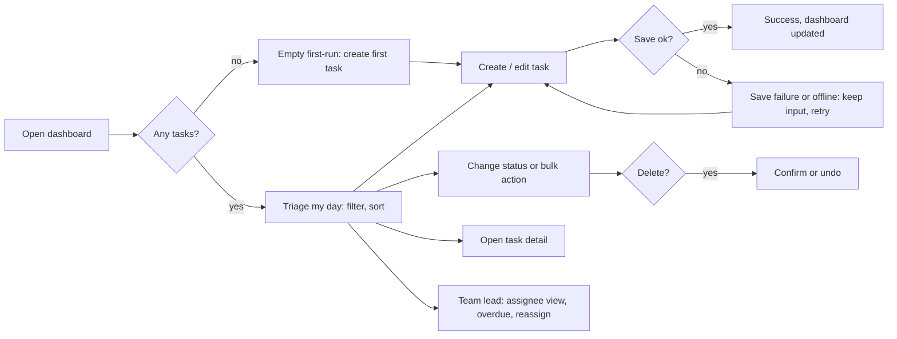
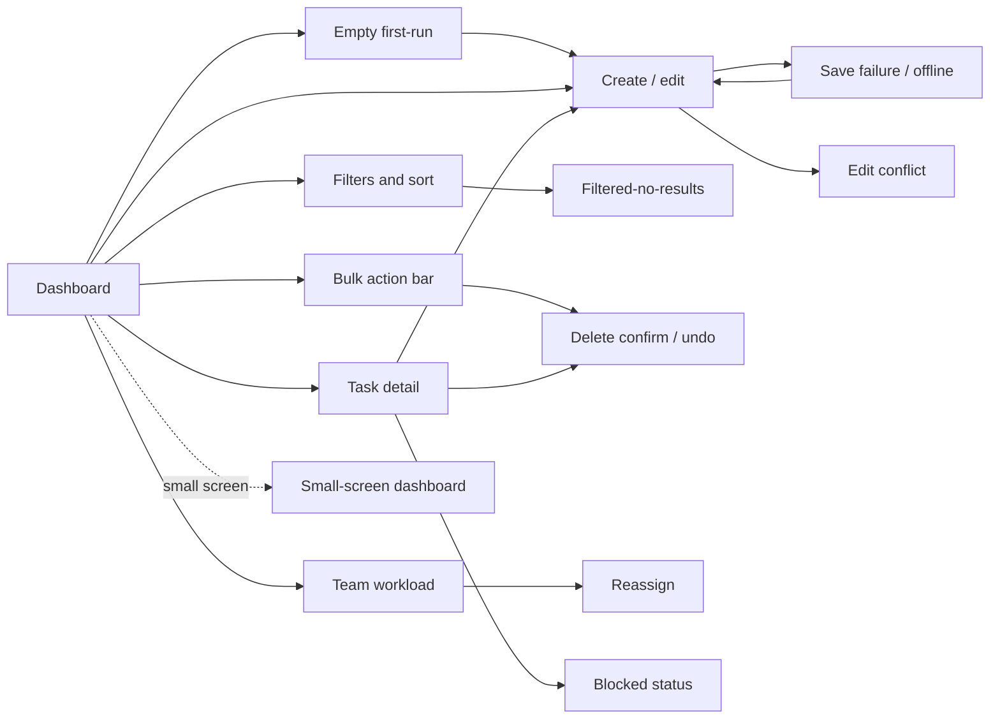

# Assignment 01 — Product Brief: What You Are Designing

**v0.2 DRAFT — 2026-11-23** · Added features, screens, configuration. Read this first. Then [requirements-and-directives.md](requirements-and-directives.md) for the rules, and [developer-guide.md](developer-guide.md) for the build path.

## 1. Product in one view

| WH | Answer |
|---|---|
| What | **Task Dashboard**: a task management dashboard, designed from lightweight research notes through flows and wireframes to hi-fi screens with every state |
| Why | Tests the full design process: problem framing, flows, structure, visual craft and state coverage |
| Who | Assumed users: a team member tracking own tasks, and a team lead reviewing workload. Both are assumptions the candidate states |
| Where | Desktop first, with a usable small-screen layout. Light and dark theme for the dashboard |
| When | 6–8 hours of design effort. Review 30–45 minutes |
| How | Any design tool. Figma link (view access) or exported PDF/PNG, plus a 1–2 page rationale doc |
| Success | Every screen traces to a stated need. Every key screen shows all six states. Status never relies on colour alone. A **Blocked** status can be added live without breaking consistency |

## 2. Personas

Both personas are assumptions from the brief. The candidate writes the full versions and labels them **Assumption**.

| Persona | Goal | Pain today (assumption) | Needs from the dashboard |
|---|---|---|---|
| **Team member** | Track and finish own tasks | Hard to see what to do first when work piles up (assumption) | Create tasks fast, triage the day, filter, sort, change status, bulk actions, recover from failures |
| **Team lead** | Review team workload | Hard to see who is overloaded or overdue (assumption) | Assignee view, overdue tasks, reassign |

## 3. Main journey

## 4. Capabilities

| ID | Capability | What it means | Brief section |
|---|---|---|---|
| C1 | Problem framing | 2 labelled personas, 5–8 needs, open questions, AI use noted | A |
| C2 | Task creation and editing | Entry points, validation, success, cancel | B, C, D |
| C3 | Daily triage | Filter, sort, change status, bulk action | B |
| C4 | Team workload review | Assignee view, overdue, reassign | B |
| C5 | Failure recovery | Save failure, offline, undo delete | B, E |
| C6 | Information architecture | Navigation model, screen inventory, wireframes with layout rationale | C |
| C7 | Hi-fi screens and theming | Dashboard, detail, create/edit, empty first-run, filtered-no-results. Light and dark. Small-screen dashboard | D |
| C8 | State coverage | Default, loading, empty, error, success, disabled. Safe delete. No colour-only status | E |
| C9 | Accessibility | Contrast, keyboard path, focus, text alternatives, headings, announced toasts | F |
| C10 | System reuse | Shared tokens and components reused; extensible for a new status | H, design instructions |

## 5. Product features

Priority: **Must** = required for submission. **Should** = expected for a strong score. **Could** = optional extra.

| ID | Feature | Capability | Priority |
|---|---|---|---|
| F-01 | Labelled personas, 5–8 user needs with IDs, open questions, AI use noted | C1 | Must |
| F-02 | Create a task from every entry point, with validation, success and cancel | C2 | Must |
| F-03 | Edit a task | C2 | Must |
| F-04 | Task detail with defined behaviour for a 200-character title | C2 | Must |
| F-05 | Empty first-run with one clear first action | C2, C7 | Must |
| F-06 | Filter and sort tasks | C3 | Must |
| F-07 | Filtered-no-results state | C3, C8 | Must |
| F-08 | Change status of one task | C3 | Must |
| F-09 | Bulk action on several tasks | C3 | Must |
| F-10 | "What to do first" view for a large overdue backlog (300-overdue scenario) | C3 | Must |
| F-11 | Workload view by assignee, with overdue shown | C4 | Must |
| F-12 | Reassign a task, with success and error | C4 | Must |
| F-13 | Save-failure and offline states that keep input and offer retry | C5 | Must |
| F-14 | Delete with deliberate confirmation or undo | C5, C8 | Must |
| F-15 | Edit-conflict state for the second editor | C5 | Must |
| F-16 | Navigation model, screen inventory, wireframes with layout rationale | C6 | Must |
| F-17 | Six states per key screen: default, loading, empty, error, success, disabled | C8 | Must |
| F-18 | Status and priority shown with text or icon, never colour alone | C8, C9 | Must |
| F-19 | Dashboard in light and dark from shared tokens | C7, C10 | Must |
| F-20 | One small-screen dashboard layout | C7 | Must |
| F-21 | Keyboard path to create and complete a task, visible focus, headings, text alternatives, announced toasts | C9 | Must |
| F-22 | Blocked status with reason, added live by reusing components and tokens | C10 | Should |
| F-23 | Light and dark for screens beyond the dashboard | C7 | Could |

## 6. Screens to design

| ID | Screen or frame | Purpose | Key elements | States to show | Users | Stories |
|---|---|---|---|---|---|---|
| S-01 | Dashboard (my tasks) | Triage the day | Task list, status and priority chips (text or icon), overdue marker, filter and sort entry, create button, light and dark | default, loading, empty, error, success, disabled | team member | US-04, 05, 06, 13 |
| S-02 | Empty first-run | Get started | Short explanation, one primary "create first task" action | empty | team member | US-03 |
| S-03 | Filters and sort | Narrow the list | Filter fields (status, priority, assignee, due), sort order, clear all, apply | default, disabled, filtered-no-results | team member, team lead | US-04 |
| S-04 | Filtered-no-results | Recover from an empty filter | Active filters shown, clear filter action | empty | team member | US-04 |
| S-05 | Task detail | See one task in full | Full title (200-character handling), status, priority, assignee, due date, edit, delete | default, loading, error, success, disabled | all | US-02, 11, 14 |
| S-06 | Create / edit task | Capture or change work | Title, fields, validation messages, save, cancel | default, loading, error (validation), success, disabled | team member | US-01, 09, 12 |
| S-07 | Bulk action bar | Act on many tasks | Selected count, status change, delete, cancel selection | default, loading, error, success, disabled | team member | US-05 |
| S-08 | Delete confirmation or undo | Prevent accidental loss | Confirm dialog or undo toast (announced) | default, success, undone | team member | US-10 |
| S-09 | Team workload | Spot overload | Tasks grouped by assignee, overdue counts, reassign entry | default, loading, empty, error | team lead | US-07 |
| S-10 | Reassign | Balance work | Assignee picker, confirm | default, loading, error, success, disabled | team lead | US-08 |
| S-11 | Save failure and offline | Keep work safe | Message with cause and next step, kept input, retry | error, offline, retrying, success | team member | US-09 |
| S-12 | Edit conflict | Avoid overwriting | Who changed what, choose to keep or reload (Candidate decides and documents) | conflict, resolved | all | US-11 |
| S-13 | Small-screen dashboard | Use the dashboard on a small screen | Same components as S-01, reflowed | default, loading, empty, error | team member | US-13 |
| S-14 | Blocked status (live follow-up) | Show why work is stuck | Blocked chip, reason field, filter option, detail field | default, error (missing reason), success | all | US-14 |

## 7. Configuration

| Setting | Scope | Default | Who can change | Where | Effect |
|---|---|---|---|---|---|
| Theme (light, dark) | User | Candidate decides and documents | Each user (assumption) | Theme toggle | Swaps semantic colour tokens. Dashboard required in both |
| Small-screen breakpoint | Product | Candidate decides and documents | Designer | Layout grid notes | When the dashboard switches to the small-screen layout |
| Status list | Product | Candidate decides and documents. **Blocked** added in live follow-up | Designer | Shared status chip and tokens | Dashboard, filters, detail and states |
| Priority levels | Product | Candidate decides and documents | Designer | Shared priority chip | List order and chips (text or icon, not colour alone) |
| Default dashboard view (filter, sort) | User | Candidate decides and documents (answers the 300-overdue scenario) | Each user | Filters and sort | What the dashboard shows first |
| Role-based visibility | Role | Team member sees own tasks; team lead also sees team workload (assumption) | Candidate decides and documents | Navigation model | Which screens and actions appear (S-09, S-10) |
| Long-title rule | Product | Must handle 200 characters; truncation rule: Candidate decides and documents | Designer | List row and detail spec | Title in list and detail |
| Delete undo window | Product | Candidate decides and documents | Designer | Toast spec | How long undo stays available |
| Blocked reason required | Status | Required (assumption) | Designer | Create / edit and detail | Validation on the reason field |

## 8. User stories and acceptance criteria

Format: **As a** persona, **I want** action, **so that** benefit. Each has checkable acceptance criteria (AC) for the design.

### Tasks

| ID | Story | Acceptance criteria |
|---|---|---|
| US-01 | As a team member, I want to create a task from where I am so that I capture work quickly | Entry points shown in the flow. Validation, success and cancel paths designed. Create/edit has hi-fi and all states |
| US-02 | As a team member, I want to open a task's detail so that I see everything about it | Task detail in wireframe and hi-fi. A 200-character title has defined behaviour in list and detail |
| US-03 | As a team member, I want an empty first-run screen so that I know how to start | Empty first-run hi-fi screen with a clear first action |

### Triage

| ID | Story | Acceptance criteria |
|---|---|---|
| US-04 | As a team member, I want to filter and sort my tasks so that I see what matters today | Filter and sort in the triage flow. Filters wireframed. Filtered-no-results screen designed |
| US-05 | As a team member, I want to change status, one task or many at once, so that I keep my list current | Status change and bulk action in the flow. Status and priority use text or icon, not colour alone |
| US-06 | As a team member with 300 overdue tasks, I want the dashboard to show me what to do first so that I am not overwhelmed | Scenario answered: what the dashboard shows first, and why |

### Team workload

| ID | Story | Acceptance criteria |
|---|---|---|
| US-07 | As a team lead, I want to see work by assignee and what is overdue so that I spot overload | Assignee view and overdue shown in the workload flow |
| US-08 | As a team lead, I want to reassign a task so that work is balanced | Reassign step in the flow, with success and error |

### Failure and recovery

| ID | Story | Acceptance criteria |
|---|---|---|
| US-09 | As a team member, I want my work kept when a save fails or I go offline so that I do not lose input | Save-failure and offline states designed. Error says what happened and what to do next |
| US-10 | As a team member, I want to undo or confirm a delete so that I do not lose a task by mistake | Delete uses a deliberate confirmation or undo. Undo-delete in the recovery flow |
| US-11 | As a team member, I want to know when someone else edited the same task so that I do not overwrite their work | Scenario answered: what the second editor sees, designed as a state |

### Access and consistency

| ID | Story | Acceptance criteria |
|---|---|---|
| US-12 | As a keyboard user, I want to create and complete a task without a mouse so that I can work my way | Keyboard path documented with visible focus. Heading structure and text alternatives defined. Toasts announced |
| US-13 | As any user, I want light or dark theme and a small-screen layout so that the dashboard works where I am | Dashboard in light and dark from shared tokens. One small-screen dashboard. Contrast results for both themes |
| US-14 | As a team member, I want to mark a task **Blocked** with a reason so that others know why it is stuck | Live follow-up: status, reason field, dashboard, filters, detail and states updated by reusing existing components and tokens |

## 9. Traceability

| Capability | Stories | How it is evidenced in the deliverable |
|---|---|---|
| C1 | all | Personas labelled **Assumption**, need IDs, open questions, AI use in rationale doc |
| C2 | US-01, 02, 03 | Create-task flow. Detail and create/edit wireframes and hi-fi. Empty first-run screen |
| C3 | US-04, 05, 06 | Triage flow. Filter wireframe. Filtered-no-results screen. 300-overdue scenario answer |
| C4 | US-07, 08 | Team workload flow with assignee view, overdue, reassign |
| C5 | US-09, 10, 11 | Recovery flow. Save-failure, offline, undo-delete and conflict states |
| C6 | US-01–08 | Navigation model, screen inventory, layout rationale tied to need IDs |
| C7 | US-13 | Hi-fi set, dashboard in light and dark, small-screen dashboard |
| C8 | US-05, 09, 10 | Six states per key screen. Delete confirmation or undo. Non-colour status |
| C9 | US-12, 13 | Accessibility check summary: contrast table, keyboard path, focus, headings, announcements |
| C10 | US-14 | Live Blocked-status change using shared status chip, filter and detail components |

## 10. Out of scope

- A working build or code (design deliverables only)
- Real user research, real metrics or quotes (assumptions only)
- Real brands, people or user data
- Screens or features with no stated user need
- Full multi-device sets beyond desktop plus one small-screen dashboard (assumption: extra layouts go under "what I would do next")
