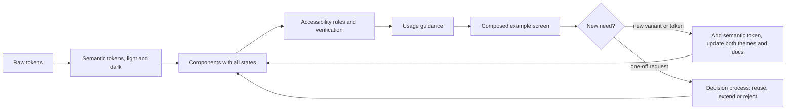
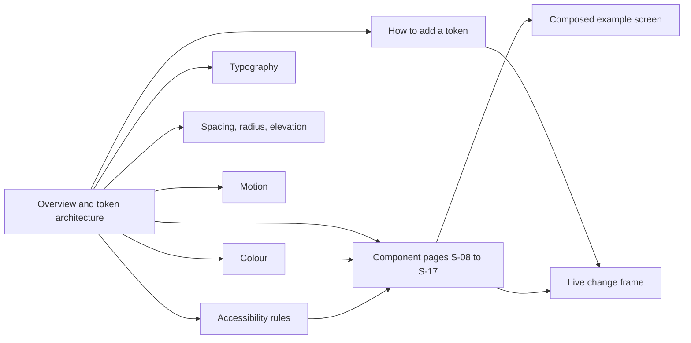

# Assignment 02 — Product Brief: What You Are Designing

**v0.2 DRAFT — 2026-11-23** · Added features, screens, configuration. Read this first. Then [requirements-and-directives.md](requirements-and-directives.md) for the rules, and [developer-guide.md](developer-guide.md) for the build path.

## 1. Product in one view

| WH | Answer |
|---|---|
| What | **Design System Starter**: a small, documented design system with tokens, 8–10 components with states, accessibility rules, usage guidance, light and dark |
| Why | Tests system thinking, consistency, and the ability to document design so others can reuse it |
| Who | Assumed consumers: designers and developers on a small product team. The candidate states these assumptions |
| Where | A web product, desktop and small screens |
| When | 6–8 hours of design effort. Review 30–45 minutes |
| How | Any design tool. Figma link (view access) or exported PDF/PNG, a token table or file, plus a 1–2 page rationale doc |
| Success | Components use semantic tokens only. Every required state exists in both themes. Contrast is verified in both themes. A new variant or token can be added live without inconsistency |

## 2. Personas

Both personas are assumptions from the brief. The candidate states them as assumptions.

| Persona | Goal | Pain today (assumption) | Needs from the system |
|---|---|---|---|
| **Product designer** | Build screens fast and consistently | One-off styles drift between screens (assumption) | Clear tokens, component states, when-to-use and when-not-to guidance |
| **Front-end developer** | Implement screens that match the design | Hard-coded values and missing states (assumption) | Token table or file, state specs, keyboard behaviour, focus spec |

## 3. Main journey

## 4. Capabilities

| ID | Capability | What it means | Brief section |
|---|---|---|---|
| C1 | Foundations | Colour, type scale, spacing (4px grid suggested), radius, elevation, motion | A |
| C2 | Token architecture | Raw and semantic layers. Naming rules. How to add a token | A |
| C3 | Theming | Light and dark values for every semantic colour | A |
| C4 | Components | 8–10 components with every required state, both themes | B |
| C5 | Accessibility rules | Contrast table both themes, focus ring, keyboard per component, target size, labels, error association, reduced motion | C |
| C6 | Usage guidance | When to use, when not to, content rules, do and don't | D |
| C7 | Composed example | One screen (form with a table or dialog) using only the system | D |
| C8 | Extensibility | Answers to scenarios and a live variant or token change | E, F |

## 5. Product features

Priority: **Must** = required for submission. **Should** = expected for a strong score. **Could** = optional extra.

| ID | Feature | Capability | Priority |
|---|---|---|---|
| F-01 | Raw tokens: colour, type scale, spacing (4px grid suggested), radius, elevation, motion | C1 | Must |
| F-02 | Semantic token layer (for example `text-primary`, `surface`, `border-focus`) | C2 | Must |
| F-03 | Token naming rules | C2 | Must |
| F-04 | "How to add a token" guide | C2, C8 | Must |
| F-05 | Light and dark value for every semantic colour | C3 | Must |
| F-06 | 8–10 components, each with every required state, in both themes | C4 | Must |
| F-07 | Component specs reference tokens only, no hard-coded values | C4 | Must |
| F-08 | Contrast verification table for all text and UI tokens, both themes | C5 | Must |
| F-09 | One focus ring spec, keyboard behaviour per component, target size | C5 | Must |
| F-10 | Labels, text alternatives, error association, no colour-only meaning, announced toasts | C5 | Must |
| F-11 | Reduced-motion rule | C5 | Must |
| F-12 | Usage guidance per component: when to use, when not to, content rules, do and don't | C6 | Must |
| F-13 | Composed example screen (form with a table or dialog), system parts only | C7 | Must |
| F-14 | Scenario answers: doubled label length, brand colour failing in dark, one-off card variant | C8 | Must |
| F-15 | Warning variant or new semantic token added live, docs and both themes updated | C8 | Should |
| F-16 | Token file as CSS or JSON (a table is also accepted) | C2 | Could |
| F-17 | Justified alternative component in place of one from the list | C4 | Could |

## 6. Screens to design

Screens are documentation pages and specimen frames. Pick 8–10 component pages from S-08 to S-17, or replace one with a justified alternative. Every component page shows all its states in light and dark.

| ID | Page or frame | Purpose | Key elements | States to show | Users | Stories |
|---|---|---|---|---|---|---|
| S-01 | Overview and token architecture | Explain how the system is built | Raw vs semantic layers, naming rules, page index | default | designer, developer | US-02 |
| S-02 | Colour tokens | One source for colour | Raw palette, semantic colours with light and dark columns | light, dark | designer, developer | US-01, 03 |
| S-03 | Typography | Type scale | Sizes, weights, line heights, token names | light, dark | designer, developer | US-01 |
| S-04 | Spacing, radius, elevation | Layout foundations | Spacing scale (4px grid suggested), radius and elevation tokens | light, dark | designer, developer | US-01 |
| S-05 | Motion | Movement rules | Duration and easing tokens, reduced-motion rule | default, reduced motion | designer, developer | US-01, 10 |
| S-06 | How to add a token | Grow the system safely | Steps, naming check, both-theme update, docs update | default | all | US-04 |
| S-07 | Accessibility rules | Prove both themes are usable | Contrast table with ratios and pass/fail, focus ring spec, target size, label and error rules | light, dark | reviewer, developer | US-08, 09, 10 |
| S-08 | Button | Specimen and guidance | Variants, token map, keyboard notes, usage guidance | default, hover, focus, active, disabled, loading | designer, developer | US-05, 06, 09, 11 |
| S-09 | Text input | Specimen and guidance | Label, help text, error association, token map | default, focus, filled, error, disabled | designer, developer | US-05, 06, 10, 11 |
| S-10 | Select or combobox | Specimen and guidance | Options list, keyboard notes | closed, open, focus, error, disabled | designer, developer | US-05, 06, 09, 11 |
| S-11 | Checkbox and radio | Specimen and guidance | Group label, error association | unchecked, checked, focus, disabled, error | designer, developer | US-05, 06, 10, 11 |
| S-12 | Badge or status chip | Specimen and guidance | Text or icon with colour, never colour alone | neutral, success, warning, danger | designer, developer | US-05, 07, 10, 11 |
| S-13 | Card | Specimen and guidance | Content slots, one-off variant decision note | default, hover, selected | designer, developer | US-05, 06, 11, 13 |
| S-14 | Table or list row | Specimen and guidance | Columns, selection | default, selected, empty, loading | designer, developer | US-05, 06, 11 |
| S-15 | Dialog | Specimen and guidance | Title, body, actions, keyboard notes | confirm, destructive, focus trap, Esc to close | designer, developer | US-05, 09, 11 |
| S-16 | Toast or banner | Specimen and guidance | Message, action, live-region note | info, success, error, announced | designer, developer | US-05, 10, 11 |
| S-17 | Tabs or navigation item | Specimen and guidance | Labels, keyboard notes | default, current, focus, disabled | designer, developer | US-05, 09, 11 |
| S-18 | Composed example screen | Show parts working together | Form with a table or dialog, system tokens and components only | light, dark (assumption) | designer, developer | US-12 |
| S-19 | Live change frame | Show a safe addition | Warning variant or new token, before and after, both themes, docs updated | before, after, light, dark | all | US-04, 07 |

## 7. Configuration

| Setting | Scope | Default | Who can change | Where | Effect |
|---|---|---|---|---|---|
| Theme (light, dark) | Product | Candidate decides and documents | System maintainer (assumption) | Semantic colour token table | Swaps semantic colours. No component spec changes |
| Raw token values | System | Candidate decides and documents. Spacing on a 4px grid suggested | System maintainer (assumption) | Raw token layer | Every semantic token that references them |
| Semantic token mapping | Theme | Candidate decides and documents | System maintainer (assumption) | Semantic token layer | Components update with no edits |
| Brand colour | System | Candidate decides and documents. Must pass contrast in both themes | System maintainer (assumption) | Raw token plus dark-theme semantic value | Fix for the dark-mode contrast scenario without touching components |
| Contrast targets | System | Candidate decides and documents | System maintainer (assumption) | Accessibility rules page | Pass/fail in the verification table |
| Focus ring | System | One spec for all components | System maintainer (assumption) | Accessibility rules page | Focus state of every component |
| Target size | System | Candidate decides and documents | System maintainer (assumption) | Accessibility rules page | Minimum size of interactive components |
| Reduced motion | User | Follows the user's system setting | Each user, via device setting | Motion tokens | Motion reduced or removed |
| Breakpoints | Product | Candidate decides and documents (desktop and small screens) | System maintainer (assumption) | Layout notes | Component and example-screen reflow |
| Label length and language | Content | Must hold a label twice as long | Content author | Content rules per component | Wrapping, truncation and width rules |
| Component variants (for example warning) | Component | Set listed in requirements. Warning added live | System maintainer via decision process | Component page and tokens | New variant in both themes and docs |

## 8. User stories and acceptance criteria

Format: **As a** persona, **I want** action, **so that** benefit. Each has checkable acceptance criteria (AC) for the design.

### Tokens and theming

| ID | Story | Acceptance criteria |
|---|---|---|
| US-01 | As a designer, I want raw foundation tokens so that every value has one source | Colour, type scale, spacing, radius, elevation and motion defined once |
| US-02 | As a developer, I want semantic tokens with clear names so that I never pick a raw hue | Semantic names (for example `text-primary`, `surface`, `border-focus`). Naming rules documented |
| US-03 | As a designer, I want light and dark values for every semantic colour so that both themes stay consistent | Every semantic colour has both values. Theme switch changes no component spec |
| US-04 | As a team member, I want a documented way to add a token so that the system grows safely | "How to add a token" written. Live follow-up shows it in use |

### Components

| ID | Story | Acceptance criteria |
|---|---|---|
| US-05 | As a designer, I want 8–10 components with every required state so that I never invent a missing state | Each component shows all states from the brief table, in light and dark. Alternatives to the list are justified |
| US-06 | As a developer, I want components built only from tokens so that a theme change needs no component edits | No hard-coded colours or sizes in component specs |
| US-07 | As a designer, I want a warning variant on an existing component so that I can show a new status | Live follow-up: variant added, docs and both themes updated, no inconsistency |

### Accessibility

| ID | Story | Acceptance criteria |
|---|---|---|
| US-08 | As a reviewer, I want a contrast verification table so that I trust both themes | All text and UI tokens listed with ratios and pass/fail for light and dark |
| US-09 | As a keyboard user, I want consistent focus and keyboard behaviour so that every component is usable | One focus ring spec. Keyboard behaviour per component. Dialog has focus trap and Esc. Target size stated |
| US-10 | As a screen-reader or low-vision user, I want labels and non-colour meaning so that I understand status and errors | Labels, text alternatives and error association defined. No colour-only meaning. Toasts announced. Reduced motion respected |

### Guidance and extensibility

| ID | Story | Acceptance criteria |
|---|---|---|
| US-11 | As a designer, I want when-to-use and when-not-to-use guidance so that I pick the right component | Every component has when to use, when not to, content rules, do and don't |
| US-12 | As a developer, I want a composed example screen so that I see the parts working together | Form with a table or dialog, built only from system tokens and components |
| US-13 | As a team, we want clear answers to common pressure cases so that the system holds up | Scenarios answered: label doubles in length, brand colour fails in dark mode (fixed without touching components), one-off card variant decision process |

## 9. Traceability

| Capability | Stories | How it is evidenced in the deliverable |
|---|---|---|
| C1 | US-01 | Token table or file: foundations |
| C2 | US-02, 04 | Raw vs semantic layers, naming rules, "how to add a token" |
| C3 | US-03 | Light and dark columns for every semantic colour. Component sheets in both themes |
| C4 | US-05, 06, 07 | Component sheets with all states. Token-only specs. Live variant change |
| C5 | US-08, 09, 10 | Accessibility verification table, focus spec, keyboard notes per component |
| C6 | US-11 | Usage guidance pages |
| C7 | US-12 | Composed example screen |
| C8 | US-07, 13 | Scenario answers in rationale doc. Live follow-up |

## 10. Out of scope

- Coded component library or production build (design deliverables only; tokens may be shared as CSS or JSON)
- More than 10 components
- Real brands or real product content
- Brand identity work beyond what the tokens need (assumption)
