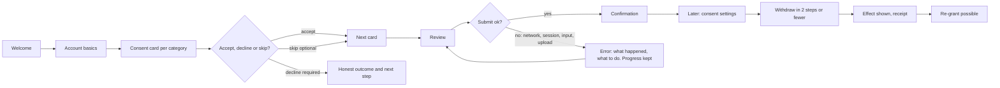
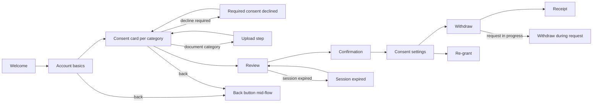

# Assignment 03 — Product Brief: What You Are Designing

**v0.2 DRAFT — 2026-11-23** · Added features, screens, configuration. Read this first. Then [requirements-and-directives.md](requirements-and-directives.md) for the rules, and [developer-guide.md](developer-guide.md) for the build path.

## 1. Product in one view

| WH | Answer |
|---|---|
| What | **Consent Onboarding Flow**: onboarding for a fictional service, with one plain-language consent card per data category, error and recovery states, and withdrawal of consent |
| Why | Tests content design, trust, accessibility and care with sensitive data decisions |
| Who | Assumed user: a first-time person asked to share personal details with a fictional service. The candidate states assumptions |
| Where | Mobile first, with one desktop layout. Light and dark for consent cards. Fictional service, synthetic data only |
| When | 5–7 hours of design effort. Review 30–45 minutes |
| How | Any design tool. Figma link (view access) or exported PDF/PNG, plus a content guide, full copy deck and a 1–2 page rationale doc |
| Success | Every card answers the 6 consent questions plainly. Accept and decline have equal weight. No input is lost on error. Withdrawal takes two steps or fewer. A new data category can be added live consistently |

## 2. Personas

The persona is an assumption from the brief. The candidate states it and any others as assumptions.

| Persona | Goal | Pain today (assumption) | Needs from the flow |
|---|---|---|---|
| **First-time user** | Sign up and share only what they are comfortable with | Vague, bundled consent and jargon (assumption) | One card per category, plain words, honest consequences, a real "no" |
| **Returning user** (assumption, from the scenario in section G) | Check or change what they agreed to | Does not remember agreeing a month ago | Findable settings with status and date, easy withdrawal and re-grant |

## 3. Main journey

## 4. Capabilities

| ID | Capability | What it means | Brief section |
|---|---|---|---|
| C1 | Context and assumptions | Fictional service, 3–4 synthetic data categories, assumptions, open questions | A |
| C2 | Onboarding flow | Welcome, account basics, consent choices, review, confirmation. Optional skip keeps user moving | B |
| C3 | Consent cards | One per category. What, why, who, how long, if I say no, how to change. Equal-weight choices | C |
| C4 | Error and recovery | Network failure, expired session, invalid input, upload rejected, back button. Progress preserved | D |
| C5 | Withdrawal | Settings list with status and date, two-step withdraw, effect on service and data, receipt, re-grant | E |
| C6 | Accessibility | Contrast, keyboard path, focus order, screen-reader labels, error announcements | F |
| C7 | Content design | Content guide, banned jargon, label list, reading level, stress test, full copy deck | C, F |
| C8 | Sensitive-data handling | Full data not shown by default on sensitive screens | F |
| C9 | System reuse | Shared tokens and components. Consent card reusable for a new category | H, design instructions |

## 5. Product features

Priority: **Must** = required for submission. **Should** = expected for a strong score. **Could** = optional extra.

| ID | Feature | Capability | Priority |
|---|---|---|---|
| F-01 | Fictional service with 3–4 synthetic data categories, assumptions and open questions | C1 | Must |
| F-02 | Flow: welcome, account basics, consent choices, review, confirmation | C2 | Must |
| F-03 | Skip an optional category and keep moving | C2 | Must |
| F-04 | Declined-required-consent outcome with honest next step | C2 | Must |
| F-05 | Mobile hi-fi plus one desktop layout | C2 | Must |
| F-06 | One consent card per category, nothing bundled or pre-ticked | C3 | Must |
| F-07 | Each card answers what, why, who, how long, if I say no, how to change | C3, C7 | Must |
| F-08 | Accept and decline with equal visual weight, no guilt copy | C3 | Must |
| F-09 | Consent cards in light and dark | C3, C9 | Must |
| F-10 | Error states: network failure on submit, expired session, invalid input, upload rejected, back button mid-flow | C4 | Must |
| F-11 | Progress preserved on every error | C4 | Must |
| F-12 | Errors name the cause and the next action, and are announced | C4, C6 | Must |
| F-13 | Consent settings listing each consent, status and date | C5 | Must |
| F-14 | Withdraw one consent in two steps or fewer, with effect on service and existing data | C5 | Must |
| F-15 | Withdrawal confirmation and receipt | C5 | Must |
| F-16 | Re-grant from settings | C5 | Must |
| F-17 | Withdraw-while-request-in-progress state | C5 | Must |
| F-18 | Contrast, keyboard path, focus order, screen-reader labels | C6 | Must |
| F-19 | Content guide: tone, banned jargon, label list, reading level, stress test, full copy deck | C7 | Must |
| F-20 | Sensitive data hidden by default | C8 | Must |
| F-21 | New data category added live with card, withdrawal and error states | C9 | Should |
| F-22 | Light and dark for screens beyond consent cards | C9 | Could |

## 6. Screens to design

Mobile first. One screen, chosen by the candidate, also has a desktop layout.

| ID | Screen or frame | Purpose | Key elements | States to show | Users | Stories |
|---|---|---|---|---|---|---|
| S-01 | Welcome | Set expectations | Service name (fictional), what sign-up asks for, start | default | first-time user | US-01 |
| S-02 | Account basics | Collect basic details | Fields, labels, inline errors, sensitive fields masked | default, invalid input, success | first-time user | US-01, 07, 08, 14 |
| S-03 | Consent card (one per category) | Decide one thing at a time | 6 answers in plain words, accept and decline of equal weight, skip if optional, withdrawal link | default, accepted, declined, skipped (optional only), light, dark | first-time user | US-02, 04, 05, 06 |
| S-04 | Required consent declined | Avoid a dead end | Honest outcome, next step, way back to the card | default | first-time user | US-03 |
| S-05 | Upload step (assumption: only if a category needs a document) | Add a document | Upload control, file rules, masked preview | default, uploading, upload rejected, success | first-time user | US-07, 08, 14 |
| S-06 | Review | Check before submit | Summary of choices, edit links, sensitive data masked | default, loading, network failure on submit, success | first-time user | US-01, 07, 08, 14 |
| S-07 | Session expired | Recover without starting again | Cause, next action, progress kept | error | all | US-07, 08 |
| S-08 | Back button mid-flow | Leave a step safely | Answers kept, way to continue | default | all | US-07 |
| S-09 | Confirmation | Close the loop | What was granted, declined, skipped, link to settings | success | first-time user | US-01 |
| S-10 | Consent settings | See and change consents | Each consent with status and date, withdraw and re-grant actions | default, loading, error | returning user | US-09 |
| S-11 | Withdraw consent | Withdraw in two steps or fewer | Effect on the service and on existing data, confirm | default, loading, error | returning user | US-10 |
| S-12 | Withdrawal receipt | Prove the change | Outcome message, date, re-grant link | success | returning user | US-10 |
| S-13 | Withdraw during a request in progress | Avoid surprise | What happens to the in-progress request (Candidate decides and documents) | default, success | returning user | US-12 |
| S-14 | Re-grant | Change mind back | Same consent card, accept and decline | default, success, error | returning user | US-11 |
| S-15 | New category (live follow-up) | Grow consistently | Same card component and copy rules, its withdrawal and error states | default, error, withdrawn | all | US-15 |

## 7. Configuration

| Setting | Scope | Default | Who can change | Where | Effect |
|---|---|---|---|---|---|
| Data categories | Service | 3–4 synthetic categories, Candidate decides and documents | Designer | Copy deck and consent card | Number of consent cards. New one added live |
| Required or optional | Category | Candidate decides and documents | Designer | Consent card and flow map | Skip allowed only for optional. Declining a required one leads to S-04 |
| Consent default | Category | Not granted. Nothing pre-ticked | Fixed rule | Consent card | The user must choose |
| Recipients | Category | Candidate decides and documents (synthetic) | Designer | Card "Who sees it?" | Copy on the card |
| Retention period | Category | Candidate decides and documents (synthetic) | Designer | Card "For how long?" | Copy on the card and withdrawal effect |
| Consent status | User, per category | Set by the user's choice | The user | Onboarding cards and consent settings | Granted or withdrawn, with date. Effect on the service |
| Theme (light, dark) | User | Candidate decides and documents | Each user (assumption) | Theme setting | Consent cards required in both |
| Language and text length | Copy | One translated or longer-text stress test | Content author | Content guide | Card layout must hold longer text |
| Reading level target | Copy | Candidate states it | Content author | Content guide | Word and sentence choice |
| Sensitive-data masking | Screen | Masked by default | User may reveal (assumption) | Sensitive screens (S-02, S-05, S-06) | Full data hidden until revealed |
| Session timeout | Service | Candidate decides and documents | Designer | Flow notes | When S-07 appears. Progress kept |
| Desktop breakpoint | Product | Candidate decides and documents | Designer | Layout notes | When the desktop layout applies |

## 8. User stories and acceptance criteria

Format: **As a** persona, **I want** action, **so that** benefit. Each has checkable acceptance criteria (AC) for the design.

### Onboarding

| ID | Story | Acceptance criteria |
|---|---|---|
| US-01 | As a first-time user, I want a clear path from welcome to confirmation so that I know where I am | Flow map covers welcome, account basics, consent choices, review, confirmation. Mobile hi-fi plus one desktop layout |
| US-02 | As a first-time user, I want to skip an optional category so that I can still finish sign-up | Skip path keeps the user moving to the next step and review |
| US-03 | As a first-time user, I want to know what happens if I decline a required consent so that I am not stuck | Scenario answered with a designed screen: honest outcome and next step |

### Consent cards

| ID | Story | Acceptance criteria |
|---|---|---|
| US-04 | As a first-time user, I want each data category explained on its own card so that I decide one thing at a time | One card per category. Nothing bundled or pre-ticked |
| US-05 | As a first-time user, I want plain answers to what, why, who, how long, if I say no, and how to change my mind so that I make an informed choice | All 6 questions answered per card. Target reading level stated. No legal jargon or vague phrases |
| US-06 | As a first-time user, I want accept and decline to look equally valid so that I am not pushed | Equal visual weight. No guilt copy. Light and dark versions of the cards |

### Error and recovery

| ID | Story | Acceptance criteria |
|---|---|---|
| US-07 | As a user, I want my answers kept when something fails so that I do not start again | Network failure on submit, expired session, invalid input, upload rejected and back button mid-flow each designed. Progress preserved |
| US-08 | As a user, I want error messages that tell me what happened and what to do so that I can recover | Each error names the cause and the next action. Errors announced to screen readers |

### Withdrawal

| ID | Story | Acceptance criteria |
|---|---|---|
| US-09 | As a returning user, I want to see every consent with its status and date so that I remember what I agreed to | Findable settings screen listing each consent, status and date. Covers the "back after a month" scenario |
| US-10 | As a returning user, I want to withdraw one consent in two steps or fewer so that it is as easy as granting | Two steps or fewer. Effect on the service and on existing data shown. Confirmation and receipt state |
| US-11 | As a returning user, I want to grant consent again so that I can change my mind back | Re-grant path designed from the settings screen |
| US-12 | As a user, I want to know what happens if I withdraw while a request is in progress so that I am not surprised | Scenario answered with a designed state |

### Access, content and consistency

| ID | Story | Acceptance criteria |
|---|---|---|
| US-13 | As a keyboard or screen-reader user, I want a logical path through the flow so that I can complete it independently | Contrast checked. Keyboard path and focus order defined. Screen-reader labels and error announcements specified |
| US-14 | As a user on a shared screen, I want sensitive data hidden by default so that others cannot read it | Sensitive screens do not show full data by default |
| US-15 | As the service, we want to add a new data category consistently so that trust is kept as the product grows | Live follow-up: new card with withdrawal and error states, using the same component, tokens and copy rules |

## 9. Traceability

| Capability | Stories | How it is evidenced in the deliverable |
|---|---|---|
| C1 | all | Context section in rationale doc: fictional service, synthetic categories, assumptions, open questions |
| C2 | US-01, 02, 03 | Flow map and hi-fi onboarding screens, mobile and desktop |
| C3 | US-04, 05, 06 | Consent card set, light and dark |
| C4 | US-07, 08 | Five error and recovery screens |
| C5 | US-09, 10, 11, 12 | Settings, withdraw, effect, receipt and re-grant screens. Scenario answers |
| C6 | US-08, 13 | Accessibility check summary |
| C7 | US-05 | Content guide, label list, stress test, full copy deck |
| C8 | US-14 | Masked-by-default sensitive screen |
| C9 | US-15 | Live new-category change using the shared consent card |

## 10. Out of scope

- Legal advice or any claim of legal compliance
- Real laws, real products, real brands or real user data
- A working build or back end (design deliverables only)
- Real identity verification or document checks (upload is shown as a design state only, assumption)
